# AI SRE Platform — Artifact 4: Functional & Non-Functional Requirements

**Layer 4 — Functional & Non-Functional Requirements** · Built from: [Artifact 1: Product Requirements Document](file:///c:/Users/diwas/OneDrive/Desktop/Projects/ai-sre/artifacts/product_requirement.md), [Artifact 2: Scope & Constraints](file:///c:/Users/diwas/OneDrive/Desktop/Projects/ai-sre/artifacts/scope_and_constraints.md), and [Artifact 3: SRE Fundamentals & Systems Architecture](file:///c:/Users/diwas/OneDrive/Desktop/Projects/ai-sre/artifacts/sre_fundamentals.md) · *Approved specifications compiled from team discussions, Claude & ChatGPT evaluations, and the Layer 4 Conversation Log*

---

## Executive Summary & Layer Alignment

Layer 1 defined the core incident investigation lifecycle, user journeys, and trust requirements.  
Layer 2 established strict operational boundaries for the 6-month MVP (single team, single cloud Python application, Docker Compose host, disposable Docker sandbox, and read-only telemetry).  
Layer 3 formulated the architectural fundamentals: standard 9-step request journey, concurrency mechanics, 7-stage internal execution pipeline, OpenTelemetry standardization, Ports & Adapters architecture, and the 11-state incident machine.

**Layer 4 establishes the formal, verifiable Functional (FR) and Non-Functional Requirements (NFR)** that govern the platform's autonomous runtime behavior. It bridges high-level SRE principles into deterministic execution contracts, strict latency and financial budgets, multi-tiered safety guardrails, and cryptographic approval state bindings.

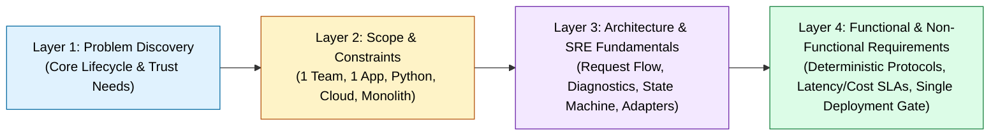

---

## Required Sections Compliance Checklist

| Specification Category | Questions Answered | Primary Focus & Deliverables in this Document |
| :--- | :--- | :--- |
| **§ 1. Incident Lifecycle & Ingestion** | Q4.1, Q4.2, Q4.3, Q4.19, Q4.28, Q4.29 | 10-step lifecycle, composite deduplication, 5 mandatory fields, intake and publication SLAs. |
| **§ 2. Staged Evidence & Diagnostic Engine** | Q4.4, Q4.5, Q4.6, Q4.7, Q4.8 | Staged telemetry rounds, JSON hypothesis schema, hybrid engine, active falsification, inconclusive handover. |
| **§ 3. Sandbox Verification & Deployment Authorization** | Q4.9, Q4.10, Q4.11, Q4.12, Q4.32 | Patch package diffs, autonomous 4-step sandbox verification (no human needed), Single Human Deployment Gate, 1-hour TTL with state fingerprinting. |
| **§ 4. Recovery Verification, Cancellation & Auditing** | Q4.13, Q4.14, Q4.15 | Multi-dimensional baseline metrics, observation window, dual-tier cancel/kill switch, append-only PostgreSQL ledger. |
| **§ 5. Platform Reliability, Failover & Data Protection** | Q4.16, Q4.17, Q4.18, Q4.23, Q4.24, Q4.25, Q4.27 | 99.5% intake availability, worker heartbeats, DB outage fallback, inline redaction gateway, PITR RPO/RTO, circuit breakers. |
| **§ 6. Concurrency, Execution & Financial Guardrails** | Q4.20, Q4.21, Q4.22, Q4.26, Q4.30, Q4.31, Q4.33, Q4.34 | 3-slot concurrency, 20-incident queue, staged timeouts, \$20 dollar cap, 500k token limit, dashboard percentiles. |
| **§ 7. Assumptions & Risk Register** | A-4.1 to A-4.34 | Exhaustive catalog of assumptions, owners, validation tests, and resolution deadlines. |
| **§ 8. Master System Architecture Graph** | Full End-to-End Synthesis | Comprehensive 8-tier master Mermaid graph consolidating all lifecycle states, boundaries, and SLAs. |

---

## Reference Scenario Anchor

Every requirement and specification in this artifact is anchored directly to the baseline reference scenario established in [Artifact 1: PRD § Reference scenario](file:///c:/Users/diwas/OneDrive/Desktop/Projects/ai-sre/artifacts/product_requirement.md):

1. **Target Organization:** Operates a production Python web application on cloud compute.
2. **Trigger Event:** An automated release deployment changes an environment configuration parameter.
3. **Failure Mode:** Application throws unhandled exceptions manifesting as an HTTP 500 error surge.
4. **Detection:** External monitoring platform detects elevated 5xx error rates and dispatches an alert payload.
5. **Resolution Goal:** Ingest alert $\rightarrow$ deduplicate $\rightarrow$ collect read-only telemetry $\rightarrow$ isolate configuration diff $\rightarrow$ test repair autonomously in an isolated Docker sandbox $\rightarrow$ secure single-gate human deployment approval $\rightarrow$ canary rollout via CI/CD $\rightarrow$ verify recovery against historical baseline metrics.

---

# Part I: Functional Requirements (FR)

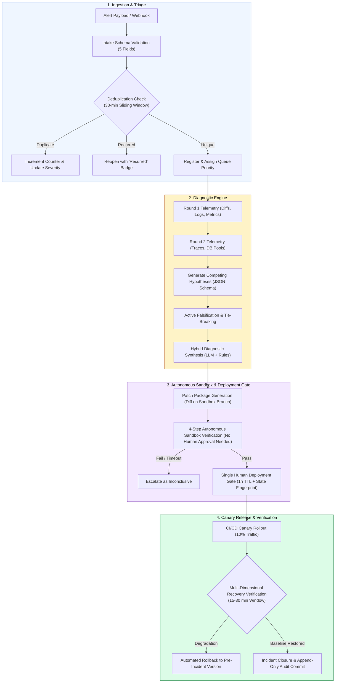

---

## 4.1 The 10-Step Standard Incident Lifecycle

*Answers: Q4.1 · Integrates: Layer 1 § 1.3, Layer 2 § 2.3, Layer 3 § 5.2*

The platform enforces a deterministic, 10-step incident investigation lifecycle. The AI agent is architecturally blocked from transitioning directly from alert ingestion to code mutation without clearing intermediate verification checkpoints:

1. **Intake & Validation:** Ingest alert webhook or manual API submission; validate against the mandatory 5-field schema.
2. **Deduplication Check:** Query active and recently closed incidents using the composite matching key.
3. **Registration & Queueing:** Persist incident record in PostgreSQL, calculate initial priority score, and assign to a worker slot (or queue if concurrency is saturated).
4. **Read-Only Evidence Collection:** Execute staged telemetry gathering (Round 1: config diffs, logs, metrics; Round 2: traces, dependencies) via read-only integrations.
5. **Hypothesis Generation & Ranking:** Synthesize evidence into competing hypothesis records with explicit FOR and AGAINST ledgers.
6. **Patch Formulation:** Formulate isolated candidate patch diff on a sandbox branch (code or configuration diff).
7. **Autonomous Sandbox Verification:** Execute candidate patch inside an ephemeral Docker container completely autonomously (no human approval required to test in sandbox); verify failure reproduction, patch success, regression tests, and full suite pass.
8. **Single Human Deployment Approval Gate:** Present verified patch package (diff, evidence, sandbox test report, blast radius, rollback plan) to an authorized engineer for production deployment authorization.
9. **Canary Rollout & Recovery Verification:** Shift initial 10% traffic via CI/CD; evaluate error rates and latency percentiles against pre-incident baseline over a sustained observation window (15–30 min) with automated rollback on degradation.
10. **Incident Closure & Audit Preservation:** Commit complete forensic ledger to the append-only database table and release concurrency slot.

> [!IMPORTANT]
> **Graceful Handover Guarantee:** At any step in this lifecycle, if a hard timeout expires, budget ceiling is reached, or an unrecoverable failure occurs, the platform immediately suspends automated execution and dispatches a comprehensive handover dossier to the on-call engineer.

---

## 4.2 Composite Deduplication Engine & Sliding Window

*Answers: Q4.2 · Integrates: Layer 2 § 2.3, Layer 3 § 5.1*

To prevent expensive model thrashing, duplicate git branches, and alert fatigue, the platform implements a deterministic deduplication engine:

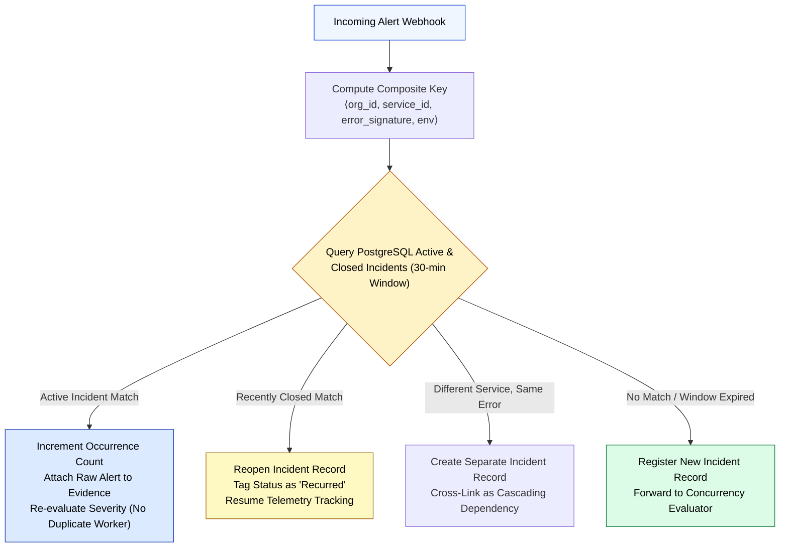

* **Composite Matching Key:**
  $$\text{Key} = \langle \text{org\_id}, \text{service\_id}, \text{error\_signature}, \text{environment} \rangle$$
* **Sliding Deduplication Window:** 30 minutes from the initial incident registration timestamp.
* **Matching State Behaviors:**
  1. *Active Incident Match:* The incoming alert is linked to the active incident. The platform increments the occurrence counter, appends the raw alert payload to the evidence log, and re-evaluates incident severity. A duplicate worker is never spawned.
  2. *Recently Closed Incident Match:* If a matching alert arrives within the 30-minute window of a closed incident, the record is reopened with status `"Recurred"` to preserve historical context.
  3. *Cross-Service Rule:* Alerts exhibiting identical error messages (e.g., `HTTP 500 Internal Server Error`) that originate from different `service_id`s are strictly treated as **distinct incidents**. They are cross-linked as potential cascade candidates if timestamps align.
* **Data Integrity:** Raw alert payloads are never discarded. Deduplication queries are strictly tenant-isolated (`org_id`).

---

## 4.3 Mandatory Intake Schema & Missing Field Handling

*Answers: Q4.3 · Integrates: Layer 1 § 1.3, Layer 3 § 1.3*

The platform requires five mandatory intake fields to establish diagnostic context:

| Field Name | Type | Description / Standard Format | Example |
| :--- | :--- | :--- | :--- |
| `service_id` | String | Unique identifier of the affected target application or microservice. | `"checkout-service"` |
| `environment` | Enum | Deployment environment (`production`, `staging`, `canary`). | `"production"` |
| `timestamp` | UTC ISO-8601 | Exact timestamp of alert trigger. | `"2026-11-23T14:30:00Z"` |
| `symptom` | String | High-level error signature or status code summary. | `"HTTP 500 Surge (Config Mismatch)"` |
| `source_endpoint` | String | Ingress route, URL path, or message topic experiencing failure. | `"/api/v1/orders"` |

### Missing Field Protocol & Cascade Failures

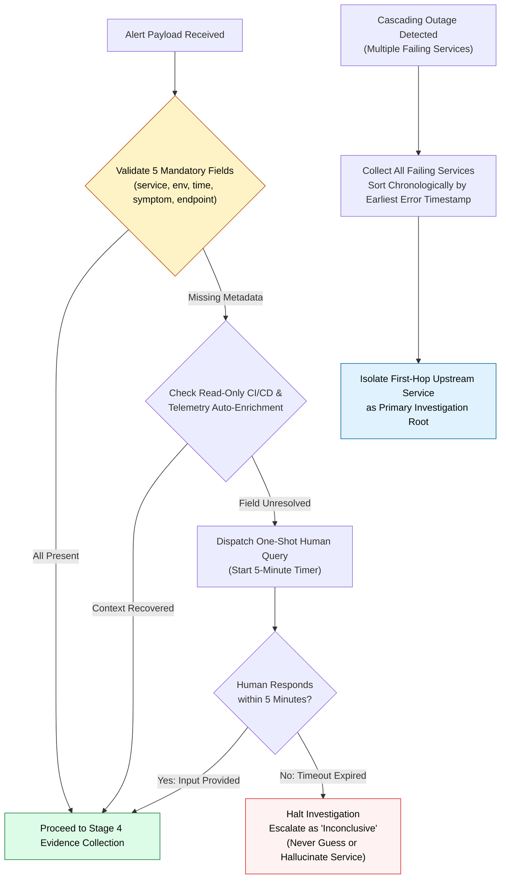

1. **Automated Context Enrichment:** If deployment or commit data is absent, the platform automatically retrieves recent commit SHAs and configuration revisions from read-only CI/CD integrations.
2. **One-Shot Human Query:** If a mandatory field cannot be inferred, the platform dispatches a single structured prompt to the on-call engineer.
3. **Timeout Fallback:** If the engineer does not respond within 5 minutes, the investigation transitions immediately to `"Inconclusive"` with partial findings. The AI is strictly forbidden from hallucinating missing service identities.
4. **Cascading Outages:** When multiple services fail simultaneously, all failing services are recorded. The platform orders them chronologically by earliest failure timestamp to isolate the upstream root cause.

---

## 4.4 Staged Telemetry & Multi-System Evidence Collection

*Answers: Q4.4 · Integrates: Layer 2 § 2.3, Layer 3 § 6.2, Layer 3 § 7.3*

Evidence gathering is structured into ordered rounds to optimize investigation speed and minimize telemetry query costs:

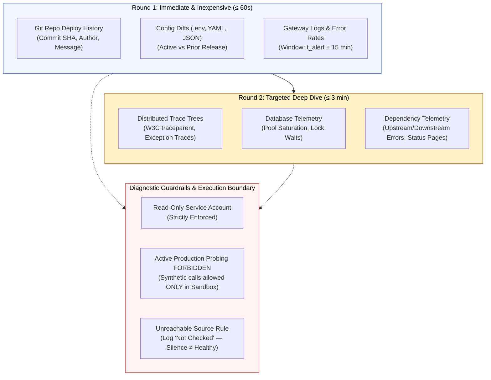

* **Round 1 (Fast & Inexpensive — $\le 60\text{ seconds}$):**
  - Git repository deployment history (commit SHA, author, commit message).
  - Configuration diffs (`.env`, YAML, JSON) between active and prior deployment.
  - Gateway error logs and HTTP 5xx error rate time series bounded strictly to the incident time window ($t_{\text{alert}} \pm 15\text{ min}$).
* **Round 2 (Targeted Deep Dive — $\le 3\text{ minutes}$):**
  - Distributed trace trees (`traceparent`) isolating unhandled runtime exception stack traces.
  - Database telemetry (active connection pool saturation, lock wait duration).
  - Downstream dependency error rates and external provider status page feeds.
* **Active Probing Restriction:** Active synthetic transactions or test accounts are **strictly forbidden in production**; they may only execute within the isolated sandbox environment.
* **Handling Unreachable Telemetry (Silence $\ne$ Healthy):** If an observability adapter is unreachable or times out, the platform logs: `"Telemetry Source [Name]: Not Checked"`. The platform never assumes silence implies system health.

---

## 4.5 Hypothesis Architecture & Evidence Representation

*Answers: Q4.5 · Integrates: Layer 3 § 7.1*

To eliminate cognitive bias and prevent premature diagnostic fixation, the platform models competing hypotheses as structured JSON objects:

```json
{
  "hypothesis_id": "HYP-001",
  "incident_id": "INC-2026-1123-01",
  "candidate_cause": "Database connection pool exhausted due to misconfigured DB_POOL_SIZE parameter in recent deployment.",
  "confidence_rank": "High",
  "evidence_for": [
    {"source": "config_diff", "ref_id": "DIFF-4401", "weight": 1.0, "finding": "DB_POOL_SIZE reduced from 50 to 5 in commit 8f9b2a."},
    {"source": "error_log", "ref_id": "LOG-8812", "weight": 0.9, "finding": "PoolTimeout: QueuePool limit of size 5 overflow 10 reached."}
  ],
  "evidence_against": [],
  "next_differentiating_check": "Inspect database pg_stat_activity active connections during the 14:30 error spike.",
  "estimated_check_cost_usd": 0.05,
  "status": "Active"
}
```

* **Mandatory "Other / Unknown" Category:** The hypothesis pool must always maintain an explicit `"Other / Unknown"` reserve to prevent artificial 100% certainty across flawed initial guesses.
* **Qualitative Scoring:** Probabilities are expressed qualitatively (`High`, `Medium`, `Low`) rather than uncalibrated percentages until statistically validated on the benchmark test harness.

---

## 4.6 Tri-Stage Hybrid Diagnostic Engine

*Answers: Q4.6 · Integrates: Layer 2 § 2.5, Layer 3 § 7.1*

The platform employs a tri-stage diagnostic engine that pairs generative LLM reasoning with deterministic rule validation and empirical sandbox reproduction:

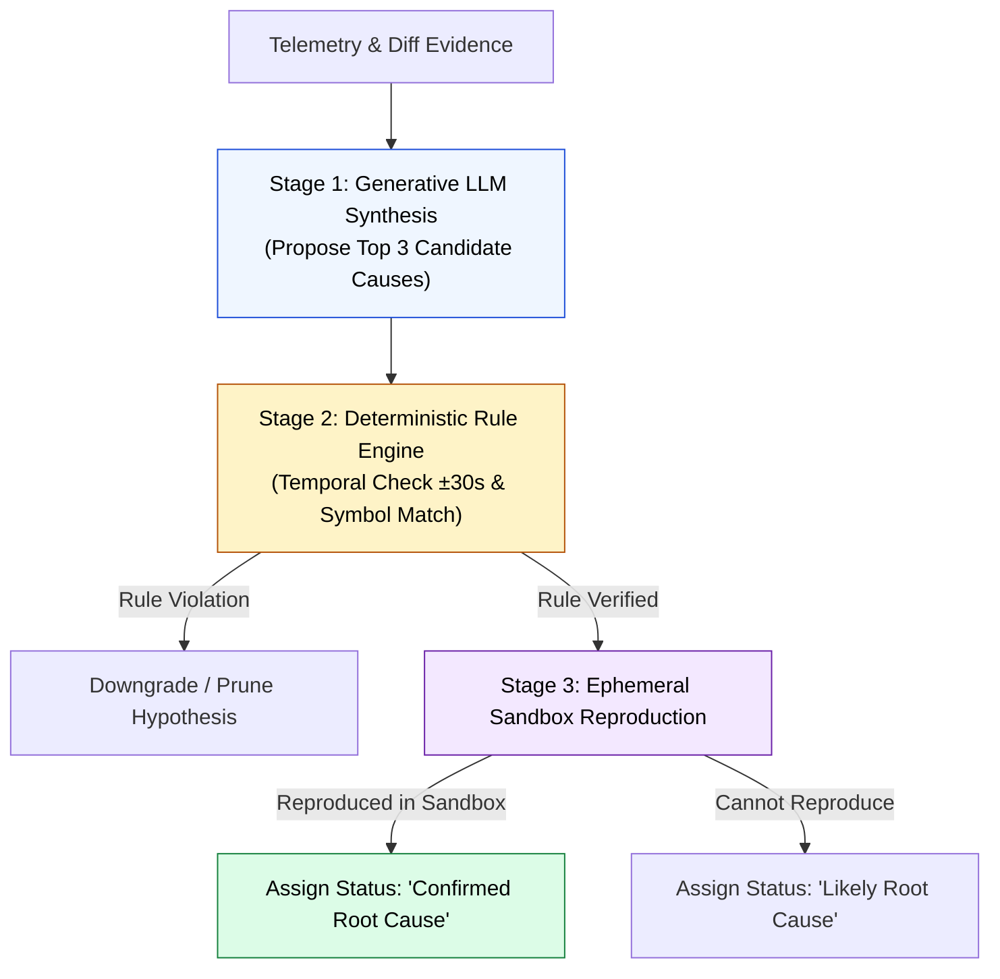

1. **Stage 1 (LLM Synthesis):** Foundation model processes sanitized evidence and proposes up to 3 candidate causes.
2. **Stage 2 (Deterministic Rule Validation):** Rule engine executes objective verification checks:
   - *Temporal Alignment:* Verifies deployment timestamp matches error spike onset within a $\pm 30\text{-second}$ window.
   - *Symbol Matching:* Verifies modified configuration keys directly intersect runtime exception parameters.
3. **Stage 3 (Empirical Sandbox Reproduction):** Candidate cause is injected into the disposable sandbox.
   - If the error reproduces identically: marked **`"Confirmed Root Cause"`**.
   - If reproduction fails or is inconclusive: marked **`"Likely Root Cause"`** with explicit disclaimers.

---

## 4.7 Active Falsification, Evidence Weighting & Tie-Breaking

*Answers: Q4.7 · Integrates: Layer 3 § 7.1*

When multiple competing hypotheses explain the observed symptoms, the platform executes active falsification to avoid confirmation bias:

* **Active Search for Contradicting Evidence:** The platform queries for evidence that explicitly disproves the leading hypothesis before accepting it.
* **Elimination of Shared Evidence:** Telemetry findings consistent with all candidate hypotheses (e.g., generic gateway 502/500 spikes) are stripped from ranking calculations.
* **Hierarchical Evidence Weighting:**
  $$\text{Effective Weight} = W_{\text{Directness}} \times W_{\text{Recency}} \times W_{\text{Reliability}}$$
  - *Directness:* Stack trace exception ($1.0$) vs. metric correlation ($0.4$).
  - *Recency:* Event concurrent with incident onset ($1.0$) vs. historical drift ($0.2$).
  - *Reliability:* Authoritative database log ($1.0$) vs. client-reported error rate ($0.6$).
* **Tie-Breaking Check:** If two hypotheses remain tied, the platform executes the single lowest-cost separating check in the sandbox. If unresolved within the 15-minute diagnostic ceiling, both hypotheses are escalated to the human engineer.

---

## 4.8 Inconclusive Protocol & Handover Dossier

*Answers: Q4.8 · Integrates: Layer 2 § 2.4, Layer 3 § 7.4*

If the diagnostic engine cannot isolate the root cause with high confidence ($\ge 60\%$) within **15 minutes** or before exhausting financial caps, the investigation automatically transitions to **`"Inconclusive"`**.

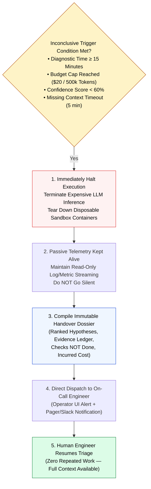

### Structure of the Handover Dossier
The platform generates an immutable markdown dossier delivered directly to the on-call engineer's triage UI:
1. **Executive Summary:** Incident ID, target service, duration, and reason for handover (timeout, budget cap, or ambiguous evidence).
2. **Ranked Hypotheses Ledger:** Candidate causes evaluated, evidence FOR and AGAINST, and calculated confidence ranks.
3. **Telemetry & Execution Log:** All queries executed, data sources marked `"Not Checked"`, and costs incurred.
4. **Recommended Next Actions:** Concrete diagnostic paths for the human engineer (e.g., run manual query on replica, inspect external third-party status).
5. **State Freezing:** Expensive LLM inference and sandbox containers are immediately terminated; passive telemetry ingestion remains active.

---

## 4.9 Patch Package Generation & Blast Radius Boundary

*Answers: Q4.9 · Integrates: Layer 2 § 2.2, Layer 2 § 2.3*

The platform formats candidate repairs into a standardized **Patch Package** presented like a Git Pull Request:

* **Diff Formatting:** Unified diff format displaying explicit before/after file changes.
* **Reference Scenario Applicability:** Capable of generating configuration diffs (e.g., `.env`, YAML, JSON) as well as Python code patches.
* **Blast Radius Documentation:** The package must explicitly enumerate:
  1. Files and parameters modified.
  2. Systems, components, and endpoints guaranteed **NOT modified**.
  3. Pre-requisite environment dependencies.
* **Sandbox Branch Isolation:** Patches are drafted strictly on isolated sandbox branches. Direct writes, branch creations, or commits to the monitored production repository are **strictly forbidden**.
* **Generation Attempt Ceiling:** Maximum **3 patch generation attempts** per incident.

---

## 4.10 4-Step Sandbox Verification Harness

*Answers: Q4.10 · Integrates: Layer 2 § 2.1, Layer 3 § 4.1*

Candidate patches must pass an autonomous 4-step verification protocol inside a clean, disposable Docker container before submission for human review:

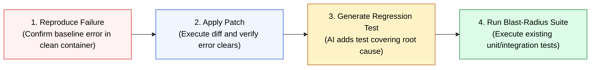

1. **Step 1 (Failure Reproduction):** Spin up disposable container using pre-incident configuration; verify that the reference error reproduces.
2. **Step 2 (Patch Application):** Apply candidate diff; verify that the failure symptom resolves and the application initializes cleanly.
3. **Step 3 (Automated Regression Test):** Generate an automated test specifically asserting the fix; verify test passes.
4. **Step 4 (Blast-Radius Test Suite):** Execute existing application unit and integration test suites.
   - *Test Immutability Rule:* The AI is **strictly forbidden from modifying, disabling, or deleting existing tests**. Any modification of existing test assertions fails the verification step immediately.

---

## 4.11 Single Human Gate: Production Deployment Authorization

*Answers: Q4.11 · Integrates: Layer 1 § 1.4, Layer 2 § 2.3*

In accordance with Layer 2 constraints, **no human approval is required for sandbox testing**; the platform formulates candidate fixes and validates them completely autonomously inside an isolated, disposable sandbox container. Human authorization is strictly and solely required for **production deployment**:

* **Unified Review Dossier:** The on-call engineer is presented with a concise, single-pane review interface:
  - Root-cause diagnosis summary with links to immutable telemetry evidence.
  - Unified patch diff (code or configuration).
  - Autonomous sandbox test execution logs, regression test results, and blast-radius suite pass.
  - Blast radius assessment and pre-verified automated rollback plan.
* **Exact Commit Binding:** Approval is cryptographically bound to the exact Git commit SHA / patch hash.
* **Explicit Boundary:** **Human approval strictly authorizes production canary deployment.** The AI is architecturally blocked from initiating production deployments without this explicit human authorization.

---

## 4.12 Executing the Approved Patch & Canary Rollout

*Answers: Q4.12 · Integrates: Layer 2 § 2.3, Layer 3 § 4.1*

Once the human engineer grants deployment authorization, the platform executes production release via CI/CD:

* **Scoped Release Credential:** Deployment executes via the single corporate CI/CD pipeline using a dedicated, audited release credential (strictly isolated from the platform's read-only triage account).
* **Pre-Flight Rollback Verification:** Prior to shifting production traffic, the platform verifies that the automated rollback mechanism (e.g., previous image tag, configuration rollback commit) is fully operational.
* **Canary Progression:**
  - Initial traffic allocation: **10% canary slice**.
  - Continuous telemetry evaluation across error rates and latency.
  - If metric degradation occurs, automated rollback is triggered immediately.

---

## 4.13 Multi-Dimensional Recovery Verification & Observation

*Answers: Q4.13 · Integrates: Layer 3 § 3.4, Layer 3 § 4.3*

Single synthetic checks (e.g., Postman / curl probes) are rejected as proof of recovery. Verification requires multi-dimensional telemetry comparison against measured historical baselines:

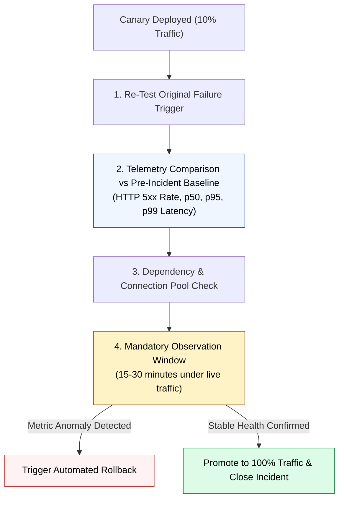

1. **Trigger Re-Verification:** Execute reproduction payload to confirm the original bug no longer generates an exception.
2. **Baseline Telemetry Matching:** Error rates and latency percentiles ($p50, p95, p99$) must return to within $\le 5\%$ of pre-incident baseline levels.
3. **Dependency Pool Health:** Verify downstream databases, connection pools, and queue depths operate within nominal limits.
4. **Mandatory Observation Window:** The incident remains open under active surveillance for **15 to 30 minutes** of sustained production traffic before marking resolved.

---

## 4.14 Dual-Tiered Cancellation Protocol & Emergency Kill Switch

*Answers: Q4.14 · Integrates: Layer 1 § 1.4, Layer 2 § 2.3*

The platform supports two explicit tiers of operational cancellation:

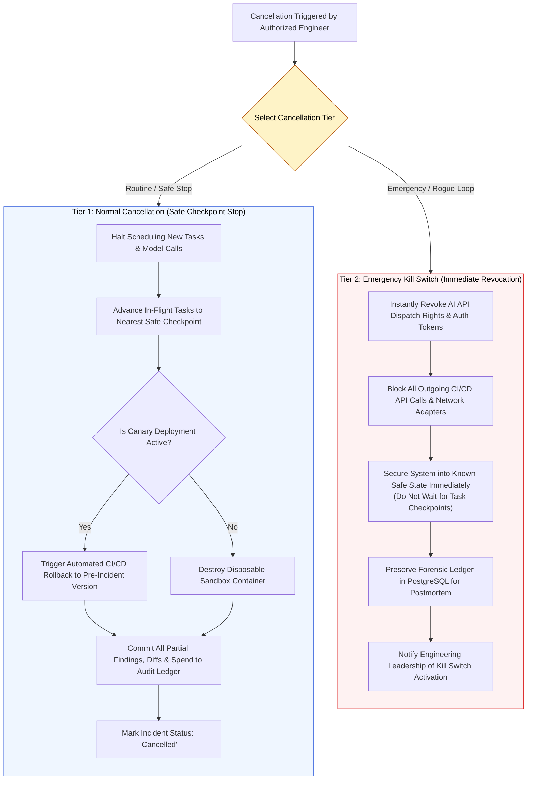

### Tier 1: Normal Cancellation (Graceful Safe Stop)
* Triggered by an authorized on-call engineer via UI or API.
* Stops scheduling new LLM calls or sandbox containers immediately.
* In-flight operations advance to the nearest **safe checkpoint** before terminating.
* In-progress canary deployments are halted and cleanly rolled back to the pre-incident version via CI/CD.
* All telemetry, diffs, and audit logs collected up to the cancellation point are preserved. Status marked `"Cancelled"`.

### Tier 2: Emergency Kill Switch (Immediate Revocation)
* Instantly revokes the AI platform's API dispatch tokens and execution rights.
* Blocks all outgoing CI/CD pipeline triggers and network access to external adapters.
* Secures the monitored system into a known safe state without waiting for task checkpoints.
* Preserves complete forensic logs for post-incident review.

---

## 4.15 Append-Only Timeline Ledger & Forensic Replay

*Answers: Q4.15 · Integrates: Layer 1 § 1.5, Layer 2 § 2.5, Layer 3 § 5.3*

All platform actions, telemetry queries, model inputs/outputs, human approvals, and rollout events are permanently committed to an append-only PostgreSQL table:

```sql
CREATE TABLE incident_timeline (
    event_id UUID PRIMARY KEY DEFAULT gen_random_uuid(),
    incident_id VARCHAR(64) NOT NULL,
    timestamp_utc TIMESTAMP WITH TIME ZONE NOT NULL DEFAULT clock_timestamp(),
    actor VARCHAR(64) NOT NULL, -- 'agent:reasoning', 'human:approver_id', 'system:ci_cd'
    action_type VARCHAR(64) NOT NULL,
    action_summary TEXT NOT NULL,
    rationale TEXT, -- Model explanation / justification
    evidence_references JSONB, -- Pointers to log IDs, diff hashes, metric snapshots
    step_duration_ms INTEGER,
    step_cost_usd NUMERIC(8, 4),
    outcome_status VARCHAR(32) NOT NULL -- 'SUCCESS', 'FAILED', 'TIMEOUT', 'SKIPPED'
);
```

* **Tamper-Proof Design:** Row updates and deletions are strictly blocked via database triggers and permissions.

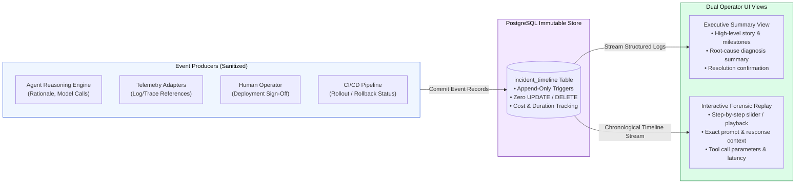

* **Dual UI Presentation:**
  1. *Executive Summary View:* High-level incident story, root cause, and timeline milestones.
  2. *Interactive Forensic Replay:* Step-by-step chronological replay allowing engineers to inspect the exact prompt, evidence context, tool call, and duration of every decision.
* **Retention Policy:** 90 days online storage (provisional).

---

# Part II: Non-Functional Requirements (NFR)

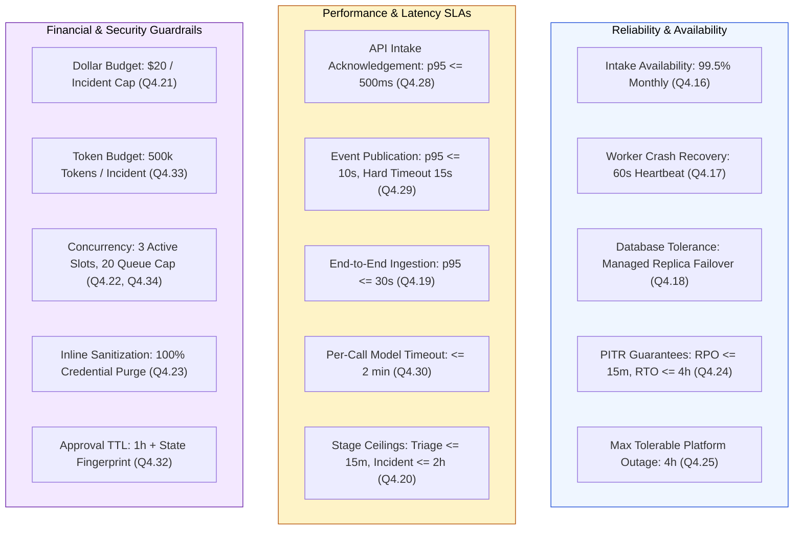

---

## 4.16 Intake Service Reliability SLA (99.5% Monthly)

*Answers: Q4.16 · Integrates: Layer 2 § 2.1, Layer 3 § 1.3*

* **Availability Target:** Provisional **99.5% monthly availability** ($\approx 3.65\text{ hours}$ maximum allowable downtime per month).
* **Monitoring Mechanism:** Monitored continuously via an **external synthetic blackbox probe** executing every 60 seconds from an independent cloud network.
* **Outage Definition:** Intake is marked down if the synthetic probe encounters an HTTP status other than $2\text{xx}$ or if round-trip response time exceeds **3 seconds**.
* **Zero Silent Alert Loss:**
  - Upstream monitoring integrations must buffer failed webhooks and retry with exponential backoff.
  - Upon intake service restoration, the platform initiates an automated pull sweep to backfill any un-ingested alerts.

---

## 4.17 Worker Heartbeats, State Checkpointing & Crash Recovery

*Answers: Q4.17 · Integrates: Layer 2 § 2.5, Layer 3 § 5.3*

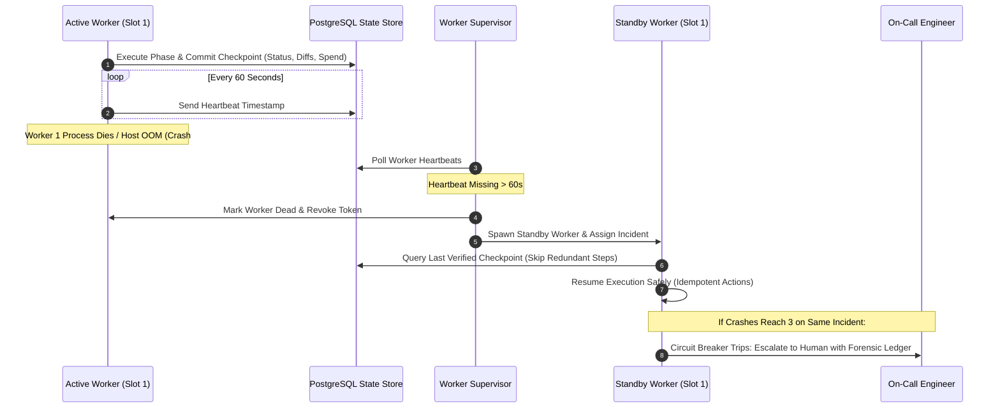

* **State Checkpointing:** Workers persist state checkpoints to PostgreSQL immediately upon completing each discrete sub-task (e.g., post-telemetry retrieval, post-hypothesis ranking, post-sandbox test).
* **Heartbeat Supervision:** Active workers emit a heartbeat signal to the database every **60 seconds**.
* **Standby Takeover:** If a worker heartbeat is missing for $>60\text{ seconds}$, the supervisor flags the worker dead, allocates a standby worker, and resumes execution strictly from the last verified checkpoint.
* **Idempotency Defense:** State-mutating operations (sandbox provisioning, CI/CD canary triggers) are tagged with unique idempotency tokens to prevent duplicate execution upon worker failover.
* **Crash Loop Circuit Breaker:** If an incident triggers **3 consecutive worker crashes**, automated execution halts permanently, and the incident is escalated to human on-call with the full forensic checkpoint ledger.

---

## 4.18 Database Fault Tolerance & Total Outage Fallback

*Answers: Q4.18 · Integrates: Layer 2 § 2.5, Layer 3 § 1.3*

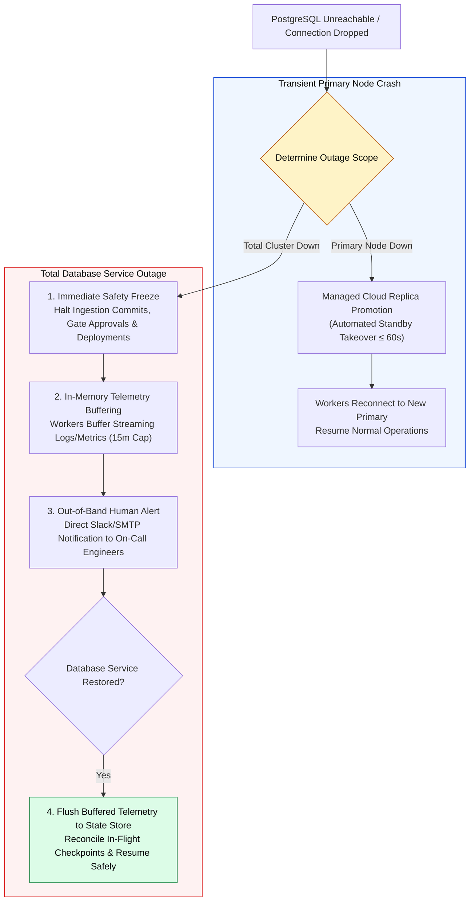

* **Primary Fault Tolerance:** Hosted on a managed PostgreSQL service featuring automated hot-standby replica promotion.
* **Total Database Outage Protocol:** If PostgreSQL becomes completely unreachable:
  1. *Freeze All State Mutations:* Immediately halt new incident intake acknowledgements, patch generation, deployment approvals, and canary rollouts.
  2. *Local Telemetry Buffering:* Active workers buffer raw in-flight telemetry in local process memory up to the 15-minute investigation ceiling.
  3. *Out-of-Band Human Alerting:* Dispatch direct notification (direct Slack webhook or external SMTP) alerting on-call engineers: *"Platform degraded (database offline) — execute manual incident triage"*.
  4. *Recovery Reconciliation:* When the database reconnects, buffered telemetry is flushed, and active investigations resume from last committed checkpoints.

---

## 4.19 Measuring & Bounding Acknowledgement Latency

*Answers: Q4.19, reconciled with Q4.28 · Integrates: Layer 2 § 2.4, Layer 3 § 1.3*

The platform enforces two distinct, non-overlapping acknowledgement latency SLAs:

$$\text{Total Ingestion Delay} = T_{\text{Monitoring/Webhook}} + T_{\text{API Intake Write}}$$

1. **Intake API Latency (p95 $\le 500\text{ ms}$, max 2s):** Measures duration from HTTP POST request receipt to durable write in PostgreSQL and return of `200 OK`. *(Updated from 200 ms to 500 ms in § 4.28 for cross-document consistency).*
2. **End-to-End Ingestion Latency (p95 $\le 30\text{ s}$, max 60s):** Measures duration from the upstream monitoring alert event timestamp to durable storage in the platform.
* **SLA Breach Handling:** If end-to-end ingestion exceeds 60 seconds, the incident is flagged with a `"Late Acknowledgement"` warning tag on the operator dashboard. All platform servers require NTP time synchronization ($\Delta t < 50\text{ ms}$).

---

## 4.20 Staged Execution Timeouts & Investigation Ceilings

*Answers: Q4.20 · Integrates: Layer 2 § 2.4, Layer 3 § 7.4*

To prevent runaway agentic loops and ensure prompt incident resolution, the platform enforces strict staged countdown timers:

| Lifecycle Stage | Maximum Duration SLA | Action Upon Timeout Expiry |
| :--- | :--- | :--- |
| **Initial Summary Digest** | $< 2$ minutes | Dispatch partial summary to on-call channel. |
| **Automated Diagnosis & Triage** | $\le 15$ minutes *(Layer 2.18)* | Freeze model calls; generate Inconclusive handover dossier. |
| **Sandbox Patch Generation & Test** | $\le 15$ minutes | Abort sandbox container; report patch generation failure. |
| **Human Deployment Approval Wait** | 30 minutes | Dispatch reminder at 15m; escalate to backup engineer at 30m. |
| **Hard Overall Incident Ceiling** | 2 hours total | Force-close automated loop; transfer full control to human. |

> [!NOTE]
> Post-incident reviews, retrospectives, and postmortems are strictly excluded from the real-time operational execution clock.

---

## 4.21 Expenditure Limits: Dollar Caps & Invocation Volume

*Answers: Q4.21 · Integrates: Layer 2 § 2.4*

Financial guardrails operate at both the individual incident level and the monthly organization tier:

* **Per-Incident Financial Ceiling:**
  - **Hard Dollar Cap:** **\$20 per incident** (provisional placeholder) covering foundation model inference, sandbox compute, and telemetry egress.
  - **Invocation Volume Cap:** Maximum **50 model calls and maximum 3 retries per step**.
* **Incident Alert Thresholds:**
  - $50\%$ Cap reached (\$10): Log warning in timeline.
  - $80\%$ Cap reached (\$16): Dispatch budget warning to on-call engineer.
  - $100\%$ Cap reached (\$20): Immediately freeze all model reasoning and sandbox compute; deliver handover dossier.
* **Monthly Budget Controls (Layer 2.15):** Organization budget alerts at $30\%$, $50\%$, $80\%$, and $100\%$. Reaching $100\%$ suspends automated LLM triage across all incoming incidents until authorized renewal.

---

## 4.22 Three-Slot Concurrency Management & Priority Queue

*Answers: Q4.22, Q4.34 · Integrates: Layer 2 § 2.4, Layer 3 § 2.1*

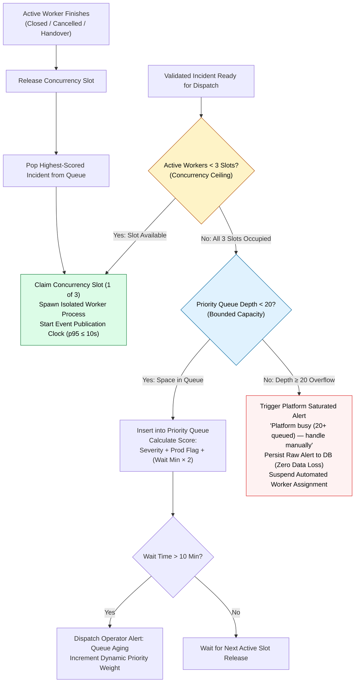

* **Active Concurrency Limit:** Exactly **3 active investigations** executing simultaneously.
* **Priority Queue Scoring:** When all 3 slots are occupied, incoming incidents wait in a managed priority queue:
  $$\text{Priority Score} = \text{Severity Weight} (\text{P1}=100, \text{P2}=50, \text{P3}=10) + \text{Environment Weight} (\text{Prod}=50) + \text{Queue Wait Time (min)} \times 2$$
* **Starvation Prevention:** Queue priority increments with elapsed wait time. If any incident waits $>10\text{ minutes}$, an alert dispatches to the engineering lead.
* **Safe Preemption Protocol:** A critical P1 incident may preempt an active P3 investigation **only at a verified safe checkpoint** (e.g., between telemetry rounds). Preemption is **strictly forbidden** during active sandbox verification or production canary deployment.

---

## 4.23 Bidirectional Inline Sanitization Gateway & PII Masking

*Answers: Q4.23 · Integrates: Layer 2 § 2.3*

An inline sanitization gateway intercepts all outbound prompts to external foundation models and all inbound generated artifacts:

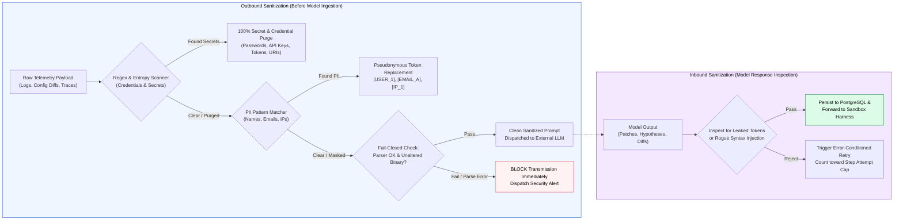

* **100% Secret & Credential Purge:** Regular expressions and entropy analyzers purge API keys, private keys, passwords, database URIs, and JWTs.
* **Pseudonymous PII Masking:** Customer names, emails, and IP addresses are replaced with deterministic pseudonyms (`[USER_1]`, `[EMAIL_A]`, `[IP_1]`). This preserves relational debugging structures without exposing identity.
* **Bidirectional Enforcement:**
  1. *Outbound:* Sanitizes error logs, configuration diffs, and database query parameters before LLM transmission.
  2. *Inbound:* Inspects generated patch code and incident timeline summaries before persisting to PostgreSQL.
* **Fail-Closed Policy:** If the sanitization gateway encounters an internal error or unparseable binary stream, outbound network transmission is blocked immediately.

---

## 4.24 Database Recovery Guarantees (RPO $\le 15\text{m}$, RTO $\le 4\text{h}$)

*Answers: Q4.24 · Integrates: Layer 2 § 2.5, Layer 3 § 1.3*

Because database read replicas replicate logical corruption instantly, disaster recovery relies on Point-in-Time Recovery (PITR):

* **Backup Architecture:** Daily full baseline snapshots coupled with continuous Write-Ahead Log (WAL) archiving to durable object storage.
* **Recovery Point Objective (RPO):** $\le 15$ minutes maximum data loss.
* **Recovery Time Objective (RTO):** $\le 4$ hours maximum restoration time to full service availability.
* **PITR Retention:** Ability to restore database state to any minute within the preceding 7 days.
* **Post-Restoration Audit & Reconciliation:** Restored database state is automatically reconciled against Git commit logs and CI/CD audit trails to restore consistent incident statuses.
* **Mandatory Drills:** Quarterly scheduled disaster recovery restoration drills conducted in a non-production environment.

---

## 4.25 Maximum Tolerable Platform Outage Duration (4 Hours)

*Answers: Q4.25 · Integrates: Layer 2 § 2.3*

* **Tolerable Outage Ceiling:** **4 hours** (aligned with the database RTO in § 4.24).
* **Assistant Boundary Principle:** The AI SRE platform is an operational assistant, not the target application itself. A total platform outage does not impact target application availability.
* **Failure Response Protocol:**
  - Detection within 5 minutes via external blackbox synthetic monitoring.
  - Immediate notification to engineering organization: *"AI SRE platform offline — switch to standard manual incident response runbooks"*.
  - Any in-progress canary rollout automatically halts traffic advancement and triggers safe rollback via CI/CD.
  - Escalation to engineering management if platform downtime exceeds 4 hours.

---

## 4.26 Observability Dashboard & Granular Stage Metrics

*Answers: Q4.26 · Integrates: Layer 3 § 6.4*

The platform provides a real-time observability dashboard reporting stage-level performance metrics:

1. **Per-Stage Latency Breakdown (p50 & p95):**
   - Telemetry Ingestion Latency.
   - Diagnostic Reasoning Latency.
   - Patch Synthesis & Sandbox Test Duration.
   - Canary Rollout & Recovery Verification Duration.
2. **Human Approval Wait Time Isolation:** Human response delay at the deployment approval gate is tracked independently to prevent organizational lag from corrupting automated platform performance metrics.
3. **AI Operational Metrics:** Real-time token consumption, per-call model latency, retry counts, schema validation error frequency, and external adapter failure rates.
4. **Historical Retention:** 90 days retention for performance metrics.

---

## 4.27 Dual-Scope Graceful Degradation & Circuit Breakers

*Answers: Q4.27 · Integrates: Layer 2 § 2.5, Layer 3 § 7.3*

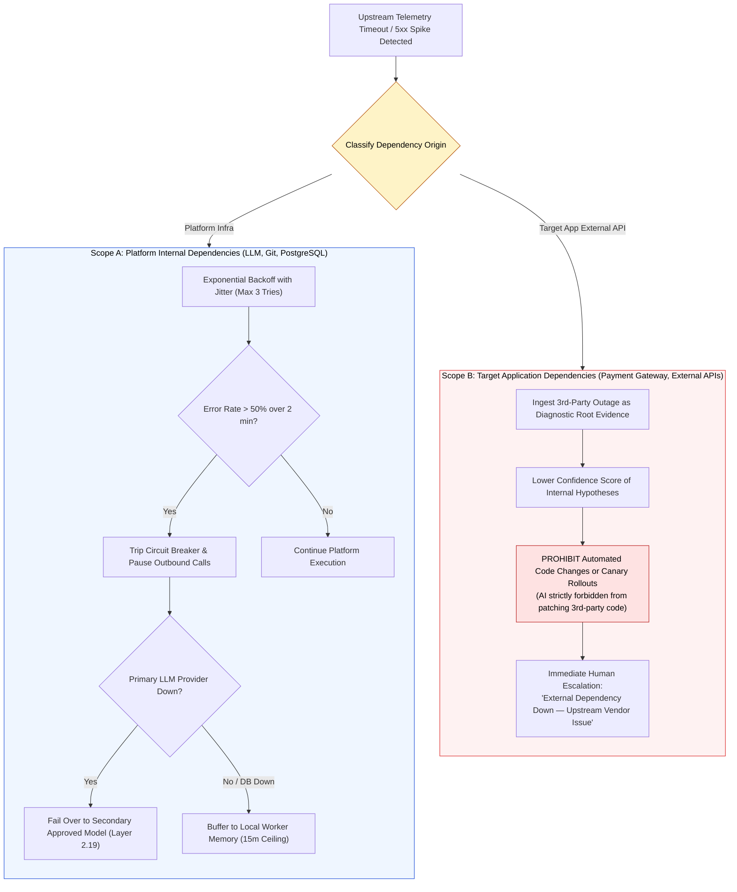

The platform distinguishes between degraded platform dependencies and degraded target application dependencies:

### Scope A: Platform Internal Dependencies (LLM APIs, Git, PostgreSQL)
* *Backpressure & Retries:* Exponential backoff with jitter (max 3 retries).
* *Circuit Breaker:* If error rate exceeds 50% over a 2-minute rolling window, trip circuit breaker and pause outbound requests.
* *Model Failover:* If primary foundation model degrades, fail over to the pre-approved secondary model provider (Layer 2.19).

### Scope B: Target Application Dependencies (Third-Party Payment Gateways, External APIs)
* *Evidence Ingestion:* Treat external service degradation as diagnostic evidence explaining application errors.
* *Confidence Downgrade:* Lower confidence score of candidate causes reliant on degraded external telemetry.
* *Prohibition of Automated Code Fixes:* The platform is **strictly forbidden from attempting automated code changes or canary deployments** targeting third-party provider outages. The incident is immediately escalated to a human engineer.

---

## 4.28 API Intake Acknowledgement SLA (p95 $\le 500\text{ ms}$)

*Answers: Q4.28, updating Q4.19 · Integrates: Layer 3 § 1.3*

* **Metric Definition:** Duration elapsed from the instant an incoming HTTP POST webhook arrives at the platform ingress gateway to the moment `200 OK` is returned following durable write to PostgreSQL.
* **Target SLA:** **p95 $\le 500\text{ ms}$** (provisional).
* **Worst-Case Ceiling:** **2.0 seconds** under peak burst load.
* **Scope Exclusion:** This clock measures purely the intake handshake and durable storage; it strictly excludes incident queueing, triage, and diagnostic reasoning.
* **Monitoring & Alerts:** Breaches of the 500 ms p95 threshold are recorded and surfaced directly on the performance dashboard.

---

## 4.29 Event Publication SLA (p95 $\le 10\text{ s}$, Hard Timeout at 15s)

*Answers: Q4.29 · Integrates: Layer 3 § 2.4, Layer 3 § 5.1*

* **Metric Definition:** Duration elapsed from the moment an incident record is durably committed in PostgreSQL until a worker process claims the dispatch event.
* **Target Bounds:** **p95 $\le 10\text{ seconds}$**; **maximum allowable upper limit is 15 seconds**.
* **Hard Timeout Protocol:**
  - If an accepted incident is not published or picked up by an active worker within **15 seconds**, the operation triggers a **hard dispatch timeout**.
  - The incident is immediately flagged as `"Dispatch Timeout"`, and an emergency alert is routed to the on-call engineer.
* **Transactional Enqueueing:** Incident registration and worker dispatch event creation execute within the same database transaction, eliminating orphan incidents.
* **Active Sweep Daemon:** A background recovery process scans every 30 seconds for unclaimed events, re-publishing them or escalating if delivery remains stalled.

---

## 4.30 Maximum Model-Call Duration ($\le 2$ Minutes)

*Answers: Q4.30 · Integrates: Layer 2 § 2.4, Layer 3 § 7.4*

* **Per-Call Timeout:** Every individual invocation of an external foundation model is bounded by a **hard 2-minute (120-second) timeout**.
* **Timeout Behavior:**
  - If no complete response is received within 120 seconds, the HTTP connection is terminated.
  - The timeout is recorded in the forensic timeline as a failed invocation.
  - The call counts toward the maximum step retry cap.
* **Subordination to Global Deadline:** The per-call timeout is strictly subordinated to the global **15-minute diagnostic ceiling** (Layer 2.18).
* **Telemetry Decoupling:** Ingestion of target application logs and background metrics continues uninterrupted during model timeouts.

---

## 4.31 Model Attempt Cap & Schema Error-Injection Retries

*Answers: Q4.31 · Integrates: Layer 2 § 2.5, Layer 3 § 7.1*

* **Primary Model Cap:** Maximum **3 total attempts per step** on the primary model (1 initial attempt + 2 retries).
* **Automated Format Checking:** Every model output is validated against strict Pydantic / JSON schemas before downstream execution.
* **Error-Conditioned Retries:** Repeating an identical prompt is forbidden. Retries must inject the exact schema validation failure message and the malformed snippet into the subsequent prompt.
* **Secondary Model Failover:** If the primary model fails 3 times, the platform initiates up to **2 attempts on the approved secondary backup model** (Layer 2.19).
* **Human Escalation:** If all primary and backup attempts fail, automated processing halts, and raw telemetry is escalated to a human engineer. Every attempt counts toward the 50-call per-incident ceiling (§ 4.21).

---

## 4.32 Approval Validity Period (1 Hour + State Fingerprinting)

*Answers: Q4.32 · Integrates: Layer 1 § 1.4, Layer 2 § 2.3*

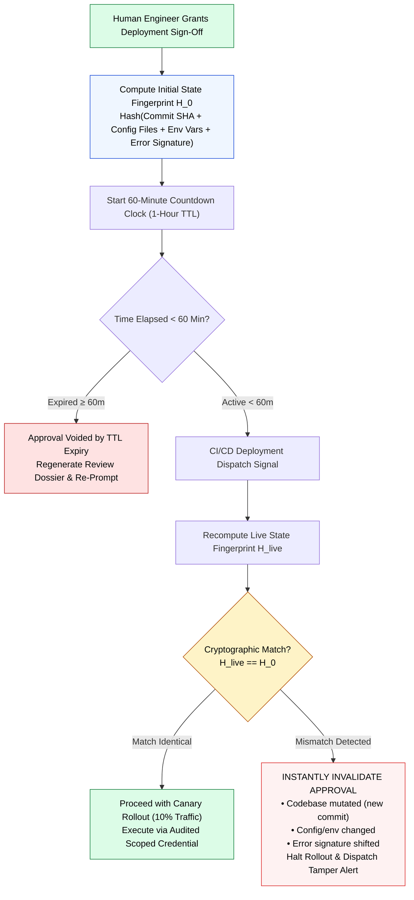

* **Time-To-Live (TTL):** Human authorization for production deployment expires **1 hour (60 minutes)** after issuance.
* **State Fingerprint Invalidation:**
  $$\text{State Fingerprint} = \text{Hash}(\text{Base Commit SHA} + \text{Config Files} + \text{Environment Variables} + \text{Error Signature})$$
  - If a state fingerprint mismatch occurs prior to execution, the approval is **instantly invalidated**, even within the 1-hour window.
  - Triggers include: a new commit pushed to repository, a modified configuration parameter, a concurrent deployment, or a significant shift in error patterns.
* **Expiry Escalation:**
  - Automated notification dispatched at 30 minutes.
  - Upon 1-hour expiry, the platform regenerates the review dossier and requests fresh authorization.

---

## 4.33 Cumulative Token Limits (500,000 Tokens & Dual Budget Control)

*Answers: Q4.33 · Integrates: Layer 2 § 2.4*

* **Incident Token Ceiling:** Maximum **500,000 combined tokens per incident** (input + output).
* **Per-Call Ingress/Egress Bounds:** Maximum **100,000 input tokens**; maximum **8,000 output tokens** per invocation.
* **Dual Control Rule:**
  $$\text{Halt Condition} = (\text{Total Incident Spend} \ge \$20) \quad \text{OR} \quad (\text{Total Incident Tokens} \ge 500,000)$$
  - Whichever ceiling is reached first immediately suspends automated model reasoning and triggers human handover.
* **Threshold Alerts:** Early warning notifications dispatched at $50\%$ (250,000 tokens) and $80\%$ (400,000 tokens). Token counts encompass retries and aborted calls.

---

## 4.34 Concurrency Ceiling & Bounded Queue Capacity

*Answers: Q4.34, re-affirming Q4.22 · Integrates: Layer 2 § 2.4, Layer 3 § 2.1*

* **Active Concurrency Slots:** Exactly **3 active investigations** executing simultaneously.
* **Bounded Queue Capacity:** Maximum **20 pending incidents** retained in the priority queue.
* **Queue Overflow Protocol:**
  - If more than 20 incidents queue simultaneously, the platform issues an emergency notification: *"Platform capacity saturated (20+ incidents queued) — handle manually"*.
  - Incoming alerts continue to be committed durably to the PostgreSQL database to prevent data loss, but automated worker assignment is suspended until active slots clear.
* **Slot Holding Lifecycle:** An active slot is occupied continuously from initial worker dispatch through investigation, sandbox testing, human approval, and canary rollout until official incident closure, cancellation, or handover.

---

# Part III: Assumptions, Dependencies & Risk Register

Every provisional number and operational constraint is cataloged below with designated ownership, validation testing criteria, and resolution deadlines:

| Assumption ID | Requirement Domain | Assumption & Provisional Value | Owner | Validation Test & Metric | Resolution Deadline |
| :--- | :--- | :--- | :--- | :--- | :--- |
| **A-4.1** | Lifecycle (§ 4.1) | Human engineers respond to deployment approval requests within 30 minutes. | Engineering Lead | Measure response latency during staged fire drills. | MVP Week 8 |
| **A-4.2** | Deduplication (§ 4.2) | Monitoring webhook emits consistent service and rule identifiers. | Integration Lead | Inspect 500 historical alert payloads for key stability. | MVP Week 4 |
| **A-4.3** | Intake Schema (§ 4.3) | Telemetry payloads contain service name and error timestamp. | Integration Lead | Schema validation tests on incoming webhook test suite. | MVP Week 4 |
| **A-4.4** | Evidence Gathering (§ 4.4) | Read-only access to logs, metrics, and CI/CD available via APIs. | SRE Lead | End-to-end API connectivity probe on testbed. | MVP Week 6 |
| **A-4.5** | Hypotheses (§ 4.5) | Foundation models output structured JSON matching schema. | AI/ML Lead | Benchmark 100 diagnostic prompts with JSON validator. | MVP Week 8 |
| **A-4.6** | Diagnostic Engine (§ 4.6) | Disposable Docker sandbox accurately reproduces target app runtime. | Tech Lead | Replay reference scenario in sandbox; assert HTTP 500. | MVP Week 6 |
| **A-4.7** | Falsification (§ 4.7) | Cheap separating check exists for top 5 failure modes. | Investigation Lead | Test separation heuristics on historical incident corpus. | MVP Week 10 |
| **A-4.8** | Inconclusive (§ 4.8) | On-call engineers can resume triage directly from handover dossier. | Platform Lead | Double-blind usability review with on-call team. | MVP Week 12 |
| **A-4.9** | Patch Package (§ 4.9) | Read-only repo access + sandbox branch is sufficient to generate diff. | Git Owner | Test diff generation against configuration repository. | MVP Week 6 |
| **A-4.10** | Sandbox Testing (§ 4.10) | Target application test suite executes in sandbox within 5 minutes. | Test Lead | Benchmark existing test suite run time in container. | MVP Week 6 |
| **A-4.11** | Deployment Review (§ 4.11) | One-page diff, sandbox verification report, and rollback plan provide sufficient context for deployment sign-off. | Engineering Lead | Usability review with senior SRE stakeholders. | MVP Week 10 |
| **A-4.12** | Canary Rollout (§ 4.12) | Target CI/CD pipeline supports automated canary and rollback. | DevOps Lead | Rehearse 10% canary traffic shift and rollback in staging. | MVP Week 8 |
| **A-4.13** | Verification (§ 4.13) | Monitoring tool provides post-deploy latency and error metrics. | SRE Lead | Verify metric scrape latency is $\le 15\text{ seconds}$. | MVP Week 8 |
| **A-4.14** | Cancellation (§ 4.14) | Asynchronous workflows reach safe checkpoint within 5 seconds. | Platform Lead | Measure cancel latency during active sandbox runs. | MVP Week 10 |
| **A-4.15** | Timeline (§ 4.15) | PostgreSQL append-only table handles event write volume. | Database Lead | Benchmark 1,000 timeline events/sec ingestion rate. | MVP Week 6 |
| **A-4.16** | Intake Reliability (§ 4.16) | 99.5% monthly intake availability achievable on single VM. | SRE Lead | Run synthetic blackbox ping for 30 consecutive days. | MVP Week 12 |
| **A-4.17** | Crash Recovery (§ 4.17) | 60-second heartbeat detects crashed workers reliably. | Backend Lead | Terminate worker process (`SIGKILL`); assert standby resume. | MVP Week 8 |
| **A-4.18** | DB Resilience (§ 4.18) | Managed cloud PostgreSQL executes replica failover within 60s. | Database Lead | Execute manual failover drill on staging replica. | MVP Week 6 |
| **A-4.19** | Intake Latency (§ 4.19) | Webhook intake commits and returns 200 OK within 500 ms p95. | Backend Lead | Load test intake API at 50 requests/second. | MVP Week 6 |
| **A-4.20** | Execution Timers (§ 4.20) | 15 minutes is sufficient for reference scenario automated diagnosis. | Platform Lead | Measure reference scenario replay MTTR across 20 trials. | MVP Week 10 |
| **A-4.21** | Dollar Budget (§ 4.21) | \$20 per incident remains well below the cost of engineer MTTR. | Product Owner | Financial ROI analysis against team hourly rate. | MVP Week 12 |
| **A-4.22** | Concurrency (§ 4.22) | 3 active slots and 20 queue capacity satisfy single-team load. | SRE Lead | Simulate peak incident burst (5 simultaneous alerts). | MVP Week 10 |
| **A-4.23** | Redaction (§ 4.23) | Inline cleaner purges credentials with 100% precision. | Security Lead | Redaction test against OWASP secrets & regex benchmark. | MVP Week 6 |
| **A-4.24** | PITR Guarantees (§ 4.24) | Continuous WAL archiving achieves RPO $\le 15$m, RTO $\le 4$h. | Database Lead | Execute point-in-time recovery to 15m prior timestamp. | MVP Week 8 |
| **A-4.25** | Outage Tolerance (§ 4.25) | Engineers can triage production manually during 4h platform outage. | Engineering Lead | Execute incident drill with platform intentionally disabled. | MVP Week 12 |
| **A-4.26** | Dashboard (§ 4.26) | Granular timestamps emitted for all automated and human stages. | Observability Lead | Assert all 10 stages have start/end telemetry in DB. | MVP Week 8 |
| **A-4.27** | Dependencies (§ 4.27) | Circuit breakers prevent cascading retries on degraded APIs. | Integration Lead | Inject 500ms latency and 50% errors on mock provider. | MVP Week 8 |
| **A-4.28** | Intake SLA (§ 4.28) | Intake API p95 $\le 500\text{ ms}$, maximum ceiling 2.0s. | Backend Lead | Continuous latency measurement in staging environment. | MVP Week 6 |
| **A-4.29** | Event Publish (§ 4.29) | Event publication p95 $\le 10\text{ s}$, hard timeout at 15s. | Platform Lead | Benchmark DB queue notification and dispatch latency. | MVP Week 6 |
| **A-4.30** | Model Timeout (§ 4.30) | 2 minutes is sufficient for single-step reasoning calls. | AI/ML Lead | Profile 99th percentile LLM response duration. | MVP Week 8 |
| **A-4.31** | Model Attempts (§ 4.31) | Error-injected retries resolve $>80\%$ of schema formatting errors. | AI/ML Lead | Evaluate JSON schema self-correction on synthetic errors. | MVP Week 8 |
| **A-4.32** | Approval TTL (§ 4.32) | 1-hour TTL and state fingerprinting prevent stale execution. | Release Lead | Inject commit hash mismatch; assert approval auto-void. | MVP Week 8 |
| **A-4.33** | Token Ceilings (§ 4.33) | 500,000 tokens stays strictly within \$20 budget ceiling. | Finance Owner | Model pricing audit across input/output token blend. | MVP Week 10 |
| **A-4.34** | Concurrency Cap (§ 4.34) | 3 concurrent investigations do not breach provider TPM/RPM. | SRE Lead | Verify foundation model quota allocations with vendor. | MVP Week 8 |

---

# Part IV: Master End-to-End Architecture & Incident Lifecycle Graph

The following comprehensive architecture graph consolidates all functional protocols, operational boundaries, non-functional SLAs, and governance guardrails established across Layer 4:

```mermaid
flowchart TD
    %% TIER 1: INGESTION & DEDUPLICATION
    subgraph TIER1["Tier 1: Telemetry Ingress, Validation & Deduplication Fabric"]
        MonAlert["External Monitoring Webhook / Synthetic Probe (60s Blackbox)"] --> API["Ingress Gateway API (p95 ≤ 500ms SLA, NTP Synced)"]
        API --> ValCheck{"Validate 5 Mandatory Fields<br/>(service_id, env, time, symptom, endpoint)"}
        ValCheck -->|Missing Fields| AutoEnrich{"Auto-Enrich via CI/CD<br/>or Prompt Human (5m Timeout)"}
        AutoEnrich -->|Context Found| DedupCheck
        AutoEnrich -->|Timeout Expired| InconcDrop["Escalate as Inconclusive (Never Hallucinate)"]
        ValCheck -->|Schema Valid| DedupCheck{"Composite Deduplication Check<br/>⟨org_id, service_id, error_signature, env⟩<br/>(30-Minute Sliding Window)"}
        DedupCheck -->|Active Match| DedupActive["Increment Occurrence Counter<br/>Attach Alert Payload & Re-evaluate Severity<br/>(Zero Duplicate Workers)"]
        DedupCheck -->|Closed Match| DedupRecur["Reopen Incident Record<br/>Tag as 'Recurred'"]
        DedupCheck -->|Unique Incident| RegDB[("Persist to PostgreSQL State Store<br/>Commit Incident & Dispatch Event Transactionally")]
    end

    %% TIER 2: QUEUE & CONCURRENCY
    subgraph TIER2["Tier 2: Concurrency Governance & Priority Queue"]
        RegDB --> SlotCheck{"Active Slots < 3?<br/>(Concurrency Ceiling)"}
        SlotCheck -->|Yes: Slot Free| DispatchWorker["Claim Concurrency Slot (1 of 3)<br/>Publish Event to Worker (p95 ≤ 10s, Hard Timeout 15s)"]
        SlotCheck -->|No: Saturated| PQueue{"Priority Queue Depth < 20?<br/>(Bounded Capacity)"}
        PQueue -->|Yes: Enqueue| QueueWait["Insert into Priority Queue<br/>Score = Severity + Prod + (Wait Min × 2)<br/>Anti-Starvation Alert at > 10 min"]
        PQueue -->|No: Overflow ≥ 20| QueueOverflow["Platform Saturated Alert Dispatched<br/>Durable Save Without Automated Triage<br/>Switch to Manual Response"]
        QueueWait -->|Slot Released| DispatchWorker
    end

    %% TIER 3: WORKER RUNTIME & RESILIENCE
    subgraph TIER3["Tier 3: Resilient Worker Execution & Audit Supervision"]
        DispatchWorker --> WorkerRun["Worker Process Execution"]
        WorkerRun --> Heartbeat["Emit 60s Heartbeat to DB"]
        Heartbeat --> HCheck{"Heartbeat Missing > 60s?<br/>(Crash Detected)"}
        HCheck -->|Yes: Crash < 3| StandbyTakeover["Spawn Standby Worker<br/>Resume from Last PostgreSQL Checkpoint<br/>(Idempotent Operations)"]
        HCheck -->|Crash Loop ≥ 3| CrashEscalate["Circuit Breaker Trips:<br/>Escalate Worker Crash Ledger to Human"]
        WorkerRun --> KillSwitchCheck{"Emergency Kill Switch or<br/>Normal Cancel Triggered?"}
        KillSwitchCheck -->|Emergency Kill Switch| HardKill["Immediate Token Revocation<br/>Block CI/CD Calls & Freeze in Safe State"]
        KillSwitchCheck -->|Normal Cancel| SafeCancel["Finish Current Step to Safe Checkpoint<br/>Halt Canary & Mark Status: 'Cancelled'"]
    end

    %% TIER 4: STAGED TELEMETRY & SANITIZATION
    subgraph TIER4["Tier 4: Staged Telemetry Collection & Sanitization Gateway"]
        WorkerRun --> SanitizeIn["Inline Sanitization Gateway<br/>• 100% Secret & Credential Purge<br/>• Pseudonymous PII Masking [USER_1]<br/>• Fail-Closed Execution"]
        SanitizeIn --> R1["Round 1 Telemetry (≤ 60s, Cheap)<br/>Git Deploy History, Config Diffs, 5xx Logs"]
        R1 --> R2["Round 2 Telemetry (≤ 3m, Deep Dive)<br/>Distributed Traces, DB Pools, Downstream Status"]
        R2 --> DepCheck{"External Dependency Degraded?"}
        DepCheck -->|Platform Infra Down| CircuitTrip["Trip Circuit Breaker & Fail Over to Secondary LLM"]
        DepCheck -->|Target 3rd-Party Down| ExtOutage["Ingest as Root Cause Evidence<br/>PROHIBIT Automated Fixes<br/>Escalate Upstream Vendor Outage"]
    end

    %% TIER 5: HYBRID DIAGNOSTIC ENGINE
    subgraph TIER5["Tier 5: Tri-Stage Hybrid Diagnostic Engine"]
        R2 --> LLMGen["Stage 1: Generative LLM Reasoning<br/>(Per-Call Timeout ≤ 2m, Max 3 Attempts)"]
        LLMGen --> DetRules["Stage 2: Deterministic Rule Validation<br/>(±30s Temporal Check & Symbol Key Match)"]
        DetRules --> Hypotheses["Structure Competing Hypotheses<br/>(Evidence FOR / AGAINST, Mandatory 'Unknown' Bucket)"]
        Hypotheses --> Falsify["Active Falsification & Evidence Weighting<br/>Directness (1.0/0.4) × Recency (1.0/0.2) × Reliability (1.0/0.6)"]
        Falsify --> DiagOutcome{"Diagnosis Confidence ≥ 60% &<br/>Time ≤ 15m & Spend ≤ $20?"}
        DiagOutcome -->|No / Budget Cap Hit| HandoverDossier["Halt Expensive Reasoning<br/>Compile Immutable Handover Dossier<br/>Escalate as 'Inconclusive' to On-Call"]
        DiagOutcome -->|Yes: Candidate Isolated| PatchGen["Draft Unified Patch Package<br/>(Code/Config Diff on Isolated Sandbox Branch)<br/>Define Explicit Blast Radius Boundary"]
    end

    %% TIER 6: AUTONOMOUS SANDBOX VERIFICATION
    subgraph TIER6["Tier 6: Autonomous Ephemeral Sandbox Harness (Zero Human Approval Needed)"]
        PatchGen --> SB_Init["Provision Fresh Disposable Docker Container<br/>(Zero Prod Access, Synthetic Data Only)"]
        SB_Init --> SB_Repro["Step 1: Reproduce Baseline Error (Assert 500)"]
        SB_Repro --> SB_Apply["Step 2: Apply Patch Diff & Verify Resolution"]
        SB_Apply --> SB_Regress["Step 3: Auto-Generate Regression Test"]
        SB_Regress --> SB_Suite["Step 4: Execute Blast-Radius Test Suite<br/>(Existing Tests Strictly Immutable)"]
        SB_Suite --> SB_Pass{"All Sandbox Verification<br/>Steps Passed?"}
        SB_Pass -->|Failure / Timeout > 15m| PatchRetry{"Generation Attempts < 3?"}
        PatchRetry -->|Yes| PatchGen
        PatchRetry -->|No| HandoverDossier
    end

    %% TIER 7: HUMAN DEPLOYMENT GATE & ROLLOUT
    subgraph TIER7["Tier 7: Single Human Deployment Gate & Canary Verification"]
        SB_Pass -->|Passed Successfully| DossierPrep["Assemble Unified Review Dossier<br/>(Diff, Telemetry Links, Sandbox Test Results, Rollback Plan)"]
        DossierPrep --> HumanGate{{"SINGLE HUMAN APPROVAL GATE<br/>Authorized Engineer Reviews Dossier<br/>(Approval Strictly for Production Deployment)"}}
        HumanGate -->|Rejected / Modification Req| WorkerRun
        HumanGate -->|Approved| Fingerprint["Compute Initial State Fingerprint H_0<br/>Hash(Commit SHA + Config Files + Env Vars + Error Signature)<br/>Start 1-Hour TTL Countdown Timer"]
        Fingerprint --> PreDeploy{"Live Fingerprint H_live == H_0 &<br/>TTL < 60 Minutes?"}
        PreDeploy -->|Mismatch / Stale| VoidApproval["INSTANTLY INVALIDATE APPROVAL<br/>State Changed / Compromised<br/>Regenerate Review Dossier"]
        PreDeploy -->|Cryptographically Verified| DeployExec["CI/CD Pipeline Canary Rollout<br/>(Initial 10% Traffic Slice via Scoped Credential)"]
    end

    %% TIER 8: RECOVERY & CLOSURE
    subgraph TIER8["Tier 8: Post-Deploy Verification & Immutable Audit Closure"]
        DeployExec --> VerifyCheck{"Multi-Dimensional Verification (15-30m Window)<br/>• Original Trigger Repro Check<br/>• Error Rate & Latency (p50/p95/p99) vs Baseline<br/>• Downstream Connection Pool Health"}
        VerifyCheck -->|Degradation Detected| AutoRollback["Trigger Automated CI/CD Rollback<br/>Restore Pre-Incident Artifact<br/>Keep Incident Open & Alert Engineer"]
        VerifyCheck -->|Baseline Met & Sustained| PromoteTraffic["Promote to 100% Production Traffic"]
        PromoteTraffic --> CloseInc["Commit Complete Forensic Ledger to Append-Only Table<br/>Enforce 90-Day Retention & Expose Forensic Replay<br/>Release Concurrency Slot"]
        CloseInc --> FinalEnd["Incident Successfully Closed"]
    end

    %% STYLING CONNECTIONS & NODES
    style TIER1 fill:#eff6ff,stroke:#1d4ed8,color:#000
    style TIER2 fill:#fef3c7,stroke:#b45309,color:#000
    style TIER3 fill:#f3e8ff,stroke:#6b21a8,color:#000
    style TIER4 fill:#e0f2fe,stroke:#0369a1,color:#000
    style TIER5 fill:#fef9c3,stroke:#a16207,color:#000
    style TIER6 fill:#dcfce7,stroke:#15803d,color:#000
    style TIER7 fill:#fce7f3,stroke:#be185d,color:#000
    style TIER8 fill:#ecfdf5,stroke:#047857,color:#000
    style HumanGate fill:#fde68a,stroke:#b45309,stroke-width:2px,color:#000
    style FinalEnd fill:#10b981,stroke:#047857,color:#fff
```
