# AI SRE Platform — Artifact 1: Product Requirements Document

**Layer 1 — Problem Discovery** · Built from: None · *Draft compiled from team discussion and Claude/ChatGPT review — pending team sign-off*

---

## Reference scenario

This scenario anchors every section below, and every later artifact in the worksheet must stay consistent with it:

1. An organization operates a Python web application.
2. An engineer deploys a new version.
3. The deployment changes a configuration value.
4. The application starts returning HTTP 500 errors.
5. The monitoring system detects the incident.

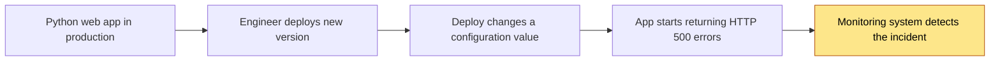

---

## 1.1 Problem statement

*Answers: Q1.1, Q1.3, Q1.6, Q1.7, Q1.8*

Engineers responding to production incidents spend most of their time on manual, repetitive investigation rather than on the judgment calls that actually need a human. Three things make this worse:

1. **Not every alert is a real problem.** Teams currently decide what's worth solving by experience and gut feel, often with no written criteria. The first step toward a solution is simply being able to measure what share of incoming alerts clear a real bar for action, rather than treating every alert as equally urgent.
2. **Information needed to diagnose an incident is scattered** across logs, metrics, deployment history, and multiple dependent services. Gathering it is slow, and the team usually doesn't know in advance which piece of scattered information will turn out to be decisive.
3. **Familiar-looking failures can have new causes.** A standard runbook can be applied with confidence when a failure looks like one seen before, but similar symptoms don't guarantee the same root cause, so judgment must be applied wherever the cost of being wrong is high, not only when a failure looks unfamiliar. A wrong diagnosis leads to a fix that doesn't resolve anything, can introduce a new problem, and extends the outage while business impact and pressure on the team keep growing.

> The underlying problem is not "we need an AI that explains errors" — it's that the full loop from detecting a real incident to a verified recovery is manual, slow, and depends on scattered information and individual judgment that isn't written down anywhere.

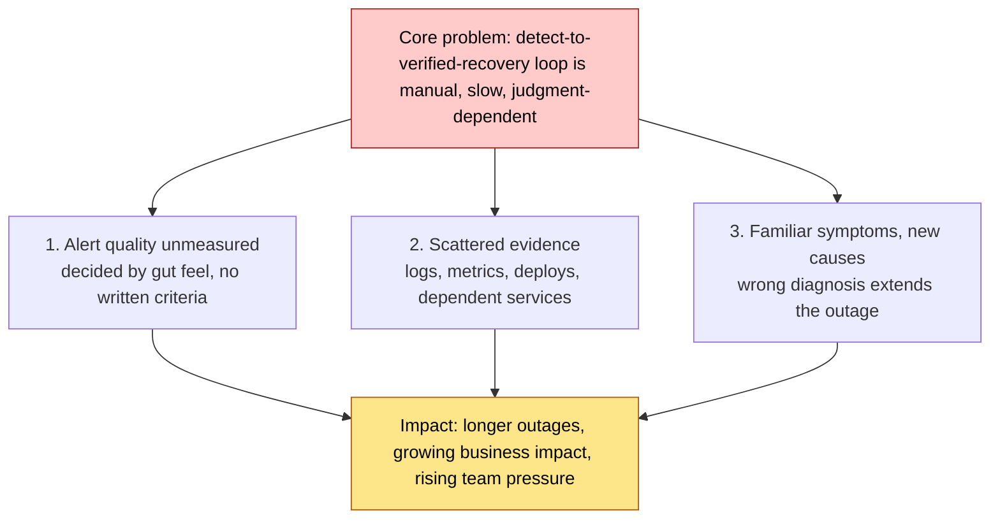

---

## 1.2 Target users

*Answers: Q1.2, Q1.4, Q1.15*

| User | Role in the incident lifecycle |
|---|---|
| **On-call / on-duty engineers** | Receive the alert first; expected to triage it, gather evidence, and either resolve it or route it. |
| **Service/application owners and team leads** | The actual point of contact for a given service; assign the specific person who will work a given incident. |
| **Engineering management and stakeholders** | Authorize risk above a certain threshold; ultimately decide whether the platform is worth the investment. |

A recurring theme across target users is **trust**: engineers do not currently trust an AI system with production incidents by default. They would need:

- **Visible evidence** — a track record of past decisions and outcomes, with sources
- **Explicit controls** — no unsupervised production changes
- **Guarantees** — rollback is always possible

See 1.4 and 1.5.

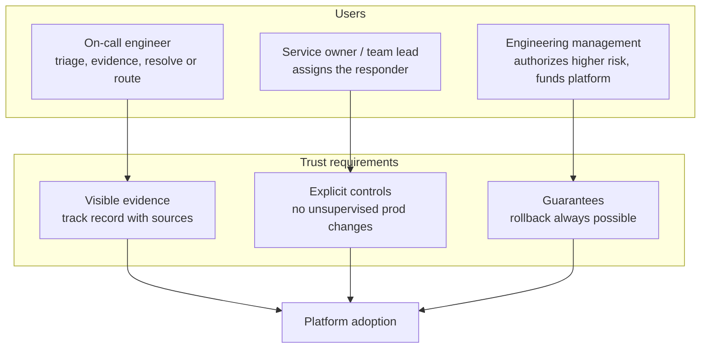

---

## 1.3 User journey

*Answers: Q1.4, Q1.5, Q1.6, Q1.7, Q1.20, Q1.21, Q1.22*

### Today's manual journey

1. An alert fires; the engineer acknowledges it.
2. They work out which service is affected and who owns it.
3. They check recent changes (deployments, config) against the timing of the incident.
4. They review logs, metrics, and connected/dependent services.
5. They form a hypothesis about the cause and test it.
6. They keep stakeholders informed throughout.

Most of this time is spent **searching and coordinating, not reasoning** — which is exactly the part the platform should take over.

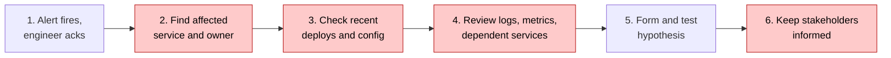

*Red steps = mostly searching and coordinating, the part the platform should take over.*

### Target journey (reference scenario, end to end)

1. Monitoring detects the HTTP 500s following the config-changing deploy.
2. The platform notifies the responsible team (and whoever made the deploy, and relevant management) and auto-assigns an available owner; if no one responds within a set time, it escalates to the next level.
3. The platform automatically retrieves logs and metrics for the incident window.
4. It classifies and investigates the evidence and proposes a diagnosis (e.g., "this config value changed at the same time the errors started").
5. The platform proposes a fix and automatically tests it in an isolated sandbox environment (no human approval required to test in sandbox).
6. Once sandbox validation succeeds, the platform presents the diagnosis, proposed fix, and sandbox test results to the human and requests approval for production deployment.
7. Upon human approval, the AI platform executes the deployment to production (with rollback ready).
8. The platform verifies recovery against an agreed baseline, not just the absence of the original symptom, and closes the incident.

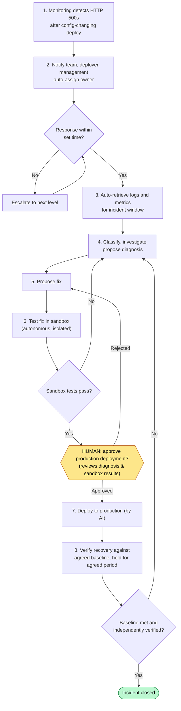

### Sequence view of the reference scenario

```mermaid
sequenceDiagram
    autonumber
    actor Dev as Engineer (deployer)
    participant App as Python web app
    participant Mon as Monitoring
    participant AI as AI SRE Platform
    actor Own as On-duty owner
    participant SB as Sandbox
    participant Prod as Production

    Dev->>App: Deploy new version (config value changed)
    App-->>Mon: HTTP 500 errors
    Mon->>AI: Alert: incident detected
    AI->>Own: Notify and auto-assign (escalate if no response)
    AI->>App: Retrieve logs and metrics for incident window
    AI->>AI: Classify evidence, propose diagnosis
    AI->>SB: Propose and test fix in sandbox (autonomous)
    SB-->>AI: Sandbox test results (passed)
    AI->>Own: Present diagnosis, fix & sandbox results; request deploy approval
    Own-->>AI: Approve deployment
    AI->>Prod: Deploy fix to production (executed by AI, rollback available)
    AI->>Mon: Verify recovery against baseline
    Mon-->>AI: Baseline met and held
    AI->>Own: Close incident with full audit log
```

### Preserving information through the lifecycle

Every action the platform takes — what it retrieved, from where, what it decided, and why — is logged in detail, so the incident is fully reconstructable afterward and the platform's own performance can be evaluated. The platform should not assume the information it gathers is complete; where it is not, that gap itself should be visible.

### Where humans must be in the loop

Testing fixes in a sandbox is completely isolated and runs autonomously without human intervention. Of all the decision points in this journey, **the true choke point for irreversible risk is the production deployment (and code merge).** Human approval is requested strictly after sandbox testing has succeeded and before production deployment; once approved, deployment is executed by the AI platform.

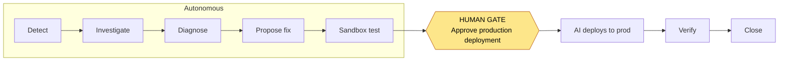

---

## 1.4 Core use cases

*Answers: Q1.9, Q1.10, Q1.11, Q1.12, Q1.13, Q1.14*

1. **Immediate response to a new incident.** Identify the originating service, produce a fast consolidated summary rather than making the engineer wait for a full investigation, and identify the area of impact (how many services/systems are affected).
2. **Investigation, not just explanation.** A plain debugging assistant can explain an error but can't act on it. This platform needs a **harness**: a component that can call tools, retrieve the codebase, and propose and test fixes in an isolated sandbox autonomously, with the reasoning component (the model) directing the harness rather than acting directly on production.
3. **Tiered approval before production deployment.** Fixes are tested autonomously in a sandbox, but deployment to production requires human approval. Minor, reversible changes can be approved by the on-duty engineer directly; higher-risk changes need a named owner (with backup) and escalate if nobody responds in time. The platform should make explicit who is actually empowered to accept a given risk, since that isn't always the nominal application owner. Once approved, deployment is executed by the AI.
4. **Independent verification of a repair.** The platform's own claim that something is fixed is not sufficient evidence. Recovery is confirmed against an agreed baseline (not just "the error stopped"), held for an agreed period, with human or automated-test validation before an incident is closed.
5. **Honest behavior under incomplete telemetry.** When it cannot establish a root cause because evidence is incomplete, the platform says so explicitly, states what's missing and how confident it is, and asks for that specific missing information rather than guessing.
6. **Going beyond suggestion to investigation, coordination, and verification.** This is the line between a debugging assistant and an engineering platform. The platform decides which tasks to hand off to automation versus keep with engineers, and a human stays accountable for outcomes even when the platform is the one that acted.

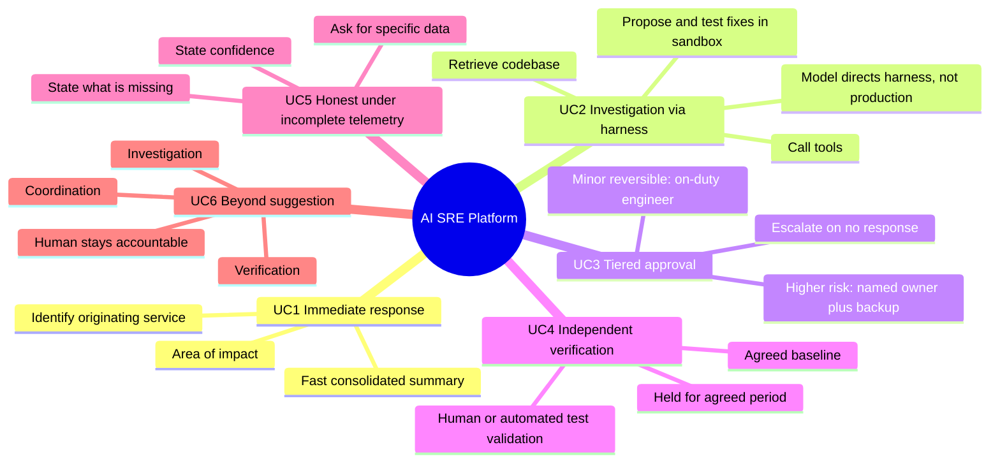

### Harness architecture (use case 2)

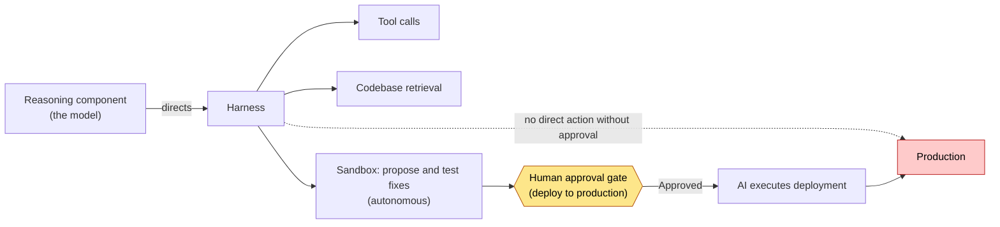

### Tiered approval model (use case 3)

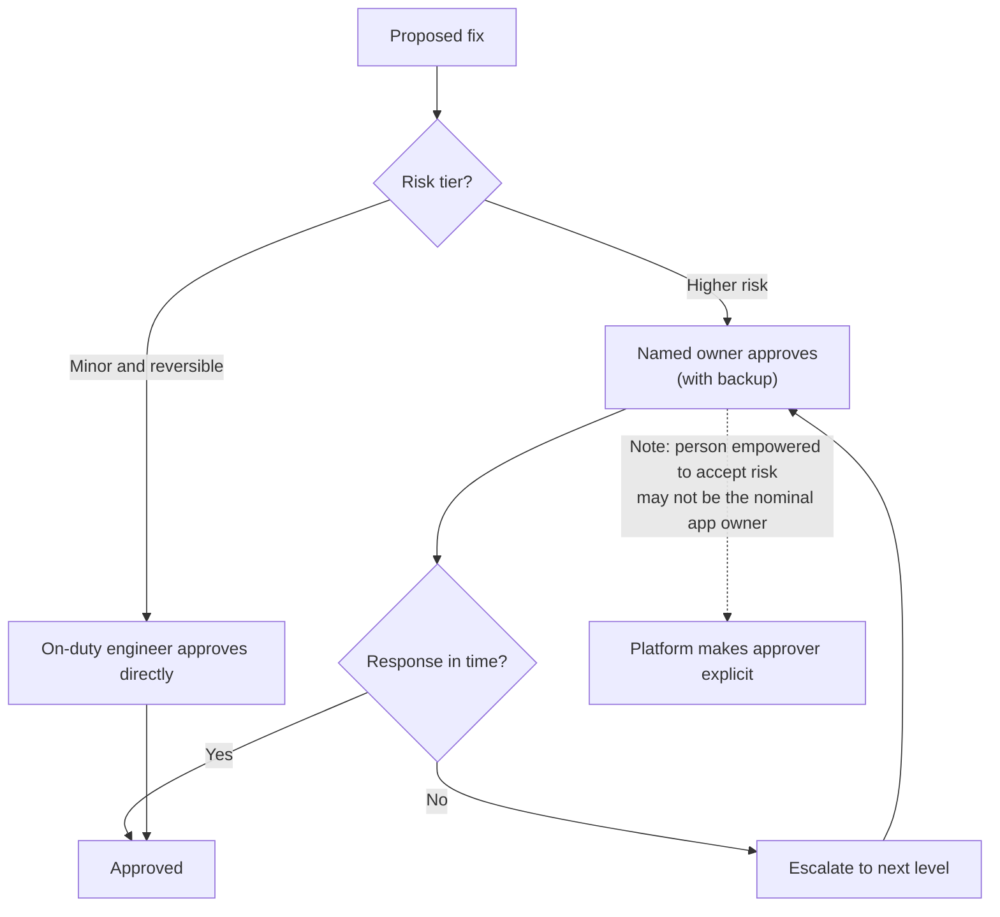

### Verification flow (use case 4)

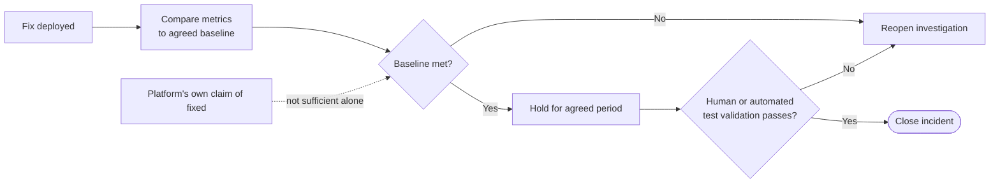

### Honest behavior under incomplete telemetry (use case 5)

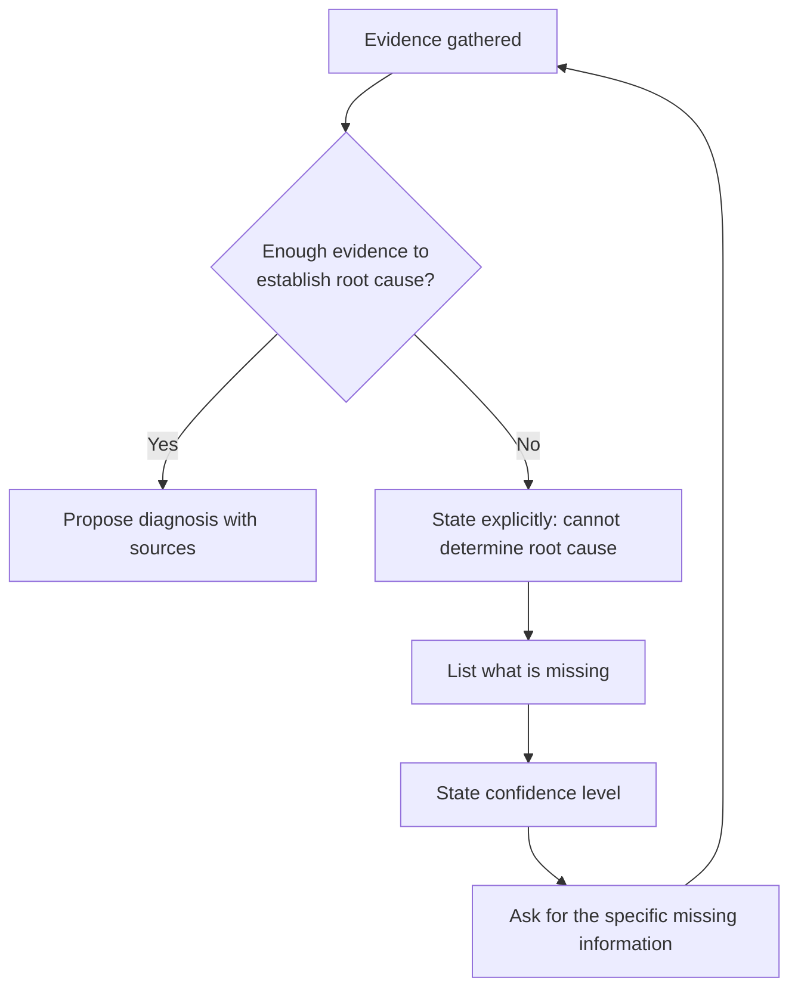

---

## 1.5 Product boundaries

*Answers: Q1.11, Q1.19, Q1.22*

- The platform **may** investigate, diagnose, propose fixes, and test fixes in an isolated sandbox autonomously (no human approval required to test in sandbox).
- The platform **may not** merge code or deploy to production without explicit human approval — sandbox testing is autonomous, but production changes are strictly gated.
- Minor, reversible changes may be approved by the on-duty engineer; anything above that risk tier requires a named owner or escalation.
- Deployment to production is executed by the AI platform, but strictly *after* human approval.
- Every proposed fix must be tested in a sandbox before any production deployment approval is requested.
- Rollback must always be possible for any change the platform helps make.
- The platform may not declare an incident resolved on the strength of its own claim alone — resolution requires independent verification against a baseline.

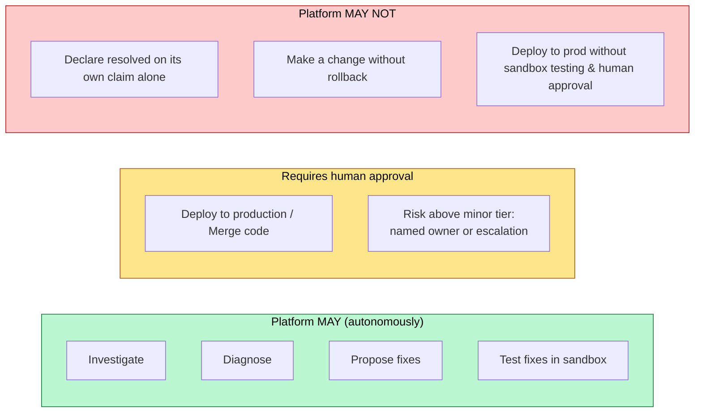

---

## 1.6 Success definition

*Answers: Q1.16, Q1.17, Q1.18*

### Minimum viable scope (6-month / small-budget build)

Apply a Pareto-style cut: build a **thin, working, end-to-end slice** through the full incident lifecycle (**detect → investigate → propose & sandbox test → approve → deploy → verify**) rather than full depth at every layer. The full set of capabilities in 1.4 is the target; the MVP should demonstrate the shape of all of them even if simplified.

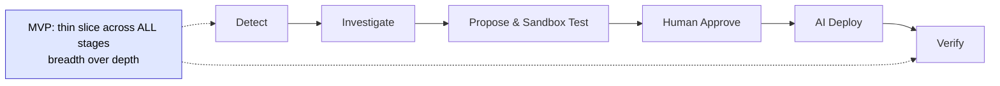

### Demonstration

Incident occurs → system detects and notifies → system investigates, proposes a fix, and tests it in sandbox (autonomously) → human reviews sandbox results and approves deployment → AI executes production deployment → recovery is verified against baseline → incident closes. This sequence, run live on the reference scenario, is the core demo.

### Measurable outcomes for management

Outcomes fall into three buckets:

| Bucket | Metrics |
|---|---|
| **Time** | Time-to-resolve, downtime reduced, mean-time-to-recovery |
| **Cost** | Engineering hours saved, estimated ROI |
| **Resources** | Fewer people needed on-call for routine investigation |

Initial figures will be an approximation to justify the budget ask; actual performance is measured and compared against that approximation once the MVP is running.

> **Open item:** the exact approximation numbers and management's bar for "worth investing in" are not yet known.

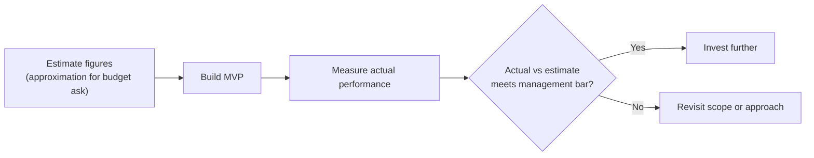

---

## 1.7 Explicit non-goals

- The platform does **not** act fully autonomously in production: it does not deploy, merge, or apply production changes without explicit human approval (autonomous action is safely confined to investigation, diagnosis, and sandbox testing; deployment is executed by AI only after human approval).
- The platform does **not** treat a single, unverified success signal (including its own claim) as proof that an incident is resolved.
- The platform does **not** attempt full-depth coverage of every capability in the first build — the MVP favors breadth across the lifecycle over depth in any one stage.

---

## Incident lifecycle state model

A consolidated view of the states an incident passes through, drawn from 1.3 to 1.5.

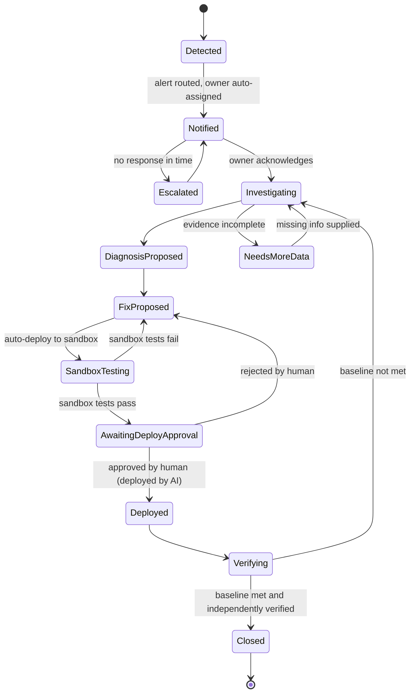

---

## Assumptions carried forward (provisional)

Per the acceptance checklist, every assumption needs a named owner and a condition for validation. Owners are still unassigned and need a name from the team before this artifact can be marked done.

| Assumption | Status | Owner | Validation condition |
|---|---|---|---|
| A documented qualifying criteria for deciding whether an alert is worth solving already exists somewhere in the organization | Reclassified as **known, not assumption**, after Claude's challenge (see below) | Unassigned | Confirm against the target organization's actual documentation once one is chosen |
| Existing incident history is relevant but may be incomplete or only partially cover "new" issue types | Provisional | Unassigned | Check completeness/quality of historical data once a real data source is available |
| A named point of contact exists per application/service who can approve production changes | Provisional | Unassigned | Confirm org chart / on-call tooling for the target organization |
| The team has the technical capability to deliver the MVP within the 6-month/budget window | Provisional | Unassigned | Revisit after MVP scope is finalized in Layer 6 (System Architecture) |
| Monitoring and logging exist for all components, though completeness is not guaranteed | Provisional | Unassigned | Confirm during Layer 7 (Data, APIs and Events) |

---

## Where Claude and ChatGPT disagreed (and how it was resolved)

1. **Whether a "qualifying criteria for deciding what's worth solving" is an assumption or a known fact.** ChatGPT treated it as an unverified assumption; Claude argued it's a knowable fact that should be checked rather than assumed, since such criteria exist in some form in any real organization. The team adopted Claude's framing and moved it from assumptions to knowns.
2. **Whether approval should be a single fixed role or tiered by risk.** The team's original answer assumed a single named owner with backup; Claude proposed tiering by risk, letting the on-duty engineer approve minor reversible changes directly. The team adopted Claude's tiered version and folded in ChatGPT's point that whoever is empowered to accept risk may not be the formal owner.
3. **How literally to take "the application owner is always the right approver."** Both models flagged this as weak; the team agreed and reworked the approval model in 1.4 and 1.5 accordingly.

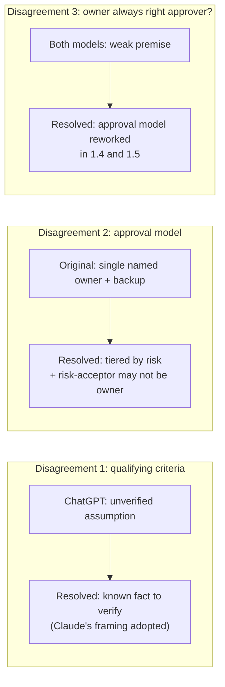

---

## Status

Draft compiled from the team's recorded discussion and Claude/ChatGPT review.

- **Required sections:** 7 of 7 drafted.
- **Outstanding before this artifact can be marked done:**
  - [ ] Assign owners to the assumptions above
  - [ ] Cross-check that all 22 questions in this layer are covered by a section
  - [ ] Get team sign-off

**Reviewed by:** _____________________ **Date:** _____________________