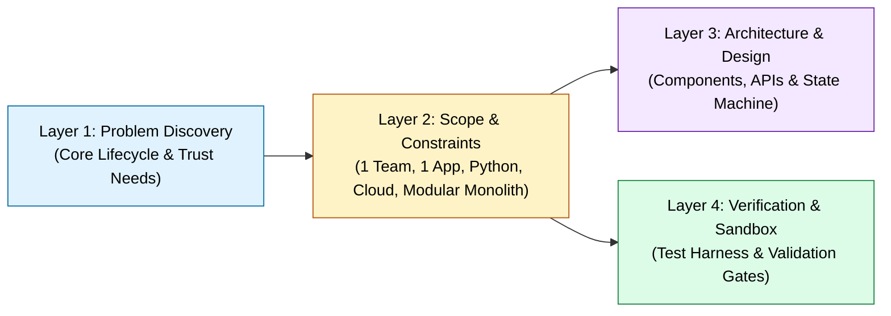
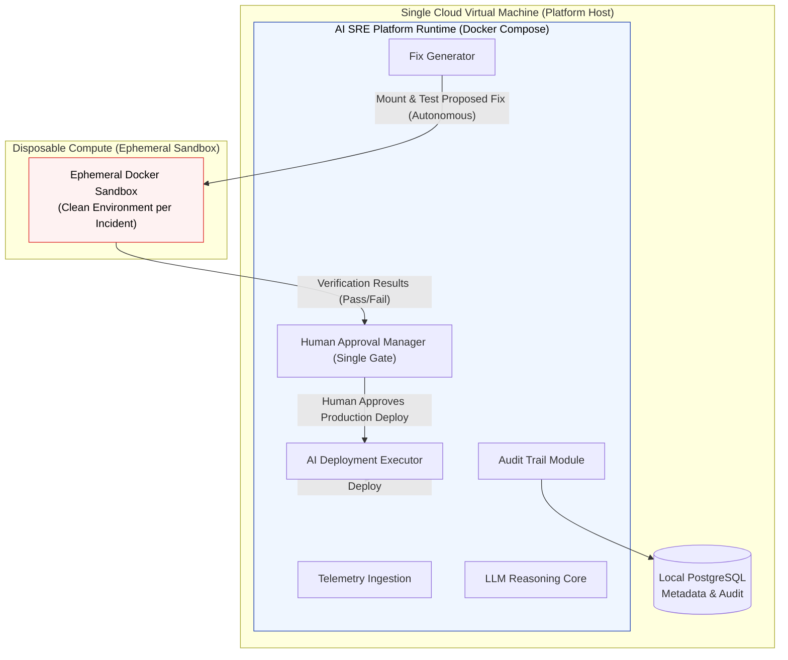
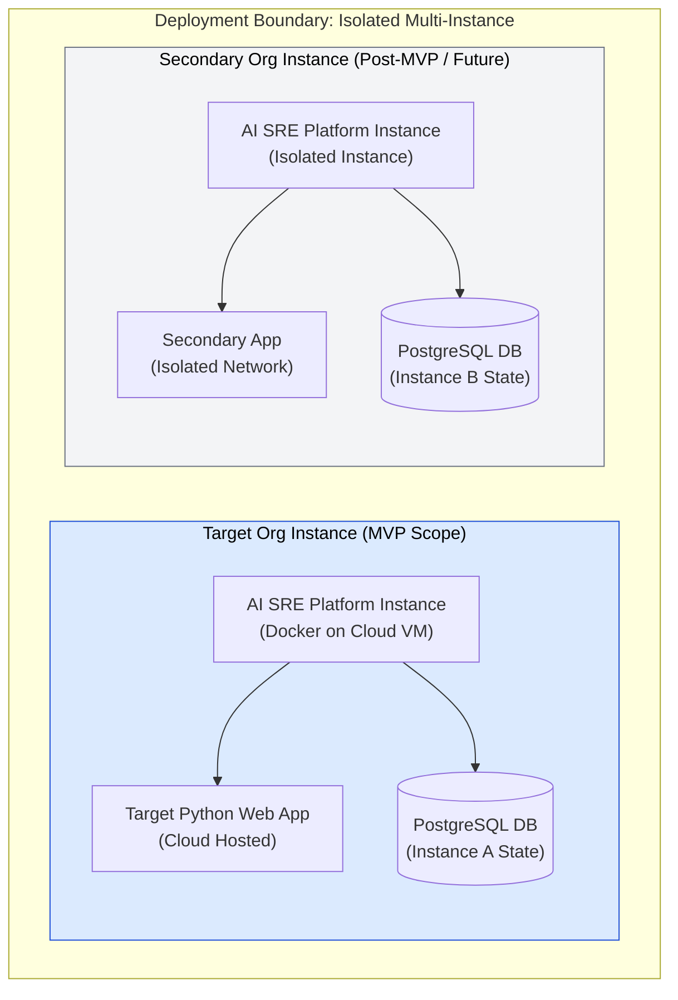
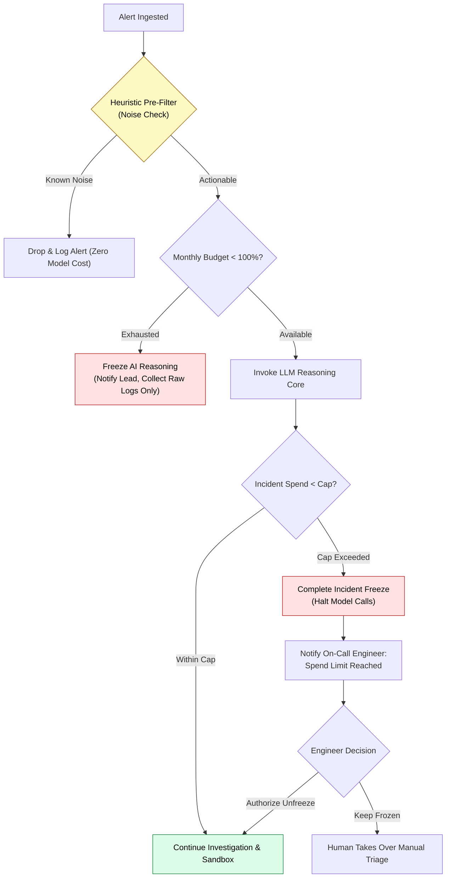
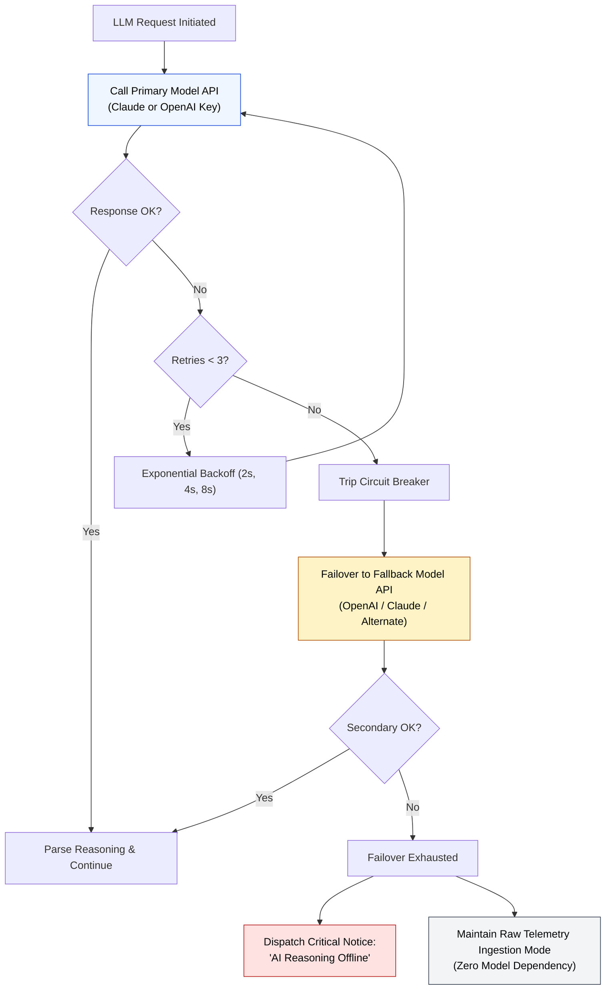

# AI SRE Platform — Artifact 2: Scope & Constraints Document

**Layer 2 — Scope & Constraints** · Built from: [Artifact 1: Product Requirements Document](file:///c:/Users/diwas/OneDrive/Desktop/Projects/ai-sre/artifacts/product_requirement.md) · *Approved specifications compiled from team discussions, Claude & ChatGPT evaluations, and the Layer 2 Conversation Log*

---

## Executive Summary & Layer Alignment

Layer 1 established the problem: incident investigation is manual, slow, fragmented across silos, and dependent on tacit human judgment. 

**Layer 2 establishes the strict boundaries, architectural constraints, and operational limitations** for the 6-month Minimum Viable Product (MVP). The overarching principle governing Layer 2 is **narrow depth over broad breadth**: validating the end-to-end incident lifecycle (detection $\rightarrow$ diagnosis $\rightarrow$ fix proposal $\rightarrow$ autonomous sandbox verification $\rightarrow$ single-gate human approval $\rightarrow$ AI deployment & recovery) on a tightly controlled environment before attempting enterprise-wide generality.

---

## Required Sections Compliance Checklist

| Required Section | Questions This Section Answers | Status | Primary Focus in this Document |
| :--- | :--- | :---: | :--- |
| **2.1 Supported environments** | Q2.3, Q2.9, Q2.14 | ☑ Done | Cloud-only host, Docker Compose (no K8s for host), ephemeral sandbox |
| **2.2 Supported application types** | Q2.2, Q2.6, Q2.10 | ☑ Done | Python 3.11+ web apps, YAML/JSON/.env configs, modular monolith |
| **2.3 Deployment boundaries** | Q2.1, Q2.4, Q2.5, Q2.8, Q2.13, Q2.14 | ☑ Done | 1 Org / 1 Team / 1 App, single-tenant multi-instance, read-only telemetry, single approval gate |
| **2.4 Budget constraints** | Q2.12, Q2.15, Q2.16, Q2.17, Q2.18 | ☑ Done | Monthly cap, per-incident freeze with human unfreeze, MTTR benchmark |
| **2.5 Provider assumptions** | Q2.4, Q2.6, Q2.11, Q2.19, Q2.21 | ☑ Done | Swappable LLM connector (Claude/OpenAI), circuit-breaker fallback, PostgreSQL state DB |
| **2.6 Explicit non-goals** | Q2.1, Q2.2, Q2.3, Q2.7, Q2.8, Q2.9, Q2.10, Q2.11, Q2.12, Q2.13, Q2.14 | ☑ Done | Comprehensive catalog of what the MVP will strictly NOT do |
| **2.7 Unresolved dependencies** | Q2.20, Q2.22, Q2.23 | ☑ Done | 5 architecture-breaking assumptions, open dependency register & deadlines |

---

## Reference Scenario Anchor

Every boundary, technology selection, and constraint in this document is anchored to the reference scenario defined in Layer 1:

1. **Target Organization:** Operates a production Python web application.
2. **Trigger Event:** An automated deployment executes, changing a configuration parameter.
3. **Failure Mode:** The application starts returning HTTP 500 errors.
4. **Detection:** The existing monitoring platform detects elevated 5xx error rates and triggers an alert.
5. **Resolution Goal:** Diagnose the root cause to the configuration diff, test a candidate repair autonomously in an isolated sandbox, obtain human sign-off for production deployment, execute deployment via AI, and verify recovery against baseline metrics.

---

## 2.1 Supported Environments

*Answers: Q2.3, Q2.9, Q2.14*

### Boundaries & Constraints

* **Public Cloud-Hosted Only:** The platform itself and the target application it monitors will reside strictly on **public cloud infrastructure** (AWS, GCP, or Azure). On-premise enterprise datacenters and air-gapped private networks are strictly out of scope for the MVP due to networking and 6-month budget limits.
* **Platform Hosting (No Kubernetes for Host):**
  * Deploying the AI SRE platform on Kubernetes is **strictly out of scope for the MVP**. 
  * The platform executes as lightweight **Docker containers managed via Docker Compose on a single cloud Virtual Machine (VM)**.
  * All platform modules are containerized from day one to ensure zero-effort migration to Kubernetes if future scaling demands it.
* **Monitored Application Runtime:** Whether the monitored target application runs on Kubernetes or a standalone VM does not impact the platform; if the target app runs on K8s, the platform interacts with it purely via read-only APIs.
* **Ephemeral Disposable Execution Sandbox:**
  * Candidate fixes are tested inside a **fresh, isolated Docker container** provisioned on demand and destroyed immediately after automated verification.
  * **Zero Production Connectivity:** Sandboxes have zero network routes to production databases and zero access to production credentials.

---

## 2.2 Supported Application Types

*Answers: Q2.2, Q2.6, Q2.10*

### Boundaries & Constraints

* **Programming Language Support:** **Python only** (specifically modern Python 3.11+). Non-Python runtimes (Java, C#/.NET, Node.js, Go) and heterogeneous cross-language microservice chains are strictly out of scope.
* **Configuration Formats:** First-class parsing and validation support for configuration formats used in the reference scenario: **YAML, JSON, `.env` files, and standard environment variables**.
* **Application Architecture (Modular Monolith):** The platform is structured as a **Modular Monolith**—a single deployable codebase featuring clean internal module boundaries (Ingestion, Investigation, Reasoning, Fix Generation, Human Approvals, Audit). Distributed microservices are rejected to prevent distributed tracing overhead and networking latency.
* **Deployment Automation Requirement:**
  * Only applications deployed via **automated CI/CD pipelines** (e.g., GitHub Actions) are supported.
  * **Manual, non-automated deployments (e.g. ad-hoc SSH scripts, manual file copies) are strictly out of scope**, as they do not provide reliable commit SHAs or deployment timestamps needed for automated root-cause correlation.

---

## 2.3 Deployment Boundaries

*Answers: Q2.1, Q2.4, Q2.5, Q2.6, Q2.8, Q2.13, Q2.14*

### Boundaries & Constraints

* **Single Organization, Single Team, Single Application:** For the MVP, the platform will be deployed within **one organization** and initially serve **one engineering team** responsible for **one target application** (the reference scenario Python web app).
* **Single-Tenant Multi-Instance Topology:**
  * The platform software is designed as **single-tenant**. A single running instance serves exactly one team and one application context.
  * Shared-cluster multi-tenancy (where multiple companies share databases and memory) is **prohibited for the MVP**.
  * If a secondary team or organization tests the platform, they will be provisioned a **completely isolated server instance (Multi-Instance)**.
* **Telemetry & Source Code Access Boundaries:**
  * Integration is restricted to **one monitoring tool** (e.g. Datadog or Prometheus) and **one Git repository / CI/CD tool** (e.g. GitHub & GitHub Actions).
  * Access is **strictly read-only** via a dedicated service account. Queries are bounded strictly to the incident time window ($t_{\text{alert}} - 30\text{m}$ to $t_{\text{alert}} + 15\text{m}$).
  * Write permissions are restricted exclusively to creating **isolated candidate fix branches and draft Pull Requests** for sandbox evaluation—never direct pushes or automated merges to production/main branches.
* **Single-Gate ("One-Bit") Human Approval Boundary:**
  * **Autonomous Sandbox Testing:** Candidate fixes are mounted and tested inside the isolated ephemeral sandbox completely autonomously (no human approval required to test in the sandbox).
  * **Single Mandatory Gate Before Production:** The AI is strictly forbidden from modifying production or merging code autonomously. Exactly one mandatory human approval gate is enforced: **Human authorizes production deployment (and code merge)** after reviewing the proposed fix and sandbox verification results.
  * **AI-Executed Deployment:** Once the human signs off at this single gate, the deployment to production is executed automatically by the AI platform (with automated rollback ready).
* **User Interface Boundary:** Primary interaction is via an **HTTP REST API** paired with a **single-page operational Web UI**. Complex multi-tenant dashboards are excluded; a CLI is maintained as an optional convenience ("may use").

---

## 2.4 Budget Constraints

*Answers: Q2.12, Q2.15, Q2.16, Q2.17, Q2.18*

### Boundaries & Constraints

* **Zero Owned GPU Hardware:** Physical GPU purchasing (CapEx) is strictly rejected. For the POC/MVP, the platform consumes pay-per-use hosted model APIs (using Anthropic Claude or OpenAI API keys). If corporate data policies strictly forbid external SaaS LLMs, the platform can rent on-demand cloud GPUs (e.g., AWS EC2 GPU / Lambda) as a fallback to host an open-weights model, but the platform is not restricted to open-weights models alone.
* **Monthly Infrastructure Spending Cap:**
  * Management defines a monthly budget cap.
  * Automated alerts trigger at **30%, 50%, and 80%** of budget consumption.
  * **At 100% budget consumption:** The platform **does not go dark**. It continues ingesting alerts and collecting raw evidence, but **automatically freezes expensive LLM reasoning and sandbox provisioning** until an administrator authorizes an emergency budget override.
  * All sandbox containers enforce an automatic TTL (Time-To-Live) of 30 minutes to prevent zombie compute charges.
* **Per-Incident Expenditure Freeze & Human Authority:**
  * Every incident investigation is subject to a hard token/cost ceiling.
  * **The Human Economic Benchmark:** The platform **must cost less money and take less time than a human engineer** handling the same incident.
  * **The Complete Freeze Guardrail:** If an investigation reaches the per-incident limit, the system **completely freezes further model calls**.
  * **Human Authority:** An immediate priority notification is dispatched to the on-call engineer, who possesses the explicit authority to either **keep the investigation frozen** or **authorize an override unfreeze**.
* **Concurrency Limit (3 Concurrent Incidents):** Sized for an initial baseline of **3 simultaneous active incident investigations**. Alerts from the same deployment window are deduplicated; overflow incidents wait in a priority queue with human notification.
* **Investigation Time Limits (Human MTTR Benchmark):**
  * The platform's operational goal is to **decisively beat the historical human engineer triage duration**.
  * **Staged Timeouts:** Initial Evidence Digest delivered within **< 2 minutes**; Total Investigation Ceiling capped at **15 minutes** (including sandbox test runs).
  * **Graceful Timeout Handover:** If the 15-minute timer expires, the platform executes an automated handover to the on-call engineer with the partial evidence ledger, unresolved hypotheses, and a confidence score.

---

## 2.5 Provider Assumptions

*Answers: Q2.4, Q2.6, Q2.11, Q2.19, Q2.21*

### Boundaries & Constraints

* **Foundation Model Provider via Swappable Connector (POC & Multi-Provider Strategy):**
  * No custom model will be trained or fine-tuned. The platform integrates existing commercial or open-source foundation models.
  * **POC Model Selection:** For the proof-of-concept (POC), the platform can utilize commercial API keys from **Anthropic Claude (e.g., Claude 3.5 Sonnet / 3.7 Sonnet) or OpenAI (e.g., GPT-4o / o-series)** rather than being locked to a single vendor or relying solely on open-weights models.
  * The model reasoning core is accessed through an abstracted connector interface, ensuring the underlying provider can be swapped via simple configuration without modifying business logic.
  * Domain adaptation is handled purely via Prompt Engineering and Retrieval-Augmented Generation (RAG).
* **Model Provider Fault Tolerance & Multi-Tier Fallback Mechanism:**
  * **Active Circuit Breaker & Fallback:** If the primary model API (Claude or OpenAI key) fails or encounters rate limits / outages:
    1. Execute 3 retries with exponential backoff ($2\text{s}, 4\text{s}, 8\text{s}$).
    2. If retries fail, trip the circuit breaker and seamlessly fail over to a configured secondary fallback provider (e.g., Anthropic Claude $\longleftrightarrow$ OpenAI GPT).
    3. The platform is not restricted to open-weights models, though rented cloud open-weights instances can serve as an additional privacy-preserving fallback tier if required.
  * **Never Fail Silently:** If all configured model providers are down or failover is exhausted, dispatch an urgent critical alert to responders stating automated reasoning is offline, while background telemetry ingestion continues uninterrupted.
* **Monitoring Tool Provider Assumptions:**
  * The monitoring provider supports webhook dispatch for alert notification and provides REST APIs for querying time-bounded logs and metrics.
* **CI/CD & Git Provider Assumptions:**
  * The Git provider supports fine-grained, repository-scoped read-only tokens and standard branch/PR creation APIs.
* **Datastore Provider (PostgreSQL):**
  * PostgreSQL is selected as the primary relational database for platform state, audit logs, and evidence links (raw logs remain upstream).
  * Encapsulated behind a strict repository pattern to ensure future storage portability.

---

## 2.6 Explicit Non-Goals

*Answers: Q2.1, Q2.2, Q2.3, Q2.7, Q2.8, Q2.9, Q2.10, Q2.11, Q2.12, Q2.13, Q2.14*

To protect the 6-month timeline and budget, the following capabilities are **explicitly out of scope** for the MVP:

1. **No Shared-Cluster Multi-Tenancy:** The platform will not host multiple independent organizations or teams on shared database clusters or shared memory runtimes (Q2.1, Q2.13).
2. **No Multi-Language Support:** The platform will not support non-Python programming languages (Java, .NET, Node.js, Go) or multi-language polyglot microservice architectures (Q2.2).
3. **No On-Premise Private Datacenter Deployments:** The platform will not support bare-metal on-premise deployments or air-gapped datacenter networking (Q2.3).
4. **No Autonomous Production Merges or Deployments:** The platform will never push directly to main branches, execute unsupervised production merges, or deploy to production without explicit human sign-off at the single approval gate (sandbox testing is autonomous, but production changes are strictly gated; deployment is performed by AI only after human approval) (Q2.14).
5. **No Custom Model Training from Scratch:** The platform will not train foundational model weights or perform fine-tuning runs (Q2.11).
6. **No Owned Physical GPU Infrastructure:** The platform will not purchase, house, or operate physical GPU server hardware (Q2.12).
7. **No Kubernetes Platform Orchestration:** The platform will not be deployed on or managed by a Kubernetes cluster; it runs via Docker Compose on a single cloud VM (Q2.9).
8. **No Distributed Microservices Architecture:** The platform core will not be split into independently deployed microservices; it runs as a Modular Monolith (Q2.10).
9. **No Testing on Live Production Incidents:** Early MVP validation will not test automated diagnosis or fix execution against live, unmanaged production outages (Q2.7).
10. **No Manual Deployment Triage:** Applications deployed via manual file transfers or untracked SSH commands without CI/CD commit correlation are excluded (Q2.6).
11. **No Complex Multi-Quarter BI Dashboards:** Custom report generators, multi-tenant administrative portals, and executive analytics charting are excluded (Q2.8).

---

## 2.7 Unresolved Dependencies & Decision Register

*Answers: Q2.20, Q2.22, Q2.23*

### The 5 Architecture-Invalidating Assumptions

The architecture explicitly isolates foundational assumptions whose failure breaks the system from simple swappable implementation components:

| Invalidation Risk | Critical Architectural Assumption | Failure Consequence | Early Validation Test (Day 1–30) |
|---|---|---|---|
| **1. Data Access** | Organization grants read-only API access to logs, metrics, deploy history, and code. | Automated diagnosis is completely impossible. | Query 1 real service's logs and commit history via test service account. |
| **2. Sandbox Fidelity** | Ephemeral sandbox can reproduce the application runtime and config error. | Candidate fixes tested in sandbox prove nothing about production safety. | Replay 1 past configuration failure in container and verify error triggers. |
| **3. Model Feasibility** | At least one model satisfies accuracy, cost ceiling, and privacy constraints together. | The platform cannot reason or violates enterprise data compliance. | Benchmark reference scenario prompt against candidate LLMs (Claude & OpenAI). |
| **4. Human Responsiveness**| Human approvers respond to approval notifications within SLA. | Incidents stall indefinitely at the deployment approval gate. | Establish agreed responder escalation protocol and test notification delivery. |
| **5. Rollback Safety** | The application supports metric baselining and automated clean rollback. | Automated recovery verification cannot be guaranteed. | Verify monitoring tool provides baseline historical queries and CI/CD supports rollbacks. |

### Architecture Decision & Assumption Register

| ID | Linked Question | Topic & Decision | Status | Owner | Validation Condition | Milestone Deadline |
|---|---|---|---|---|---|---|
| **ADR-01** | Q2.3, Q2.5, Q2.11 | **Data Privacy on Cloud LLMs:** Confirm whether target org permits sanitized logs/diffs to reach external cloud LLM APIs. | `Open` | *Security Lead* | Written approval from target org InfoSec / Legal team. | Sprint 2 (Day 14) |
| **ADR-02** | Q2.2, Q2.6 | **Target App & Config Location:** Identify exact target Python version (e.g. 3.11) and where configs live (Git vs. AWS Secrets Manager). | `Provisional` | *Tech Lead* | Inspect target service repository and CI/CD workflow files. | Sprint 2 (Day 14) |
| **ADR-03** | Q2.4 | **Monitoring Tool Credentials:** Obtain read-only API credentials and test webhook delivery for the target monitoring tool. | `Open` | *DevOps Engineer* | Execute 1 test metric query and receive 1 synthetic webhook. | Sprint 3 (Day 21) |
| **ADR-04** | Q2.16, Q2.18 | **Human MTTR & Cost Baseline:** Measure target team's average manual triage time and engineer cost per incident. | `Provisional` | *Engineering Mgr* | Review past 10 incident postmortems for time-to-diagnosis data. | Sprint 4 (Day 28) |
| **ADR-05** | Q2.19 | **LLM Provider & Fallback Strategy:** Select primary provider (Claude or OpenAI API key) and configure circuit-breaker fallback (OpenAI $\longleftrightarrow$ Claude, not limited to open-weights only). | `Provisional` | *AI Architect* | Benchmark primary and fallback models on synthetic reference scenario prompt. | Sprint 4 (Day 28) |
| **ADR-06** | Q2.14 | **Sandbox Infrastructure Provisioning:** Confirm container runtime and automated test execution tooling for sandbox repairs. | `Provisional` | *Platform Engineer*| Run containerized automated test suite against faulty reference app. | Sprint 3 (Day 21) |
| **ADR-07** | Q2.20, Q2.23 | **Decision Register Governance:** Designate named owner to maintain this register and review weekly. | `Open` | *Project Mgr* | Include 10-minute ADR review in weekly sprint planning syncs. | Sprint 1 (Day 7) |

---

## 2.8 Traceability Matrix: Worksheet Questions to Artifact Sections

| Worksheet Question | Layer 2 Scope & Constraints Section | Primary Architectural Decision / Constraint |
|---|---|---|
| **Q2.1: Deployment Scope** | § 2.3 Deployment Boundaries | 1 organization, 1 engineering team, 1 target application. |
| **Q2.2: Programming Languages** | § 2.2 Supported Application Types | Modern Python (3.11+) and standard config formats (YAML/JSON/.env). |
| **Q2.3: Deployment Environments** | § 2.1 Supported Environments | Public cloud hosted; private datacenter hosting is out of scope. |
| **Q2.4: Monitoring Integrations** | § 2.3 Deployment Boundaries & § 2.5 | 1 existing monitoring tool; dual use for intake & recovery verification. |
| **Q2.5: Telemetry Access** | § 2.3 Deployment Boundaries | Dedicated read-only service account; PII/secrets sanitization. |
| **Q2.6: Source & CI/CD Access** | § 2.2 & § 2.3 Deployment Boundaries | 1 Git repo & 1 CI/CD tool; read-only triage; manual deploys out of scope. |
| **Q2.7: Incident Datasets** | § 2.6 Non-Goals & § 2.1 | Phase 1 synthetic fixtures; Phase 2 sanitized real incident replays. |
| **Q2.8: User Interfaces** | § 2.3 Deployment Boundaries | Core HTTP API + single-page Web UI; CLI is optional convenience. |
| **Q2.9: Kubernetes Scope** | § 2.1 Supported Environments | Kubernetes out of scope for platform hosting; Docker Compose on single VM. |
| **Q2.10: Application Architecture**| § 2.2 Supported Application Types | Modular Monolith codebase; test sandbox is only isolated compute. |
| **Q2.11: Custom AI Models** | § 2.5 Provider Assumptions & § 2.6 | No custom model training/fine-tuning; commercial/open foundation models via RAG/prompts. |
| **Q2.12: GPU Infrastructure** | § 2.4 Budget Constraints & § 2.6 | Zero owned physical GPUs; pay-per-use APIs (Claude/OpenAI); rented cloud GPUs if needed. |
| **Q2.13: Multi-Tenancy** | § 2.3 Deployment Boundaries & § 2.6 | Shared multi-tenancy out of scope; isolated multi-instance model. |
| **Q2.14: Disposable Sandbox** | § 2.1 Supported Environments & § 2.3 | Ephemeral containers; zero prod route; autonomous sandbox test with single-gate deployment approval. |
| **Q2.15: Spending Bounds** | § 2.4 Budget Constraints | Monthly budget cap; 30/50/80% alerts; freeze heavy compute at 100%. |
| **Q2.16: Cost Per Incident** | § 2.4 Budget Constraints | Complete freeze at limit; human unfreeze authority; beats human benchmark. |
| **Q2.17: Concurrent Incidents** | § 2.4 Budget Constraints | Baseline 3 concurrent incidents; storm alert deduplication & queueing. |
| **Q2.18: Investigation Timeout** | § 2.4 Budget Constraints | Must beat human MTTR; <2 min digest, 15 min total limit; handover on timeout. |
| **Q2.19: Provider Unavailability**| § 2.5 Provider Assumptions | 3 retries $\rightarrow$ circuit breaker $\rightarrow$ secondary fallback failover (Claude $\longleftrightarrow$ OpenAI); never fail silent. |
| **Q2.20: Requirements vs Assumptions**| § 2.7 Unresolved Dependencies | Formal register; fixed = non-negotiable safety; assumptions = owned tests. |
| **Q2.21: PostgreSQL Decision** | § 2.5 Provider Assumptions | PostgreSQL for relational platform state; abstracted behind repository. |
| **Q2.22: Invalidation Risks** | § 2.7 Unresolved Dependencies | 5 core architecture-invalidating dependencies tracked & prioritized. |
| **Q2.23: Decision Records (ADRs)**| § 2.7 Unresolved Dependencies | Lightweight ADR & Assumption Register in Git with explicit lifecycles. |
