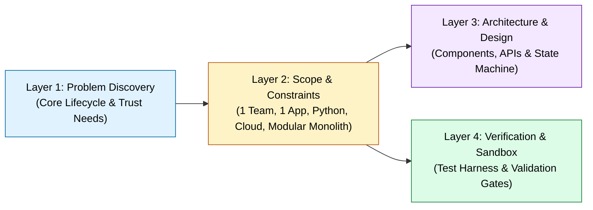
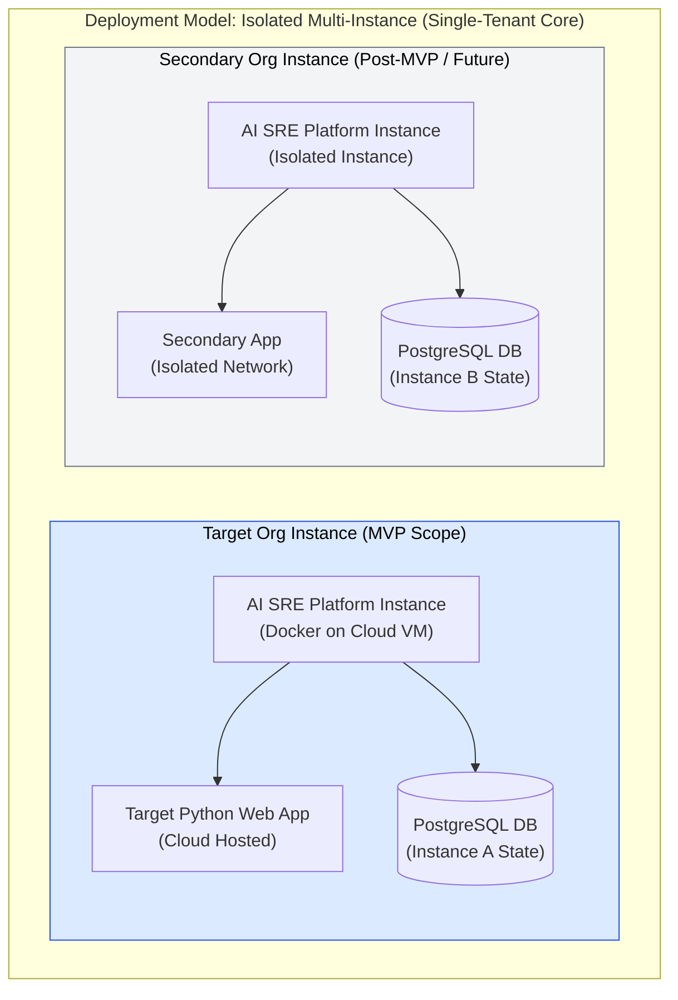
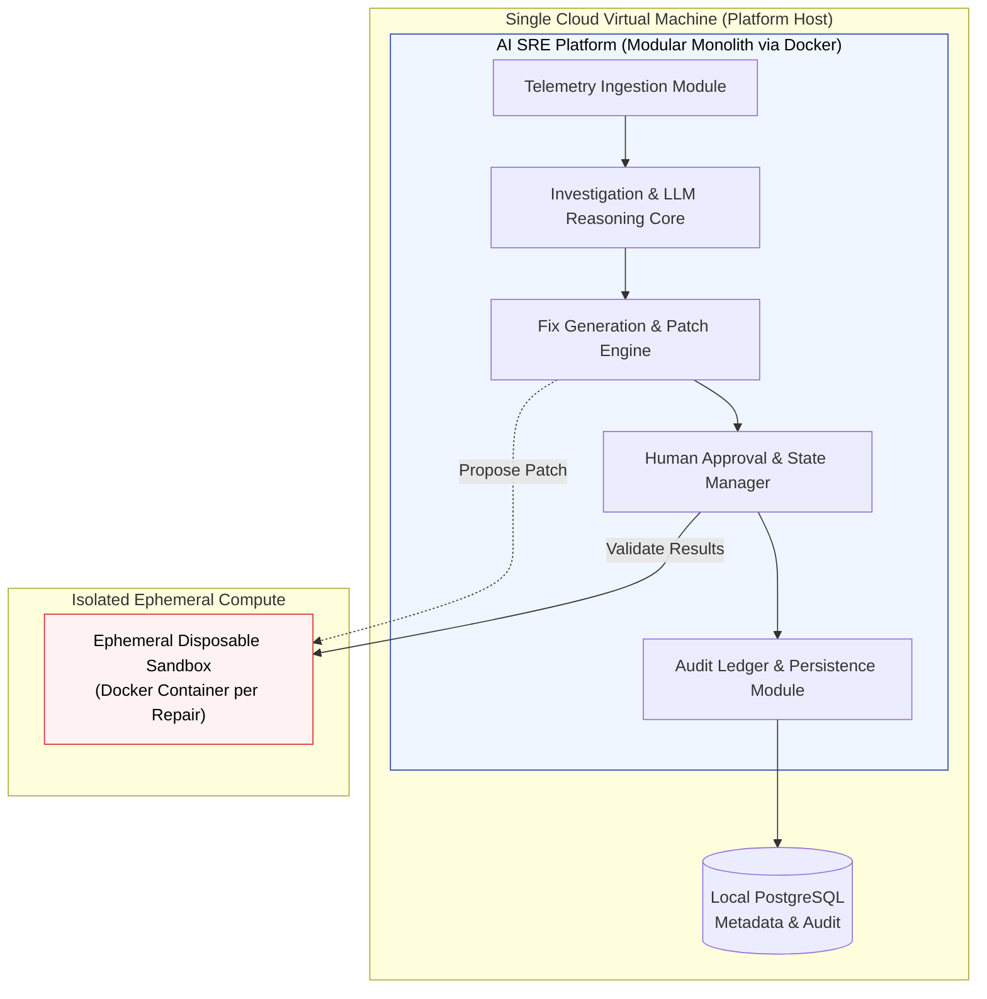
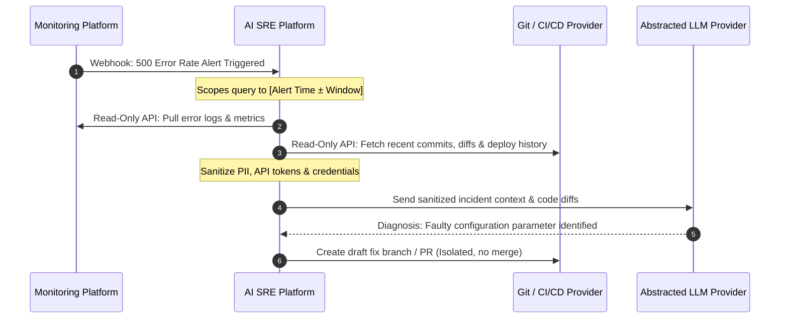
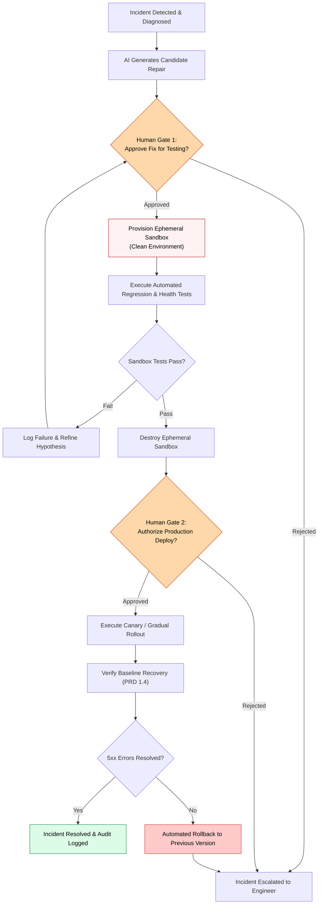
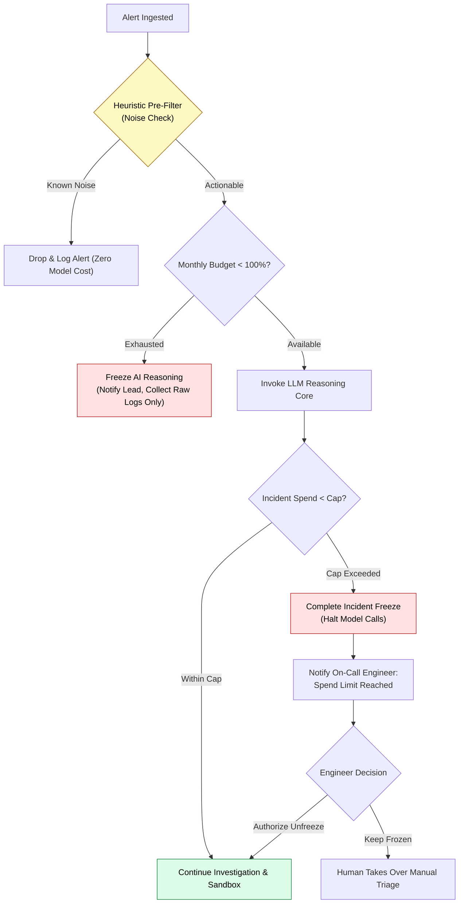
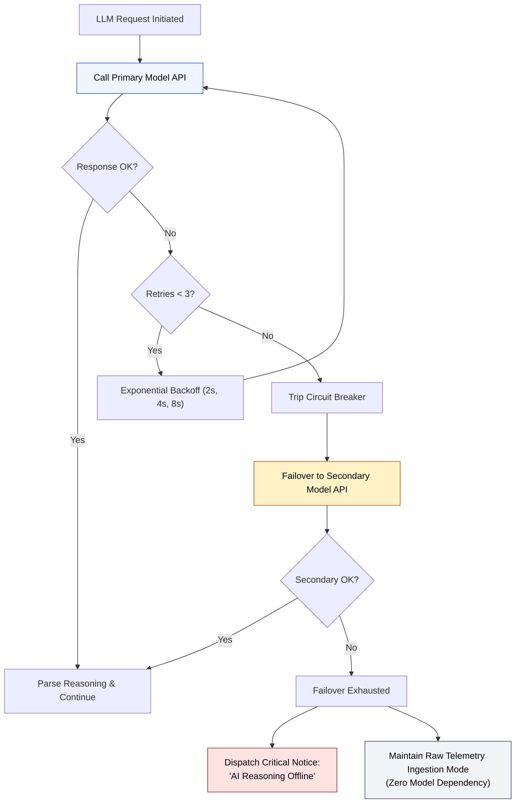

# AI SRE Platform — Artifact 2: Scope & Constraints Document

**Layer 2 — Scope & Constraints** · Built from: [Artifact 1: Product Requirements Document](file:///c:/Users/diwas/OneDrive/Documents/ai-sre/artifacts/product_requirement.md) · *Approved specifications compiled from team discussions, Claude & ChatGPT evaluations, and the Layer 2 Conversation Log*

---

## Executive Summary & Layer Alignment

Layer 1 established the problem: incident investigation is manual, slow, fragmented across silos, and dependent on tacit human judgment. 

**Layer 2 establishes the strict boundaries, architectural constraints, and operational limitations** for the 6-month Minimum Viable Product (MVP). The overarching principle governing Layer 2 is **narrow depth over broad breadth**: validating the end-to-end incident lifecycle (detection $\rightarrow$ diagnosis $\rightarrow$ fix proposal $\rightarrow$ human approval $\rightarrow$ sandbox verification $\rightarrow$ recovery) on a tightly controlled environment before attempting enterprise-wide generality.

---

## Reference Scenario Anchor

Every boundary, technology selection, and constraint in this document is anchored to the reference scenario defined in Layer 1:

1. **Target Organization:** Operates a production Python web application.
2. **Trigger Event:** An automated deployment executes, changing a configuration parameter.
3. **Failure Mode:** The application starts returning HTTP 500 errors.
4. **Detection:** The existing monitoring platform detects elevated 5xx error rates and triggers an alert.
5. **Resolution Goal:** Diagnose the root cause to the configuration diff, test a candidate repair in an isolated sandbox, obtain human sign-off, deploy, and verify recovery against baseline metrics.

---

## 2.1 Deployment Scope & Tenancy Topology

*Answers: Q2.1, Q2.3, Q2.13*

### Boundaries & Constraints

* **Single Organization, Single Team:** For the MVP, the platform will be deployed within **one organization** and serve **one engineering team** responsible for the reference Python application. Cross-organization and cross-team multi-tenancy are strictly out of scope.
* **Cloud-Hosted Deployment:** The platform itself and its target application will reside on **public cloud infrastructure**. On-premise datacenter deployments are out of scope for the MVP due to 6-month budget and networking constraints.
* **Single-Tenant Architecture (Multi-Instance Model):** 
  * The platform software is designed as **single-tenant**. A single running instance serves exactly one team and one application context.
  * Shared-cluster multi-tenancy (where multiple companies or teams share databases, background workers, and memory) is **prohibited for the MVP** to prevent cross-tenant data leakage and complex RBAC overhead.
  * If a secondary team or organization tests the platform, they will be provisioned a **completely isolated server instance (Multi-Instance)**.
* **Architectural Forward-Hygiene:** All internal database records, logs, and RAG knowledge vectors will be tagged with an `organization_id` from day one, ensuring future logical database partitioning requires no schema rewrite.

---

## 2.2 Technical Ecosystem & Infrastructure Scope

*Answers: Q2.2, Q2.9, Q2.10*

### Boundaries & Constraints

* **Supported Programming Languages:** **Python only** (specifically modern Python 3.11+). Non-Python services (Java, .NET, Node.js, Go) and cross-language distributed microservices are out of scope.
* **Configuration Formats:** First-class support for configuration file structures used in the reference scenario: **YAML, JSON, `.env` files, and standard environment variables**.
* **Application Architecture (Modular Monolith):** The platform is architected as a **Modular Monolith**—a single deployable codebase featuring clean internal module boundaries (Ingestion, Investigation, Reasoning, Fix Generation, Human Approvals, Audit). Distributed microservices are rejected to prevent distributed tracing overhead and networking latency.
* **Platform Hosting (No Kubernetes for Platform):** 
  * Kubernetes orchestration for hosting the AI SRE platform is **strictly out of scope for the MVP**. 
  * The platform runs as lightweight **Docker containers on a single cloud Virtual Machine (VM)** via Docker Compose.
  * All platform modules are containerized from day one to ensure zero-effort migration to Kubernetes if post-MVP scaling demands it.
* **Monitored App Infrastructure:** Whether the target application runs on Kubernetes or a VM does not alter the platform's hosting; if the target app runs on K8s, the platform interacts with it purely via read-only APIs.

---

## 2.3 Telemetry, CI/CD & Data Access Constraints

*Answers: Q2.4, Q2.5, Q2.6*

### Boundaries & Constraints

* **Single Monitoring Tool Integration:** The platform will integrate with **exactly one existing monitoring tool** used by the target application team (e.g., Datadog or Prometheus). Building a replacement monitoring system is out of scope.
* **Dual Monitoring Integration Points:**
  1. *Incident Intake:* Ingesting alerts via inbound webhook.
  2. *Recovery Verification:* Querying metric timeseries post-fix to verify recovery against historical baselines (PRD 1.4).
* **Strict Least-Privilege & Read-Only Access:**
  * Investigation access is **strictly read-only** via a dedicated service account.
  * Queries are bounded strictly to the target application service and the incident time window ($t_{\text{alert}} - 30\text{m}$ to $t_{\text{alert}} + 15\text{m}$) to prevent runaway commercial API egress charges.
* **Source Code & CI/CD Integrations:**
  * Integration is restricted to **one Git repository manager and one automated CI/CD pipeline** (e.g., GitHub & GitHub Actions).
  * Manual deployments are **strictly out of scope**.
  * The platform correlates deployment completion timestamps and commit SHAs with error spikes.
* **Write Permissions Boundary:** Investigation is strictly read-only. Write permissions are restricted exclusively to creating **isolated candidate fix branches and draft Pull Requests** for sandbox evaluation—never direct pushes or automated merges to production/main branches.
* **Data Sanitization & Privacy:** All logs, stack traces, and configurations pulled by the platform pass through an automated **PII and secrets scrubbing filter** before being exposed to LLM reasoning modules. Every query is logged in an immutable audit ledger.

---

## 2.4 Testing, Sandboxing & Safety Guardrails

*Answers: Q2.7, Q2.14*

### Boundaries & Constraints

* **Dataset Progression Strategy:**
  1. *Phase 1 (Development & Benchmarking):* 100% **reproducible synthetic fixtures** modeling the reference scenario (containerized Python web app with programmatic traffic generator and injected configuration faults).
  2. *Phase 2 (Pre-Deployment Validation):* Replaying **sanitized historical incidents** provided by the partner organization with customer data, internal IPs, and credentials scrubbed.
  3. *Production Testing:* Live unsupervised production incident testing is strictly forbidden.
* **Ephemeral Disposable Sandbox:**
  * Every candidate repair generated by the AI is built and tested in a **fresh, isolated Docker container** provisioned on demand and destroyed immediately after testing.
  * **Zero Production Connectivity:** Sandboxes have zero network routes to production databases and zero access to production secrets/credentials.
* **The Two-Gate Human Approval Workflow:**
  * In strict compliance with PRD 1.3 and 1.5, the platform operates under **two mandatory human-in-the-loop gates**. The AI cannot merge code or deploy autonomously.

---

## 2.5 User Interface & Interaction Boundaries

*Answers: Q2.8*

### Boundaries & Constraints

* **Core HTTP API First:** All platform capabilities (incident intake, investigation status, diagnostic logs, fix generation, and approval triggering) are exposed via a clean REST/HTTP API.
* **Lightweight Single-Page Web UI:** The primary stakeholder and responder interface is a **single-page operational dashboard** dedicated solely to active incident execution. It displays:
  * Incident timeline and affected service topology.
  * Root-cause diagnosis with clickable links to underlying evidence sources.
  * **Interactive Human Approval Action Center** (One-click buttons for Gate 1 and Gate 2).
  * Verification status against baseline metrics and audit ledger trail.
* **Out-of-Scope UI Features:** Custom BI report builders, long-term multi-quarter analytics, drag-and-drop dashboard customizers, and complex multi-org user administration.
* **Role of the CLI:** Command Line Interfaces are an **optional, non-blocking convenience ("may use")** for internal developer debugging, not a mandatory deliverable.
* **Contingency UI Fallback Ladder:**
  $$\text{Interactive Single-Page Web UI} \longrightarrow \text{Minimal Static Status Viewer} \longrightarrow \text{API-Only (OpenAPI / Swagger)}$$

---

## 2.6 AI Model Architecture & Economic Bounds

*Answers: Q2.11, Q2.12, Q2.15, Q2.16*

### Boundaries & Constraints

* **No Custom Model Training:** Training a model from scratch or fine-tuning weights is strictly out of scope for the MVP. The platform leverages **existing general-purpose commercial/open-source foundation models** via a decoupled connector.
* **Domain Adaptation via Prompting & RAG:** Organization-specific context (runbooks, architecture docs, postmortems) is provided purely via prompt engineering and Retrieval-Augmented Generation (RAG).
* **Zero Owned GPU Hardware:** Physical GPU purchasing (CapEx) is strictly rejected. The platform consumes pay-per-use hosted model APIs. If corporate data policies forbid external SaaS LLMs, the platform will rent on-demand cloud GPUs (e.g., AWS EC2 GPU / Lambda) to self-host an open-source model (e.g., Llama 3).
* **Monthly Infrastructure Spending Cap:**
  * Management defines a monthly budget cap.
  * Automated alerts trigger at **30%, 50%, and 80%** of budget consumption.
  * **At 100% budget consumption:** The platform **does not go dark**. It continues ingesting alerts and collecting raw evidence, but **automatically freezes expensive LLM reasoning and sandbox provisioning** until an administrator authorizes an emergency budget override.
  * All sandbox containers enforce an automatic TTL (Time-To-Live) of 30 minutes to prevent zombie compute charges.
* **Per-Incident Expenditure Freeze & Human Authority:**
  * Every incident investigation is subject to a hard token/cost ceiling.
  * **The Human Economic Benchmark:** The platform **must cost less money and take less time than a human engineer** handling the same incident.
  * **The Freeze Guardrail:** If an investigation reaches the per-incident limit, the system **completely freezes further model calls**.
  * **Human Authority:** An immediate priority notification is dispatched to the on-call engineer, who possesses the explicit authority to either **keep the investigation frozen** or **authorize an override unfreeze**.

---

## 2.7 Concurrency, Performance & Fault Tolerance

*Answers: Q2.17, Q2.18, Q2.19*

### Boundaries & Constraints

* **Concurrency Capacity (3 Concurrent Incidents):** Sized for an initial baseline of **3 simultaneous active incident investigations**.
* **Alert Deduplication & Storm Grouping:** Cascading alerts occurring within the same 10-minute window and pointing to the same deployment or service topology are automatically collapsed into a single incident entity to prevent model thrashing.
* **Concurrency Overflow:** Excess incidents beyond 3 are queued in a priority queue (P1 critical outages bypass P3 warnings), and on-call engineers are alerted immediately.
* **Investigation Time Limits (Human MTTR Benchmark):**
  * The platform's operational goal is to **decisively beat the historical human engineer triage duration**.
  * **Staged Timeouts:**
    1. *Initial Evidence Digest:* Delivered within **< 2 minutes** of alert intake.
    2. *Total Investigation Ceiling:* Capped at **15 minutes** (including sandbox test runs).
  * **Graceful Timeout Handover:** If the 15-minute timer expires, the platform executes an automated handover to the on-call engineer, providing all gathered evidence, hypotheses evaluated, unverified questions, and a confidence score.
* **Model Provider Fault Tolerance (Circuit Breaker):**
  * If the primary model API fails: execute 3 retries with exponential backoff ($2\text{s}, 4\text{s}, 8\text{s}$).
  * If retries fail: trip the circuit breaker and failover to a configured secondary approved model provider (e.g., Anthropic Claude $\longleftrightarrow$ OpenAI GPT).
  * **Never Fail Silently:** If all model providers are down, dispatch an urgent critical alert to responders stating automated reasoning is offline, while background telemetry ingestion continues uninterrupted.

---

## 2.8 Persistence & Governance Architecture

*Answers: Q2.20, Q2.21, Q2.22, Q2.23*

### Boundaries & Constraints

* **Primary Datastore (PostgreSQL):** PostgreSQL is selected as the relational database for platform lifecycle state: incident logs, evidence references, approval states, and audit trails. Raw high-volume telemetry remains in upstream tools.
* **Storage Abstraction:** All persistence is encapsulated behind a strict repository pattern, ensuring datastore migrations require zero modifications to core business logic.
* **The 5 Architecture-Invalidating Assumptions:** The architecture explicitly distinguishes between swappable implementation components vs. foundational assumptions whose failure breaks the system:

| Invalidation Risk | Critical Architectural Assumption | Failure Consequence | Early Validation Test (Day 1–30) |
|---|---|---|---|
| **1. Data Access** | Organization grants read-only API access to logs, metrics, deploy history, and code. | Automated diagnosis is completely impossible. | Query 1 real service's logs and commit history via test service account. |
| **2. Sandbox Fidelity** | Ephemeral sandbox can reproduce the application runtime and config error. | Candidate fixes tested in sandbox prove nothing about production safety. | Replay 1 past configuration failure in container and verify error triggers. |
| **3. Model Feasibility** | At least one model satisfies accuracy, cost ceiling, and privacy constraints together. | The platform cannot reason or violates enterprise data compliance. | Benchmark reference scenario prompt against candidate LLMs. |
| **4. Human Responsiveness**| Human approvers respond to approval notifications within SLA. | Incidents stall indefinitely at Gate 1 or Gate 2. | Establish agreed responder escalation protocol and test notification delivery. |
| **5. Rollback Safety** | The application supports metric baselining and automated clean rollback. | Automated recovery verification cannot be guaranteed. | Verify monitoring tool provides baseline historical queries and CI/CD supports rollbacks. |

---

## 2.9 Traceability Matrix: Worksheet Questions to Artifact Sections

| Worksheet Question | Layer 2 Scope & Constraints Section | Primary Architectural Decision / Constraint |
|---|---|---|
| **Q2.1: Deployment Scope** | § 2.1 Deployment Scope & Tenancy | 1 organization, 1 engineering team, 1 target application. |
| **Q2.2: Programming Languages** | § 2.2 Technical Ecosystem & Runtime | Modern Python (3.11+) and standard config formats (YAML/JSON/.env). |
| **Q2.3: Deployment Environments** | § 2.1 Deployment Scope & Tenancy | Public cloud hosted; private datacenter hosting is out of scope. |
| **Q2.4: Monitoring Integrations** | § 2.3 Telemetry, CI/CD & Data Access | 1 existing monitoring tool; dual use for intake & recovery verification. |
| **Q2.5: Telemetry Access** | § 2.3 Telemetry, CI/CD & Data Access | Dedicated read-only service account; PII/secrets sanitization. |
| **Q2.6: Source & CI/CD Access** | § 2.3 Telemetry, CI/CD & Data Access | 1 Git repo & 1 CI/CD tool; read-only triage; manual deploys out of scope. |
| **Q2.7: Incident Datasets** | § 2.4 Testing, Sandboxing & Safety | Phase 1 synthetic fixtures; Phase 2 sanitized real incident replays. |
| **Q2.8: User Interfaces** | § 2.5 User Interface Boundaries | Core HTTP API + single-page Web UI; CLI is optional convenience. |
| **Q2.9: Kubernetes Scope** | § 2.2 Technical Ecosystem & Runtime | Kubernetes out of scope for platform hosting; Docker Compose on single VM. |
| **Q2.10: Application Architecture**| § 2.2 Technical Ecosystem & Runtime | Modular Monolith codebase; test sandbox is only isolated compute. |
| **Q2.11: Custom AI Models** | § 2.6 AI Model Architecture & Economics | No custom model training/fine-tuning; foundation models via RAG/prompts. |
| **Q2.12: GPU Infrastructure** | § 2.6 AI Model Architecture & Economics | Zero owned physical GPUs; pay-per-use APIs; rented cloud GPUs if needed. |
| **Q2.13: Multi-Tenancy** | § 2.1 Deployment Scope & Tenancy | Shared multi-tenancy out of scope; isolated multi-instance model. |
| **Q2.14: Disposable Sandbox** | § 2.4 Testing, Sandboxing & Safety | Ephemeral containers; zero prod route; mandatory two-gate approval. |
| **Q2.15: Spending Bounds** | § 2.6 AI Model Architecture & Economics | Monthly budget cap; 30/50/80% alerts; freeze heavy compute at 100%. |
| **Q2.16: Cost Per Incident** | § 2.6 AI Model Architecture & Economics | Complete freeze at limit; human unfreeze authority; beats human benchmark. |
| **Q2.17: Concurrent Incidents** | § 2.7 Concurrency & Fault Tolerance | Baseline 3 concurrent incidents; storm alert deduplication & queueing. |
| **Q2.18: Investigation Timeout** | § 2.7 Concurrency & Fault Tolerance | Must beat human MTTR; <2 min digest, 15 min total limit; handover on timeout. |
| **Q2.19: Provider Unavailability**| § 2.7 Concurrency & Fault Tolerance | 3 retries $\rightarrow$ circuit breaker $\rightarrow$ secondary model failover; never fail silent. |
| **Q2.20: Requirements vs Assumptions**| § 2.8 Persistence & Governance | Formal register; fixed = non-negotiable safety; assumptions = owned tests. |
| **Q2.21: PostgreSQL Decision** | § 2.8 Persistence & Governance | PostgreSQL for relational platform state; abstracted behind repository. |
| **Q2.22: Invalidation Risks** | § 2.8 Persistence & Governance | 5 core architecture-invalidating dependencies tracked & prioritized. |
| **Q2.23: Decision Records (ADRs)**| § 2.8 Persistence & Governance | Lightweight ADR & Assumption Register in Git with explicit lifecycles. |

