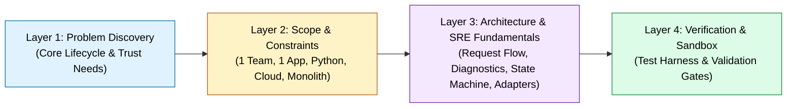
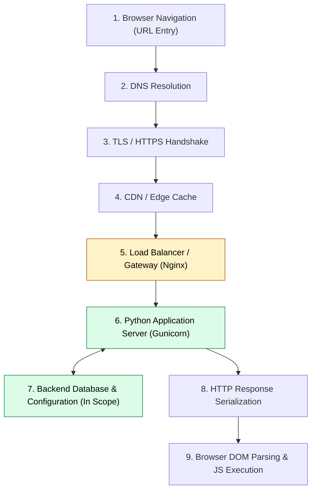
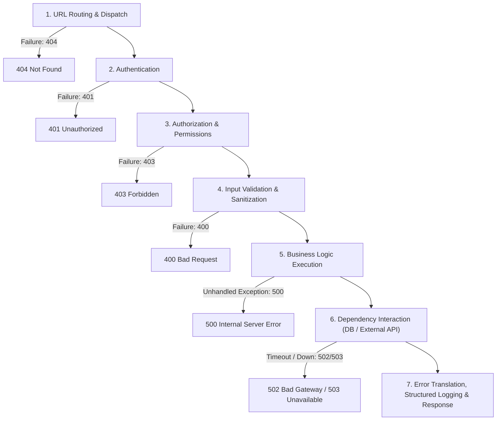
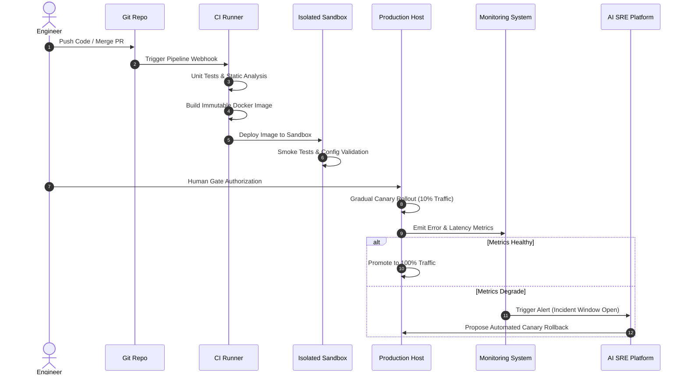
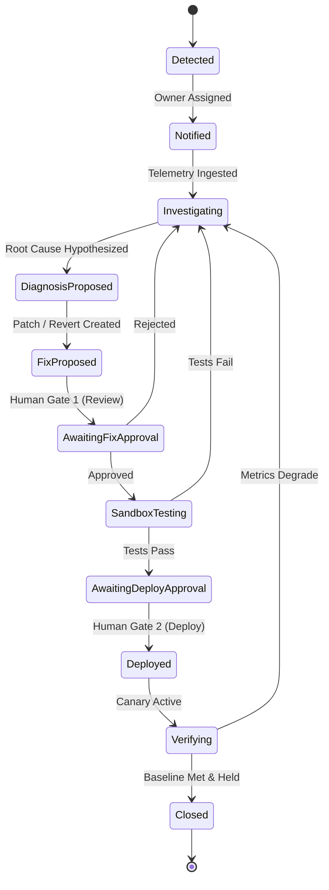
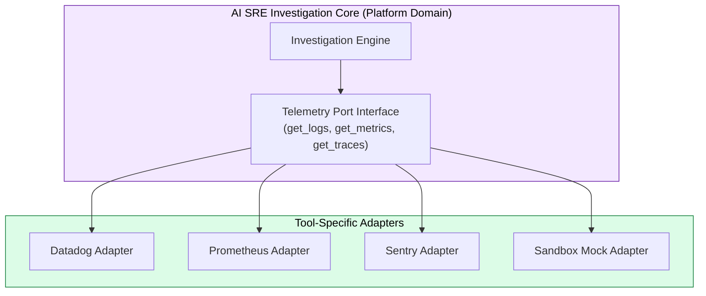

# AI SRE Platform — Artifact 3: SRE Fundamentals & Systems Architecture

**Layer 3 — SRE Fundamentals & Operational Architecture** · Built from: [Artifact 1: Product Requirements Document](file:///c:/Users/diwas/OneDrive/Desktop/Projects/ai-sre/artifacts/product_requirement.md) and [Artifact 2: Scope & Constraints](file:///c:/Users/diwas/OneDrive/Desktop/Projects/ai-sre/artifacts/scope_and_constraints.md) · *Approved specifications compiled from team discussions, Claude & ChatGPT evaluations, and the Layer 3 Conversation Log*

---

## Executive Summary & Layer Alignment

Layer 1 defined the core incident investigation lifecycle, trust requirements, and human approval gates.  
Layer 2 established the strict operational boundaries for the 6-month Minimum Viable Product (MVP): one engineering team, one cloud-hosted Python application, read-only telemetry, and single-tenant architecture.

**Layer 3 establishes the architectural, operational, and diagnostic fundamentals** that govern how the AI SRE platform interacts with production applications. It defines:
1. The **exact request journey** and where the platform's diagnostic authority begins and ends.
2. The **mechanics of failure**: distinguishing outages from latency degradation, memory leaks from traffic bursts, and correlation from causation.
3. The **systematic investigation protocol**: hypothesis-driven reasoning, ordered evidence collection, and the 11-state incident machine.
4. The **vendor-neutral integration fabric**: standardizing on OpenTelemetry, W3C headers, and the Ports & Adapters pattern.



---

## Required Sections Compliance Checklist

| Architecture Domain | Questions Answered | Primary Focus in this Document |
| :--- | :--- | :--- |
| **§ 1. Request Journey & Boundaries** | Q3.1, Q3.4, Q3.5 | Standard 9-step request flow, gateway ingress, and durable persistence vs session state. |
| **§ 2. Concurrency & Resource Saturation** | Q3.2, Q3.23, Q3.24, Q3.25 | Worker load shedding, CPU run queue/load average, memory leak slopes, and queue lag metrics. |
| **§ 3. Request Lifecycle & Error Taxonomy** | Q3.3, Q3.10, Q3.11, Q3.18, Q3.21 | 7-stage internal pipeline, 5xx clue rule, 40% partial failure clustering, and p95/p99 latency. |
| **§ 4. Deployment Pipeline, Regression & Rollback** | Q3.6, Q3.7, Q3.8, Q3.14, Q3.26, Q3.27 | 4-phase canary pipeline, Git Bisect, config diff isolation, safe rollback sequence, and causation proof. |
| **§ 5. Incident Lifecycle & State Machine** | Q3.9, Q3.13, Q3.15, Q3.16 | 5 pre-filter declaration triggers, Two-Track resolution, PRD 11-state machine, and escalation ledger. |
| **§ 6. Observability Telemetry Standards** | Q3.17, Q3.19, Q3.20, Q3.28, Q3.29, Q3.30 | JSON structured logs, OpenTelemetry + W3C context propagation, dual-role telemetry, and dashboard UX. |
| **§ 7. Investigation Engine & Adapter Architecture** | Q3.12, Q3.31, Q3.32, Q3.33, Q3.34, Q3.35, Q3.36, Q3.37 | Hypothesis-driven loop, Ports & Adapters, ordered evidence gathering, resilience, and stop conditions. |

---

## § 1. The Request Journey & Architectural Boundaries

### 1.1 The Standard 9-Step Request Flow
To prevent fragmented triage during an incident, all platform components adhere to a standardized 9-step map of request execution.



### 1.2 Diagnostic Scope (Layer 2 Guardrails)
* **In-Scope for Automated Diagnosis (Steps 5–7):** The platform analyzes gateway logs, Python runtime exceptions, environment configurations (`.env`, YAML, JSON), and database connection telemetry accessed via the read-only monitoring tool.
* **Out-of-Scope (Steps 1–4, 9):** Client-side JavaScript bundle crashes, DNS propagation delays, CDN cache poisoning, and expired TLS certificates. If telemetry demonstrates that a failure resides in these outer tiers, the platform logs:  
  `"Failure point outside MVP diagnostic boundary (Client/Edge Tier)"` and immediately escalates to a human on-call engineer without guessing.
* **The "Blank Screen" Symptom:** A blank screen indicates that a response arrived but was empty, malformed, or unhandled. In the **Reference Scenario**, a deployment changes a configuration parameter, causing the Python application to throw an unhandled exception (HTTP 500); if the client frontend lacks an error boundary, this manifests as a blank screen.

### 1.3 Ingress & State Separation
* **External Communication Component (Q3.4):** The **API Gateway / HTTP REST API Layer** is the sole communication interface exposed to external clients (monitoring webhooks, UI dashboard, CI/CD runners, and optional CLI). Direct access to internal modules or the database is strictly blocked.
* **Persistence Hierarchy (Q3.5):**
  1. *Database (PostgreSQL):* Manages permanent customer records, system state, and incident history across application restarts.
  2. *Session Store (Memory/Redis):* Manages temporary interaction tokens during active user browsing; volatile across restarts.
  3. *Browser Cookie:* Stores client-side session tokens; never stores durable profile data.

---

## § 2. Concurrency, Load & Resource Saturation

### 2.1 Component Responsibilities Under High Load (Q3.2)
1. **Load Balancer:** Evenly distributes traffic across healthy application replicas; instantly evicts nodes failing active health checks.
2. **Python Application Workers:** Run bounded concurrent worker pools; enforce request timeouts; shed excess load with graceful `HTTP 503 Service Unavailable` responses rather than crashing.
3. **Database & Connection Pooling:** Implements connection pool ceilings to protect against thread starvation; utilizes indexes to bound query duration.
4. **Asynchronous Background Queue:** Offloads long-running tasks (reports, email delivery) to workers so HTTP web threads remain responsive.
5. **Rate Limiting:** Throttles abusive requests at the gateway before they consume application resources.

### 2.2 CPU Saturation vs. High Utilization (Q3.23)
* **The Saturation Rule:** CPU utilization reaching 85% is not inherently an incident. Saturation occurs when runnable tasks exceed available cores, causing requests to queue.
* **Diagnostic Signature:**
  $$\text{Load Average (1m, 5m, 15m)} > \text{Available CPU Cores} \quad \text{AND} \quad \text{CPU Run Queue Length} \gg 0$$
* **Container Throttling:** For containerized workloads, check `container_cpu_cfs_throttled_periods_total`. A process capped by its cgroup limit causes latency spikes even when host CPU is idle.

### 2.3 Memory Exhaustion, Leaks & Fixed Container Limits (Q3.24)
* **The Container Memory Myth:** Docker containers **do not auto-scale memory**. Container memory limits (`mem_limit`) are hard ceilings set at provisioning.
* **Diagnostic Signatures:**
  1. *Memory Leak Pattern:* A monotonic, steady upward slope in memory consumption over hours during stable traffic.
  2. *Garbage Collection Strain:* High GC pause frequency and prolonged pause durations as the runtime struggles to reclaim objects.
  3. *Swap Disk Activity:* Rapid escalation in swap usage as the OS pages memory to disk—this is the final leading indicator before a crash.
  4. *OOM Kill Termination:* Linux kernel invokes the Out-Of-Memory killer (`SIGKILL`), causing container exit code 137 and restart loops.

### 2.4 Background Queue Backpressure (Q3.25)
* **Queue Lag Metric:** While Queue Depth (total pending items) indicates backlog size, **Oldest Job Age** measures true SLA breach.
* **Backpressure Threshold:** If $\text{Enqueue Rate} > \text{Dequeue Rate}$ persistently and Oldest Job Age exceeds threshold $T_{\text{max}}$, the platform alerts on worker starvation.

---

## § 3. Request Lifecycle & Error Taxonomy

### 3.1 The 7-Stage Internal Application Pipeline (Q3.3)
When an HTTP request enters the Python application server, it must clear sequential checkpoints. A failure at any stage halts downstream execution:



### 3.2 Error Classification & The 5xx Clue Rule
* **4xx vs. 5xx Ownership:** 4xx errors reflect client-side protocol or input errors (the request was rejected). 5xx errors reflect server-side processing failures on an acceptable request.
* **The 5xx Misconception:** An HTTP 500 is a symptom, **never immediate proof of a configuration bug**. While our Reference Scenario involves a configuration error, 500s can originate from database connection exhaustion, unhandled code exceptions, deadlocks, or bad third-party payloads. The platform treats 5xx status codes as **diagnostic clues, never conclusions**.
* **MVP Scope Restriction:** Automated investigation in the MVP is restricted to **5xx server errors**. 4xx error surges (e.g., auth configuration failures) and network drops are escalated to human engineers.

### 3.3 Partial Failures vs. Complete Outages (Q3.10)
* **Verification Matrix:**
  * *Complete Outage:* Overall error rate is 100%; health checks (`/health`) fail; all endpoints return errors uniformly.
  * *Partial Failure / Degraded State:* Error rate is $<100\%$ (e.g. 40%); `/health` responds 200 OK; errors are **clustered** along specific endpoints (e.g. `/checkout` failing while `/catalog` succeeds) or specific geographic regions.

### 3.4 Latency Degradation Incidents (Q3.11, Q3.21)
* **Severity Characterization:** An 80x latency jump (100 ms $\rightarrow$ 8 seconds) is categorized as a **High-Severity Latency Incident**. Even with a 0% HTTP error rate, the application is functionally unusable due to client timeouts and user abandonment.
* **Percentile Standard:** Mean (average) latency is prohibited for SLA tracking because it conceals outlier spikes. The platform monitors:
  * **p50 (Median):** Typical user experience.
  * **p95:** Experience for 95% of traffic.
  * **p99:** Tail latency (worst 1% of transactions)—the primary leading indicator of systemic degradation.

---

## § 4. Release Pipeline, Regression Isolation & Rollback

### 4.1 The 4-Phase Canary Release Sequence (Q3.6)
To satisfy Layer 2.6 and Layer 2.14, every production release must follow a controlled four-phase lifecycle:



### 4.2 Configuration vs. Application Code Isolation (Q3.7)
In the Reference Scenario, source code is identical between builds, but behavior changes due to an environment variable change. The platform isolates this via a 4-step protocol:
1. **Diff Configuration:** Ingest old vs. new environment values from the CI/CD deployment webhook.
2. **Correlate Timestamp:** Verify error rate spiked at the precise second the configuration was applied while code commit remained identical.
3. **Inspect Stack Traces:** Confirm log traces directly reference the modified configuration key (e.g., connection timeout or database URL).
4. **Controlled Sandbox Revert:** Revert the variable in the isolated test sandbox; if health metrics recover, causality is proven.

### 4.3 Systematic Regression Isolation & Git Bisect (Q3.8)
When a deployment bundles multiple commits and introduces a failure:
* *Small Release (1–2 commits):* Inspect the diff directly against log stack traces.
* *Large Release (Many commits):* Execute an automated **Git Bisect** routine within the test sandbox, performing a binary search between the last known good commit and the current release until the breaking commit is isolated.

### 4.4 Automated 5-Step Canary Rollback (Q3.14)
* **The Layer 2 Assumption 5 Guardrail:** Automated rollback is an architecture-breaking assumption that must be validated in Sprint 3 (ADR-06).
* **Rollback Protocol:**
  1. *Identify Baseline:* Retrieve commit SHA and deployment ID of previous stable release.
  2. *Trigger via CI/CD:* Issue rollback deployment via pipeline API (never manual file editing).
  3. *Human Gate Authorization:* Single-gate human approval authorizes the rollback execution.
  4. *Canary Rollback:* Shift traffic gradually (10% $\rightarrow$ 50% $\rightarrow$ 100%) to verify error recovery.
  5. *Verify Recovery:* Compare error rates and p95 latency against pre-incident baselines before closing.

### 4.5 Proving Causation vs. Mere Correlation (Q3.27)
Simultaneous timing between a deploy and an error surge is a hypothesis, not proof. To confirm causation:
1. Error logs must explicitly cite a modified code line or configuration key.
2. Errors must begin precisely at deployment completion (not before).
3. Sandbox rollback must successfully restore baseline health.
4. Third-party factors (traffic spikes, external vendor outages) must be ruled out.

---

## § 5. Incident Lifecycle & State Machine

### 5.1 Deterministic Incident Declaration Triggers (Q3.9)
Before invoking expensive LLM reasoning, the platform executes a lightweight, zero-cost pre-filter. An incident is declared only if at least one condition is met:
1. **User Impact:** $>5\%$ of active users experiencing failed requests.
2. **Critical Function Broken:** Core business pathways down (authentication, billing/payments).
3. **Complete Unavailability:** Application returns 0 successful responses.
4. **Security / Compliance Breach:** Exposure of sensitive customer data or active compliance violation.
5. **SLA Breach:** Response duration or downtime exceeds contractual commitments.

### 5.2 Two-Track Incident Resolution (Q3.13)
Once root cause is identified, the team executes two tracks in parallel:
* **Track A: Immediate Service Mitigation (Stop the Bleeding):** Fast canary rollback, environment variable revert, or feature-flag disablement to restore user availability.
* **Track B: Permanent Root-Cause Repair:** Develop a clean code/config patch on a sandbox branch, run regression tests, obtain human approval, and deploy.
* **The Closure Rule:** *"Service Restored"* (Track A) and *"Incident Closed"* (Track B) are separate states. The incident remains open until Track B verifies baseline recovery.

### 5.3 The PRD 11-State Incident Machine (Q3.15)
Every incident progresses through an authoritative state machine stored in an append-only PostgreSQL database table (Layer 2.21):



### 5.4 Escalation Triggers & Handoff Contract (Q3.16)
The AI SRE platform acts as the **first responder**. When it cannot resolve an incident, escalation to a human engineer is a primary product deliverable, not a failure.
* **Escalation Triggers:**
  1. *No Expertise / Inconclusive Evidence:* AI cannot confirm a hypothesis with $>70\%$ confidence.
  2. *No Access / IAM Block:* Telemetry source requires higher permissions.
  3. *Time Ceiling Reached:* Investigation reaches the 15-minute ceiling (Layer 2.18).
* **Immutable Handoff Ledger:** The platform transfers a structured handover packet containing: telemetry gathered, hypotheses tested and ruled out, missing data, and reason for stopping. The incoming engineer never repeats already-completed work.

---

## § 6. Observability Telemetry Standards

### 6.1 Structured Event Logging Standard (Q3.17)
All application events must emit structured JSON containing 8 mandatory fields:
```json
{
  "timestamp": "2026-11-23T13:45:00.123Z",
  "log_level": "ERROR",
  "service_name": "payment-service",
  "trace_id": "4bf92f3577b34da6a3ce929d0e0e4736",
  "span_id": "00f067aa0ba902b7",
  "user_id": "usr_anon_98234",
  "event_description": "Database query timed out during checkout execution",
  "stack_trace": "File 'db/connection.py', line 84, in execute_query\\nTimeoutError: Connection timed out",
  "context": {
    "timeout_limit_seconds": 2,
    "target_database": "orders_db"
  }
}
```

### 6.2 Logs vs. Metrics: Dual-Role Telemetry Model (Q3.20)
* **Metrics (Aggregated Counters & Rates):** Ingested in real time; pre-computed; cheap to store and query. Used for **anomaly detection, error rate alerting, and SLA verification**.
* **Logs (Discrete Event Records):** Detailed, line-by-line execution context; expensive to scan across historical windows. Used for **root-cause diagnosis and stack trace inspection**.

### 6.3 Distributed Tracing: OpenTelemetry & W3C Context (Q3.19, Q3.30)
* **Instrumentation SDK:** Applications standardize on **OpenTelemetry**.
* **Context Propagation:** Services must forward the **W3C Trace Context** header (`traceparent`) on all outbound HTTP calls:
  `traceparent: 00-4bf92f3577b34da6a3ce929d0e0e4736-00f067aa0ba902b7-01`
* **Journey Reconstruction:** Querying the shared `trace_id` reconstructs the multi-service dependency graph, isolating the exact hop where latency spiked or an error occurred.

### 6.4 Metrics Collection & Dashboard Architecture (Q3.28, Q3.29)
* **5 Core Metrics Engine Responsibilities:** 1. Instrument code, 2. Collect measurements, 3. Store time-series data, 4. Expose query API (PromQL/REST), 5. Evaluate alert rules continuously.
* **Dashboard Capabilities:** Implements Layer 2.8 Web UI featuring time-series graphs, host CPU/RAM timelines, zoomable pre/post deploy windows, service filters, active incident state machine status, and one-click drill-down to underlying traces.

---

## § 7. Investigation Engine & Integration Architecture

### 7.1 Hypothesis-Driven Investigation Loop (Q3.12)
The platform follows a rigorous 4-step scientific method:
1. **Pattern Match:** Compare active telemetry against runbooks and past incident vectors.
2. **Form Hypothesis:** Formulate a specific failure hypothesis with an explicit **Confidence Score** (e.g. *"Database connection exhaustion — 80% confidence"*).
3. **Targeted Evidence Query:** Pull the exact metric or log line required to confirm or disprove the hypothesis (e.g. query connection pool saturation).
4. **Iterate or Escalate:** If disproved, evaluate the next hypothesis. If all are disproved, declare an evidence gap and escalate to a human. Never hallucinate.

### 7.2 The Adapter Pattern / Hexagonal Architecture (Q3.32)
To preserve vendor neutrality and support sandbox testing, all external integrations implement the **Adapter Pattern (Ports and Adapters)**:


* **Swappability:** Swapping from Datadog to Prometheus requires changing an environment configuration parameter; zero core investigation logic is modified.

### 7.3 External Error Tracking Integration (Q3.31)
* **Dual Pattern:**
  1. *Webhook Push:* Real-time alert intake when an unhandled exception spikes.
  2. *REST API Pull:* On-demand, read-only extraction of stack traces and affected user counts bounded strictly to the incident window.

### 7.4 Systematic 7-Step Evidence Collection Order (Q3.33)
Evidence is gathered in a cost-optimized, cheapest-first sequence:
1. **Alert Metadata:** Service name, alert rule, trigger timestamp, severity.
2. **Deployment Record:** Commit SHA, author, code diff, config diff, deploy timestamp.
3. **Time-Windowed Metrics:** Error rate, p95 latency, and volume ($t-30\text{m}$ to $t+15\text{m}$).
4. **Error Logs:** Stack traces and failure logs within the incident window.
5. **Distributed Traces:** Spans of failing transactions.
6. **Historical Runbooks:** Past incident resolutions for LLM context.
7. **Evidence Gap Report:** Mandatory formal statement declaring missing or inaccessible telemetry.

### 7.5 Provider Outage Resilience (Q3.36)
If the monitoring provider becomes unavailable during an investigation:
1. Continue investigating using previously cached telemetry.
2. Query alternative adapters (CI/CD webhooks, Git history, error tracking APIs).
3. Dispatch an immediate alert to on-call engineers reporting the monitoring outage.
4. Explicitly state the telemetry blind spot in all generated diagnostic reports. The platform **never fails silently**.

### 7.6 Safe Stopping Conditions (Q3.37)
The platform immediately halts autonomous reasoning and escalates when:
1. **15-Minute Ceiling:** The hard time limit expires (Layer 2.18).
2. **All Hypotheses Disproved:** Evidence eliminates all plausible causes.
3. **Missing Data Inaccessible:** Crucial telemetry requires elevated permissions or is unavailable.
4. **Cost Ceiling Hit:** Incident token budget limit is reached (Layer 2.16).

---

## § 8. Layer 3 Requirements and Assumptions Register

| ID | Item Description | Type | Owner | Validation Condition & Deadline |
| :--- | :--- | :---: | :---: | :--- |
| **REQ-3.1** | Standardize on OpenTelemetry and W3C `traceparent` headers | Requirement | Tech Lead | Validated on multi-service test request in Sprint 2. |
| **REQ-3.2** | Adapter Pattern enforced for all external telemetry and CI/CD tools | Requirement | Tech Lead | Mock adapters verified in sandbox testing (Sprint 2). |
| **REQ-3.3** | 11-State Incident Machine stored in append-only PostgreSQL table | Requirement | Tech Lead | State transitions audit-verified in Sprint 2. |
| **REQ-3.4** | Bounded dual integration for error tracking (Webhook push + API pull) | Requirement | DevOps Lead | Verified against staging Sentry instance in Sprint 3. |
| **REQ-3.5** | Pre-filter drops non-qualifying alerts at \$0 LLM cost | Requirement | Tech Lead | Unit tested against 100 synthetic noisy alerts in Sprint 2. |
| **ASM-3.1** | Target application emits structured JSON logs with Request/Trace IDs | Assumption | Tech Lead | Trigger config bug on test copy; verify log output (Sprint 2). |
| **ASM-3.2** | Target CI/CD tool exposes queryable deployment diffs via webhook | Assumption | DevOps Lead | Ingest test deployment webhook payload in Sprint 3 (ADR-03). |
| **ASM-3.3** | Target application supports automated canary rollback via pipeline | Assumption | DevOps Lead | Validate 1-click rollback on staging in Sprint 3 (ADR-06). |
| **ASM-3.4** | Monitoring tool provides p50/p95/p99 latency percentiles via API | Assumption | DevOps Lead | Query Prometheus/Datadog API for latency percentiles in Sprint 3. |
| **ASM-3.5** | Target organization provides quantified SLA and user impact thresholds | Assumption | Eng Manager | Sign-off on incident declaration thresholds in Sprint 1 (ADR-04). |
