# AI SRE Platform — Artifact 6: System Architecture Document

**Layer 6 — System Architecture** · Built from: [Artifact 4: Functional & Non-Functional Requirements](file:///c:/Users/diwas/OneDrive/Desktop/Projects/ai-sre/artifacts/functional_and_non_functional_requirements.md) and [Artifact 5: Threat Modeling, Security & Failure-Mode Architecture](file:///c:/Users/diwas/OneDrive/Desktop/Projects/ai-sre/artifacts/threat_modeling.md) · *Approved specifications compiled from team transcripts, Claude & ChatGPT evaluations, the [Layer 6 Conversation Log](file:///c:/Users/diwas/OneDrive/Desktop/Projects/ai-sre/conversation%20log/layer_6_conversation_log.md), and [Architecture Decision Records (ADR-08–ADR-14)](file:///c:/Users/diwas/OneDrive/Desktop/Projects/ai-sre/adr/README.md).*

---

## Executive Summary & Layer Alignment

Layers 1–5 established the problem boundaries (single org, single team, single Python cloud web app), the deterministic 10-step operational lifecycle, strict latency/budget SLAs (`p95 <= 500 ms` intake, `15 min` diagnostic ceiling, `2 hr` incident ceiling, `\$20` / `500k` token cap), and adversarial trust boundaries (untrusted logs/LLMs/sandbox vs. deterministic platform verifiers and an isolated `AI Deployment Executor`).

**Layer 6 translates those requirements and threat controls into concrete system structure.** It defines a **Modular Monolith with Ports & Adapters** deployed from one codebase and one Docker image as **three privilege-separated runtime processes** (`api`, `worker`, `executor`) coordinated through **PostgreSQL** (business-domain state and append-only audit ledger) and **Temporal** (durable workflow execution, retries, timers, and signals).

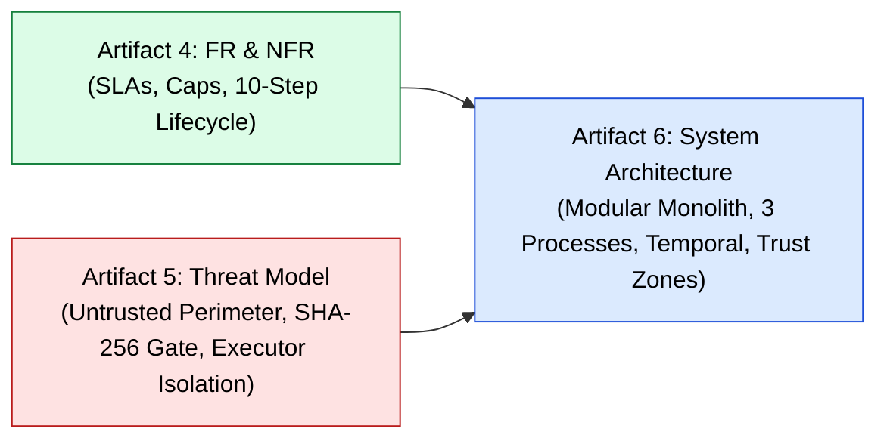

---

## Required Sections & Question Traceability Checklist

Every required section from the Layer 6 Deliverable specification is present below, and every question (`Q6.1–Q6.39`) is mapped to at least one section:

| Section | Required Deliverable | Questions Answered | Status |
| :--- | :--- | :--- | :--- |
| **§ 6.1** | Context diagram | Q6.1, Q6.9, Q6.34 | Complete |
| **§ 6.2** | Container/process diagram | Q6.1, Q6.2, Q6.3, Q6.4, Q6.8, Q6.34, Q6.35, Q6.38 | Complete |
| **§ 6.3** | Component diagram | Q6.6, Q6.7, Q6.9, Q6.10, Q6.11, Q6.12, Q6.13, Q6.14, Q6.15, Q6.16, Q6.17, Q6.18, Q6.19, Q6.20, Q6.21, Q6.22, Q6.28, Q6.34, Q6.36, Q6.38 | Complete |
| **§ 6.4** | Technology selection | Q6.23, Q6.24, Q6.25, Q6.26, Q6.27, Q6.28, Q6.29, Q6.30, Q6.31, Q6.32, Q6.33 | Complete |
| **§ 6.5** | Architecture Decision Records (ADRs) | Q6.1, Q6.3, Q6.4, Q6.5, Q6.6, Q6.7, Q6.8, Q6.9, Q6.11, Q6.16, Q6.18, Q6.23, Q6.24, Q6.26 | Complete |
| **§ 6.6** | Component ownership | Q6.3, Q6.4, Q6.6, Q6.9–Q6.22, Q6.35, Q6.38 | Complete |
| **§ 6.7** | Trust boundaries | Q6.3, Q6.12, Q6.17, Q6.18, Q6.19, Q6.30, Q6.37, Q6.39 | Complete |
| **§ 6.8** | Alternatives and trade-offs (+ Assumptions & Conflicts) | Q6.5, Q6.6, Q6.11, Q6.13, Q6.16, Q6.25, Q6.26, Q6.27, Q6.29, Q6.33, Q6.34, Q6.36, Q6.37, Q6.38, Q6.39 | Complete |

---

## 6.1 Context Diagram

*Answers: Q6.1, Q6.9, Q6.34 · Integrates: Artifact 4 § 4.1, § 4.16, § 4.28; ADR-09*

To onboard new engineers without overwhelming them in internal code details, the architecture is presented using **C4 Model zoom levels** (Context → Container/Process → Component) paired with behavioral sequence flows and trust boundary overlays—explicitly avoiding cloud-vendor-specific icon diagrams (e.g., AWS service charts) that obscure the MVP's single-host Modular Monolith topology.

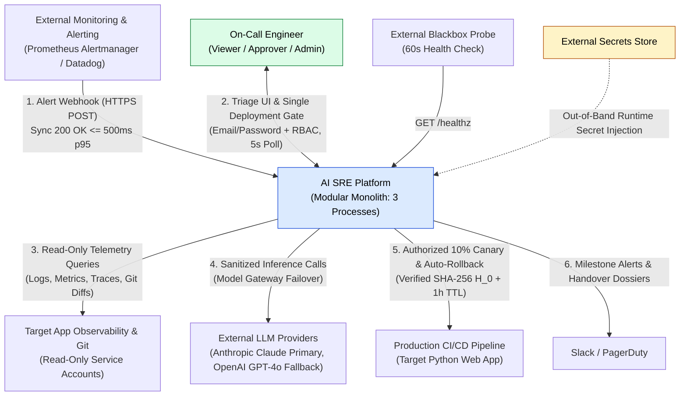

* **Synchronous Ingress Handshake (Q6.1, Q6.9, ADR-09):** External monitoring webhooks terminate immediately after authenticating, validating the 5 mandatory intake fields, running composite deduplication (`<org_id, service_id, error_signature, environment>` over a 30-minute sliding window), and committing the incident + workflow trigger. The API replies `200 OK` within `p95 <= 500 ms`; long-running triage never keeps HTTP connections open.
* **Graceful Enrichment:** Payloads missing enrichable fields are saved as `"needs_info"` and enriched asynchronously rather than dropped.

---

## 6.2 Container / Process Diagram

*Answers: Q6.1, Q6.2, Q6.3, Q6.4, Q6.8, Q6.34, Q6.35, Q6.38 · Integrates: ADR-08, ADR-09, ADR-10*

The platform is built from **one Python repository and one Docker image**, launched via Docker Compose as **three distinct runtime processes** (`api`, `worker`, `executor`) plus backing infrastructure (`PostgreSQL`, `Temporal`, `Artifact Storage`, `Prometheus`/`Grafana`) and on-demand **`Ephemeral Sandbox`** containers.

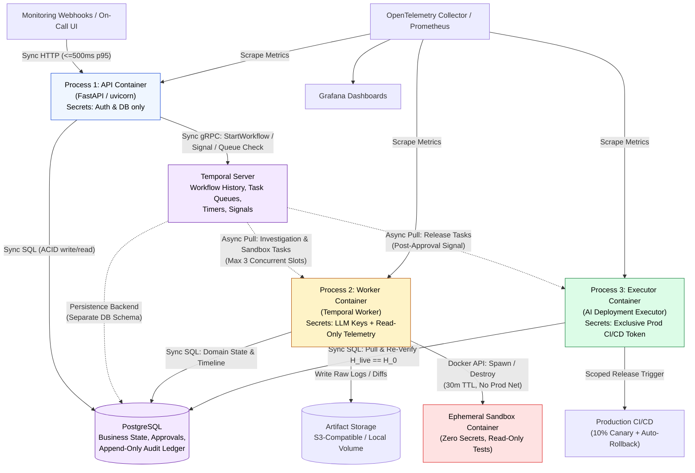

### Key Runtime & Communication Rules (Q6.2, Q6.35, Q6.38)

1. **No Direct Container-to-Container Bridge RPC:** Although Docker Compose places containers on a shared bridge network to reach `PostgreSQL` and `Temporal`, `api`, `worker`, and `executor` **never** call one another directly over HTTP/RPC. All inter-process coordination is mediated by `PostgreSQL` and `Temporal`.
2. **Pull-Based Workers:** `worker` and `executor` **poll** Temporal task queues asynchronously (dashed arrows); `api` never pushes work to them directly.
3. **Passive Database:** All domain SQL arrows point **into** `PostgreSQL`; it never initiates outbound calls.
4. **Complementary State Ownership (Q6.35, ADR-10):** `PostgreSQL` owns **business-domain state** (incidents, approvals, `incident_timeline`), while `Temporal` owns **workflow execution state** (activity retries, durable checkpoints, TTL timers, human approval signals). In the MVP, Temporal uses a separate schema inside PostgreSQL as its persistence store.
5. **Sync vs. Async Split (Q6.2):**
   - **Synchronous (`< 2s`):** Webhook validation, composite deduplication, atomic DB persistence, status reads (5s UI poll), human approval/cancel submissions, emergency kill switch.
   - **Asynchronous:** Round 1/2 evidence collection (bounded parallelism capped at 4 concurrent reads), LLM diagnosis, sandbox verification, canary deployment, 15–30 min recovery observation.
   - **Human Approval Wait:** Temporal parks the workflow cleanly via a **Signal** + **1-hour timer** while preserving concurrency accounting.
6. **Concurrency Governance (Q6.4, ADR-10):** Maximum **3 active investigation slots** enforced via Temporal worker concurrency settings (`max_concurrent_workflow_task_executors = 3`); **20-incident queue cap** checked at `api` intake; starvation alert emitted if an incident waits `> 10 minutes`.

---

## 6.3 Component Diagram

*Answers: Q6.6, Q6.7, Q6.9–Q6.22, Q6.28, Q6.34, Q6.36, Q6.38 · Integrates: ADR-08, ADR-11, ADR-12, ADR-13, ADR-14*

Inside the single codebase, components are organized as a **Modular Monolith with Ports & Adapters**. Modules interact exclusively through public domain interfaces (in-process Python calls inside the same container) and own their own database tables. Automated **`import-linter`** rules in CI forbid cross-module table access and forbid investigation/diagnosis modules from importing deployment execution code.

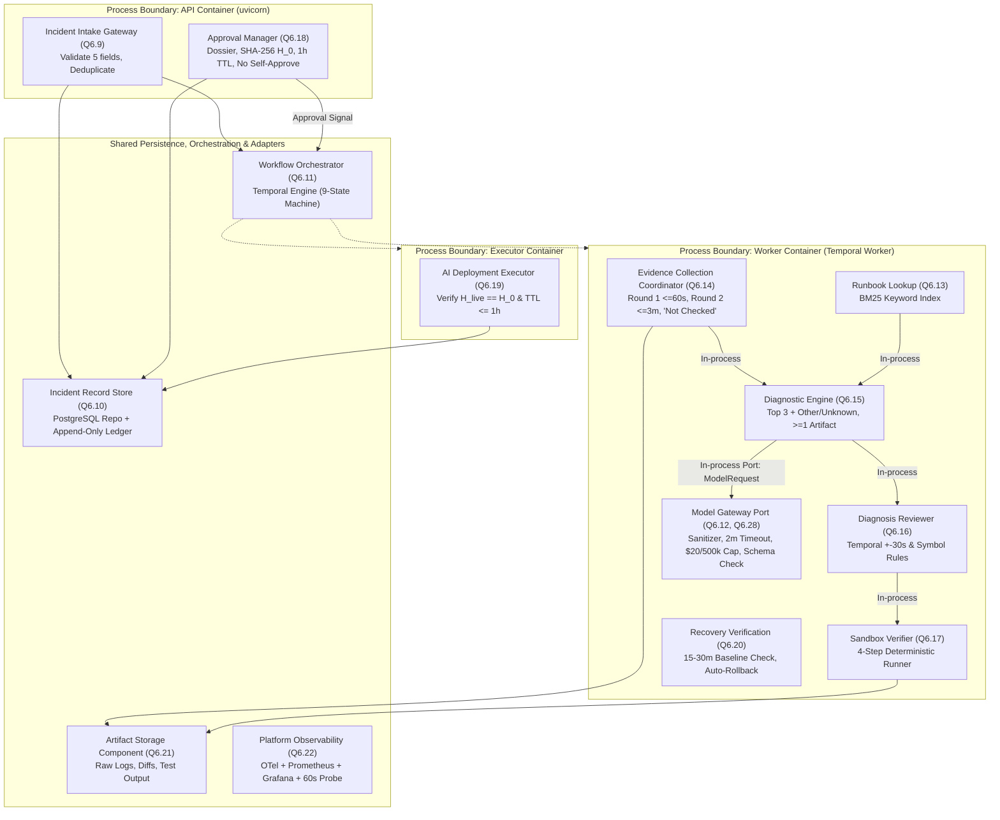

### Model Gateway & Provider Adapter Relationship (Q6.12, Q6.28, Q6.36)

To isolate the `Diagnostic Engine` (running inside `worker`, never `api`) from vendor SDKs and format differences, all LLM calls cross the **`Model Gateway` port** using internal `ModelRequest` / `ModelResponse` contracts:

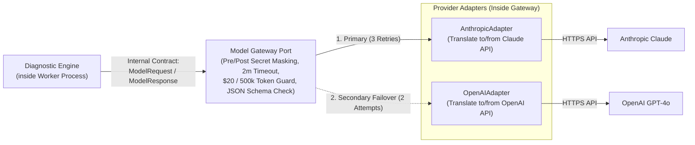

* **Zero SDK Leakage:** Investigation code never imports Anthropic or OpenAI client libraries.
* **Single Enforcement Point:** Bidirectional secret/PII masking (`[HIDDEN]`/`[REDACTED]`), per-call 2-minute timeouts, malformed JSON rejection/retry limits, and cumulative token/dollar accounting execute once inside the gateway.

---

## 6.4 Technology Selection

*Answers: Q6.23–Q6.33 · Integrates: Layer 2 § 2.2; ADR-08, ADR-10, ADR-13*

Every technology below was evaluated against an explicit responsibility identified in Parts A and B and signed off against the Layer 6 candidate stack:

| Responsibility | Selected Technology | Decision | First-Principles Justification | Linked Ref |
| :--- | :--- | :--- | :--- | :--- |
| **Backend API** | **FastAPI** | ✅ Accept | Async non-blocking I/O handles 5s UI polling alongside `p95 <= 500 ms` webhook intake; auto-generates OpenAPI contracts; kept strictly thin in `api/` adapter. | Q6.23, ADR-13 |
| **Validation** | **Pydantic** | ✅ Accept | Declaratively enforces the 5 mandatory intake fields (`service_id`, `environment`, `timestamp`, `symptom`, `source_endpoint`) and strict LLM JSON schemas before domain logic runs. | Q6.23, ADR-13 |
| **Database** | **PostgreSQL** | ✅ Accept | ACID guarantees for atomic intake/dedup; relational integrity across incidents/hypotheses/approvals; `JSONB` for flexible telemetry snapshots; insert-only triggers for `incident_timeline`. | Q6.24, ADR-10 |
| **ORM** | **SQLAlchemy** | ✅ Accept | Mature, battle-tested Python ORM + Core expression layer for clean repository adapters; preferred over newer convenience wrappers (`SQLModel`) for MVP stability. | Q6.33 |
| **Migrations** | **Alembic** | ✅ Accept | Version-controlled numbered migrations (`upgrade()` / `downgrade()`) tracked in `alembic_version`; executed automatically before services start in CI/Compose (replaces manual admin DB edits). | Q6.25, Q6.8 |
| **Workflow Engine** | **Temporal** | ✅ Accept *(Override)* | Durable execution history survives crashes without hand-rolled checkpointing; built-in task queues, retry policies, TTL timers, and Signals for human approval. Overrides prior PostgreSQL orchestrator. | Q6.26, ADR-10 |
| **Model Providers** | **Anthropic Claude + OpenAI GPT-4o** | ✅ Accept *(Replaced "Tinker")* | API-only (no GPU ops in MVP); both support tool calling and `>= 100k` context; dual vendors ensure an Anthropic outage fails over cleanly to OpenAI within the `\$20` cap. | Q6.27 |
| **Provider Abstraction** | **Provider Adapter Pattern** | ✅ Accept | `AnthropicAdapter` and `OpenAIAdapter` inside `Model Gateway` translate internal `ModelRequest`/`ModelResponse` schemas so the agent stays provider-agnostic. | Q6.28, Q6.12 |
| **Retrieval** | **BM25** | ✅ Accept | In-process keyword ranking over static Markdown runbooks indexed by service and symptom; zero separate server or embedding model overhead at MVP corpus size. | Q6.29, Q6.13 |
| **Execution Isolation** | **Ephemeral Docker Sandbox** | ✅ Accept | Linux cgroups + namespaces isolate CPU, RAM, processes, filesystem, and network per verification run; destroyed after 4-step test protocol (`30m` TTL). | Q6.30, Q6.17 |
| **Metrics** | **Prometheus** | ✅ Accept | Pull-based time-series storage and PromQL alerting for platform SLAs (intake latency, queue depth, token spend, worker health). | Q6.31, Q6.22 |
| **Dashboard** | **Grafana** | ✅ Accept | Queries Prometheus metrics to visualize platform health, SLA compliance, and cost ceilings. | Q6.31, Q6.22 |
| **Tracing / Telemetry** | **OpenTelemetry** | ✅ Accept | Vendor-neutral SDK instrumenting `api`, `worker`, and `executor` spans/metrics alongside the external 60s synthetic blackbox probe. | Q6.31, Q6.22 |
| **Dev Environment** | **Docker Compose** | ✅ Accept | Orchestrates `api`, `worker`, `executor`, `PostgreSQL`, `Temporal`, and observability locally with deterministic startup ordering (`Postgres` → `Alembic` → services). | Q6.32, Q6.8 |
| **Dependency Mgmt** | **uv** | ✅ Accept | Fast deterministic Python dependency resolution and lockfile management across the single Modular Monolith image. | Q6.33 |

### Deferred Technologies & Reintroduction Triggers (Q6.33)

| Technology | Why Avoided Initially | Quantitative Trigger to Introduce Later |
| :--- | :--- | :--- |
| **Kafka / RabbitMQ** | Extra broker ops/clustering complexity unneeded for 3-slot MVP throughput. | Event volume exceeds `> 1,000 events/min` OR fan-out requires `5+` independent consumer groups. |
| **Redis** | Extra stateful cache; PostgreSQL handles MVP read/query volume comfortably. | Query profiling shows PostgreSQL read latency degrading intake/UI SLAs due to hot read contention. |
| **Kubernetes** | Single-host 3-process monolith needs no cluster control plane. | Multi-host scaling, multi-region HA, or independent horizontal autoscaling of workers becomes mandatory. |
| **Vector DB & Embeddings** | Separate server/index sync unnecessary for `< 200` structured Markdown runbooks. | Runbook corpus exceeds `> 200 documents` OR BM25 keyword recall drops `< 80%`. |
| **Self-Hosted Open-Weights LLM** | Layer 2 explicitly defers GPU infrastructure and model hosting ops. | Strict enterprise data-residency mandate OR API token spend exceeds dedicated GPU hosting cost at scale. |

---

## 6.5 Architecture Decision Records (ADRs)

*Answers: Q6.1, Q6.3–Q6.9, Q6.11, Q6.16, Q6.18, Q6.23, Q6.24, Q6.26*

The key architectural decisions and cross-layer reconciliations for Layer 6 are codified into formal Architecture Decision Records (ADRs). To ensure this document is completely standalone—such that the platform architecture remains unambiguous even without the `/adr` directory—each active ADR (ADR-08 through ADR-14) is presented below in full detail, complete with architectural flowcharts, sequence diagrams, state machine visualizations, and precise first-principles justifications:

| ADR ID | Decision Title | Status | Scope & Key Reconciliation |
| :--- | :--- | :--- | :--- |
| **[ADR-08](file:///c:/Users/diwas/OneDrive/Desktop/Projects/ai-sre/adr/ADR-08-modular-monolith-and-three-process-runtime.md)** | Modular Monolith Codebase with 3-Process Runtime Topology | Accepted | One Python codebase and one Docker image running as `api`, `worker`, and `executor`; internal boundaries enforced in CI via `import-linter` (Q6.3, Q6.5–Q6.8). |
| **[ADR-09](file:///c:/Users/diwas/OneDrive/Desktop/Projects/ai-sre/adr/ADR-09-intake-api-handshake-and-enrichment-fallback.md)** | Synchronous Intake Handshake (`200 OK`) with Graceful Missing Field Enrichment | Accepted | Standardizes `200 OK` (`p95 <= 500 ms`); persists incomplete alerts as `"needs_info"` for async enrichment instead of dropping them (Q6.1, Q6.9). |
| **[ADR-10](file:///c:/Users/diwas/OneDrive/Desktop/Projects/ai-sre/adr/ADR-10-temporal-workflow-engine.md)** | Temporal as the Durable Workflow Engine *(Replaces PostgreSQL Orchestrator)* | Accepted | **Overrides** the prior PostgreSQL `SKIP LOCKED` orchestrator; adopts Temporal for durable history, task queues, retries, TTL timers, and human signals while PostgreSQL retains domain state and audit ledger (Q6.4, Q6.11, Q6.24, Q6.26). |
| **[ADR-11](file:///c:/Users/diwas/OneDrive/Desktop/Projects/ai-sre/adr/ADR-11-deterministic-diagnosis-verification-over-llm-debate.md)** | Deterministic Diagnosis Verification Over Multi-Round LLM Debate | Accepted | Defers multi-round LLM-vs-LLM critic loops; enforces evidence gate (`>= 1` timestamped artifact), rule checks (`±30s` temporal + symbol match), active falsification, and sandbox reproduction (Q6.16). |
| **[ADR-12](file:///c:/Users/diwas/OneDrive/Desktop/Projects/ai-sre/adr/ADR-12-composite-sha256-patch-and-state-fingerprint.md)** | Composite SHA-256 Approval Fingerprinting (Target State + Canonical Diff) | Accepted | Reconciles Artifact 4 § 4.32 and Artifact 5 § 6 into $H_0 = \text{SHA256}(\text{base\_commit\_sha} + \text{canonical\_diff\_bytes} + \text{target\_path} + \text{env\_hash})$; enforces 1h TTL and blocks triggering deploy author from self-approving (Q6.18). |
| **[ADR-13](file:///c:/Users/diwas/OneDrive/Desktop/Projects/ai-sre/adr/ADR-13-fastapi-http-gateway-and-pydantic-validation.md)** | FastAPI and Pydantic for HTTP Intake & Status Gateway | Accepted | Confirms FastAPI + Pydantic as a thin `api/` adapter with zero LLM reasoning or workflow logic inside route handlers (Q6.23). |
| **[ADR-14](file:///c:/Users/diwas/OneDrive/Desktop/Projects/ai-sre/adr/ADR-14-canonical-9-state-incident-lifecycle-reconciliation.md)** | Canonical 9-State Incident Lifecycle Machine Reconciliation | Accepted | Reconciles Layer 3/4/5 state naming into 9 canonical states (`Detected` → `Notified` → `Investigating` → `DiagnosisProposed` → `SandboxTesting` → `AwaitingDeployApproval` → `Deployed` → `Verifying` → `Closed`) plus sub-statuses `Inconclusive`, `Cancelled`, `Recurred` (Q6.11). |

---

### Comprehensive Architecture Decision Records (Standalone Specification)

#### ADR-08: Modular Monolith Codebase with 3-Process Runtime Topology

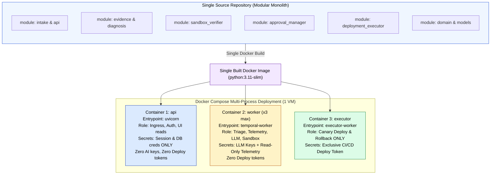

- **Status:** Accepted (2026-11-26)
- **Context (First Principles):** An incident platform executes three fundamentally incompatible workloads:
  1. *High-Availability Ingress:* Receiving webhooks and serving UI queries must never block.
  2. *Untrusted, Long-Running Reasoning:* Inspecting logs, running LLMs, and executing sandbox containers takes minutes and consumes non-deterministic memory and CPU.
  3. *Privileged Production Execution:* Triggering canary deployments requires high-privilege CI/CD tokens that must never leak to prompt-injected LLMs.
  
  Co-locating all three in one Python process risks webhook timeouts and severe credential compromise. Conversely, splitting them into full microservices (multiple git repositories, separate CI/CD pipelines, distributed tracing, network serialization) creates overwhelming operational friction for a small team.
- **Decision:**
  1. **Single Modular Monolith Codebase:** The platform is structured as a Modular Monolith with Ports & Adapters inside a single Python repository. Strict boundary rules are enforced in CI via `import-linter`—investigation and diagnosis modules are prohibited from importing deployment execution code.
  2. **Single Built Image, Three Runtime Roles:** One container image is built, but deployed as three separate services in Docker Compose:
     - `api`: Ingress, authentication, dashboard reads, recording approvals. Holds **zero AI API keys** and **zero production deployment tokens**.
     - `worker`: General-purpose background worker polling Temporal task queues for investigation and sandbox runs. Holds AI API keys and read-only telemetry tokens, but **zero production deployment tokens**.
     - `executor` (`AI Deployment Executor`): Runs in a dedicated container listening strictly on a secured Temporal release queue. **Exclusively holds CI/CD deploy credentials** and triggers releases only after cryptographically verifying patch hashes.
- **Overrides & Traceability:** Reconciles debates in Q6.3, Q6.5, and Q6.8; enforces Layer 2 § 2.2, Layer 5 § 3 (Zones 1–3), and Layer 5 § 6.
- **Consequences:** Positive: Zero duplicated domain models, fast local setup via Docker Compose, strict process-level credential isolation. Negative: Developers must adhere strictly to `import-linter` rules to avoid architectural erosion.

---

#### ADR-09: Synchronous Intake Handshake (200 OK) with Graceful Missing Field Enrichment

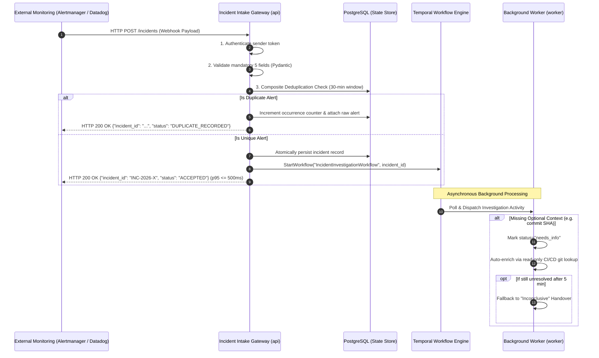

- **Status:** Accepted (2026-11-26)
- **Context (First Principles):** External monitoring systems (Alertmanager, Datadog) send webhooks over standard HTTP. If the intake endpoint takes minutes to complete an investigation, upstream monitoring systems time out and repeatedly retry, creating an alert storm. Furthermore, incoming alert payloads frequently miss non-essential metadata (e.g., exact commit SHA or source endpoint). Dropping alerts due to missing optional fields leaves engineers completely blind to real production outages.
- **Decision:**
  1. **Synchronous Intake Handshake (`200 OK`):** The HTTP intake route performs only four fast operations: authenticate sender, validate the 5 mandatory fields (`service_id`, `environment`, `timestamp`, `symptom`, `source_endpoint`), execute 30-minute composite deduplication, and commit the incident and start the Temporal workflow. It immediately replies with `200 OK` within `p95 <= 500 ms` (max 2 seconds).
  2. **Missing Field Graceful Handling:** Incoming alerts with missing enrichable fields are never dropped. They are saved with status `"needs_info"`, followed by automated async CI/CD lookup, and a 5-minute one-shot query to on-call before falling back to `"Inconclusive"`.
- **Overrides & Traceability:** Standardizes `200 OK` (Layer 4 § 4.28) over `202 Accepted`; reconciles Layer 4 § 4.3 & § 4.28 with Layer 6 Q6.1 & Q6.9.
- **Consequences:** Positive: Zero risk of webhook timeout, predictable acknowledgment SLA, alerts are never silently discarded. Negative: The monitoring client receives immediate acknowledgement and must rely on UI polling or webhooks to observe downstream investigation progress.

---

#### ADR-10: Temporal as the Durable Workflow Engine (Replaces PostgreSQL Orchestrator)

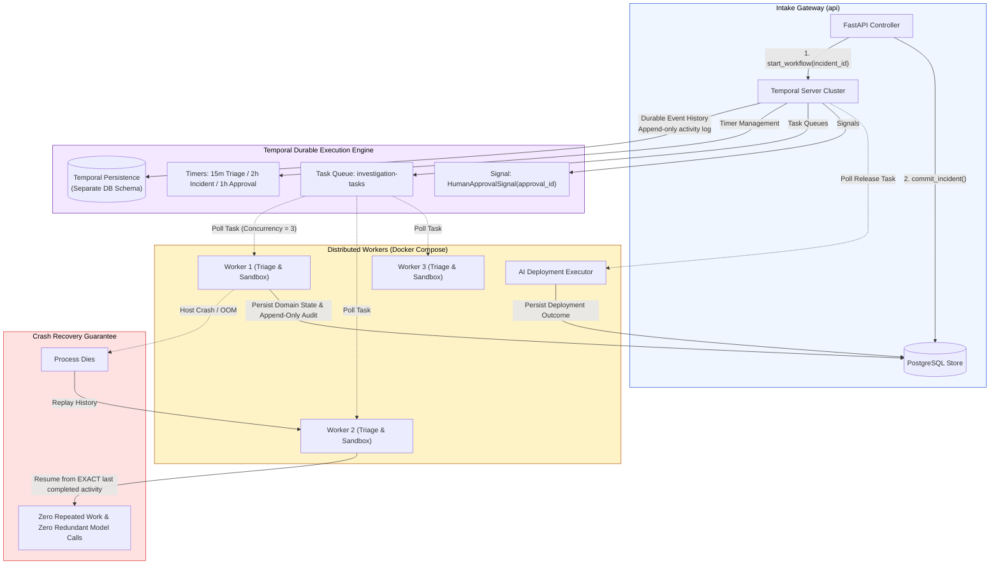

- **Status:** Accepted (2026-11-27) — *Formally overrides and deletes the prior PostgreSQL SKIP LOCKED orchestrator proposal.*
- **Context (First Principles):** Incident triage and verification runs for several minutes to 2 hours. If a worker process crashes at minute 45 during sandbox testing, restarting from scratch wastes significant money on repeated LLM calls, violates the 2-hour SLA, and risks non-idempotent side effects. A previous proposal relied on manual PostgreSQL checkpoints + a 60s heartbeat sweeper daemon + `SKIP LOCKED` queries. While viable, this required writing, testing, and maintaining custom state serialization, heartbeat daemons, and manual crash resume logic for every activity.
- **Decision:**
  1. **Adopt Temporal for Durable Workflow Execution:** Temporal is adopted as the platform's durable workflow engine. Every discrete phase (evidence collection, hypothesis ranking, sandbox test, canary rollout) is modeled as a Temporal Activity. If a worker crashes mid-investigation, a standby worker replays Temporal's append-only event history and resumes from the exact last completed activity without manual checkpoint code.
  2. **Native Timers and Human Approval Signals:** Temporal timers natively enforce SLA deadlines (`15 min` triage ceiling, `2 hour` total investigation ceiling, `1 hour` human approval TTL). The human approval wait state is modeled as a Temporal Signal—the workflow suspends cleanly and consumes zero CPU while awaiting the approver's action.
  3. **Strict Concurrency Governance:** The platform's 3-slot active investigation ceiling is enforced via Temporal worker task executor concurrency (`max_concurrent_workflow_task_executors = 3`). The 20-incident queue cap is enforced at API intake prior to workflow dispatch.
  4. **State Split Architecture (PostgreSQL vs. Temporal):**
     - **Temporal** owns *workflow execution state* (activity inputs/outputs, retry counters, timers, execution histories).
     - **PostgreSQL** owns *business-domain state* (canonical incident records, structured hypotheses, cryptographic approval records, and the permanent append-only `incident_timeline` audit ledger).
- **Overrides & Traceability:** Overrides the prior PostgreSQL-backed job queue ADR; reconciles Layer 4 § 4.17, § 4.20, § 4.22, § 4.32 with Layer 6 Q6.4, Q6.11, Q6.24, Q6.26.
- **Consequences:** Positive: Native crash durability, zero custom checkpointing code, out-of-the-box observability via Temporal Web UI. Negative: Requires running a Temporal Server instance and its backing store within the Docker Compose environment.

---

#### ADR-11: Deterministic Diagnosis Verification Over Multi-Round LLM Debate

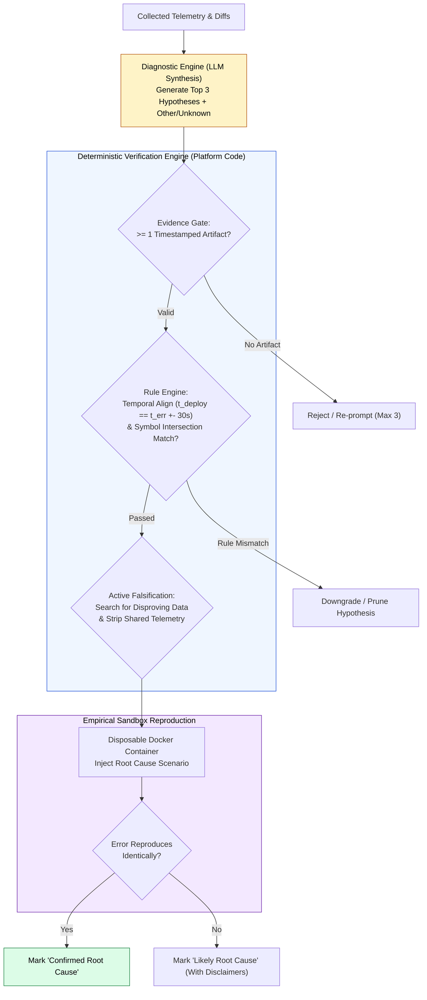

- **Status:** Accepted (2026-11-26)
- **Context (First Principles):** When an LLM produces a diagnosis, confident hallucinations are a major risk. A proposed alternative was a multi-round "LLM critic" debate loop where two models cross-examine each other over 3 to 4 rounds. However, models from the same vendor share systemic training biases and blind spots. More critically, multi-round debates rapidly consume token budgets and operational time, threatening the `$20` cap, `500k` token limit, and `15 min` triage ceiling (Layer 4 § 4.20–§ 4.33). In software engineering, code execution is the only objective ground truth: code either reproduces the bug or it does not.
- **Decision:**
  1. **Defer Multi-Round LLM Debate:** Multi-round AI debate loops are deferred as post-MVP research; zero LLM-vs-LLM debate loops run in the MVP.
  2. **Deterministic Empirical Verification:** Diagnosis evaluation relies strictly on deterministic platform verification:
     - *Evidence Gate:* Every diagnosis must link to at least 1 timestamped telemetry artifact.
     - *Rule Engine:* Checks temporal alignment (`t_deploy == t_error ± 30s`) and configuration symbol intersection.
     - *Active Falsification:* Actively queries for contradicting evidence and eliminates non-discriminating shared symptoms.
     - *Empirical Sandbox Reproduction:* The candidate cause is injected into an ephemeral Docker container. If reproduced, status is marked `"Confirmed Root Cause"`; otherwise marked `"Likely Root Cause"`.
- **Overrides & Traceability:** Supersedes multi-round AI debate proposals in Q6.16; enforces Layer 4 § 4.5–§ 4.7 and Layer 5 § 4.
- **Consequences:** Positive: Fast, predictable spend within SLA limits; objective verification grounded in actual application behavior. Negative: Verification fidelity depends on deterministic rule design and sandbox reproduction accuracy.

---

#### ADR-12: Composite SHA-256 Approval Fingerprinting (Target State + Canonical Diff)

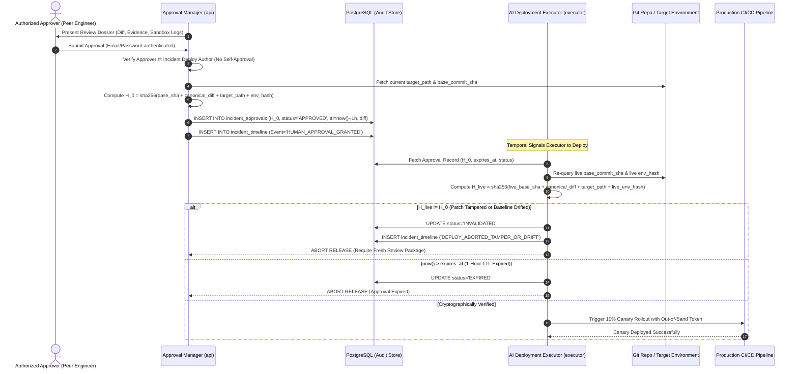

- **Status:** Accepted (2026-11-26)
- **Context (First Principles):** Human approval authorizes production change. Between the moment an engineer reviews a patch and the moment deployment begins, two attack vectors exist:
  1. *Patch Tampering:* Malicious software or prompt injection alters diff bytes in flight.
  2. *State Drift:* A teammate merges an unrelated commit or changes an environment variable while approval is pending, causing the patch to apply against an unverified baseline.
- **Decision:**
  1. **Composite SHA-256 Fingerprint ($H_0$):** When an authorized engineer approves a patch, the platform calculates a composite hash binding the exact diff bytes, the target file path, and the target baseline state:
     $$H_0 = \text{SHA256}(\text{base\_commit\_sha} + \text{canonical\_diff\_bytes} + \text{target\_path} + \text{env\_hash})$$
  2. **Pre-Deployment Fail-Closed Verification:** Immediately prior to calling CI/CD, the isolated `AI Deployment Executor` re-queries git and environment state, recomputes $H_{\text{live}}$, and asserts:
     - `status == APPROVED`
     - `current_timestamp <= expires_at` (1-hour TTL)
     - $H_{\text{live}} == H_0$
     If any assertion fails, deployment aborts immediately (`INVALIDATED`), and a fresh review package is required.
  3. **Self-Approval Guardrail:** The engineer who authored the commit or configuration change that triggered the incident is strictly barred from approving the remediation deploy.
- **Overrides & Traceability:** Reconciles Layer 4 § 4.32 with Layer 5 § 6, Layer 5 § 10, and Layer 6 Q6.18.
- **Consequences:** Positive: Cryptographic protection against post-approval tampering and accidental baseline drift. Negative: Fast-moving repositories will invalidate approvals if background commits land during the review window, requiring a quick re-generation of the review package.

---

#### ADR-13: FastAPI and Pydantic for HTTP Intake & Status Gateway

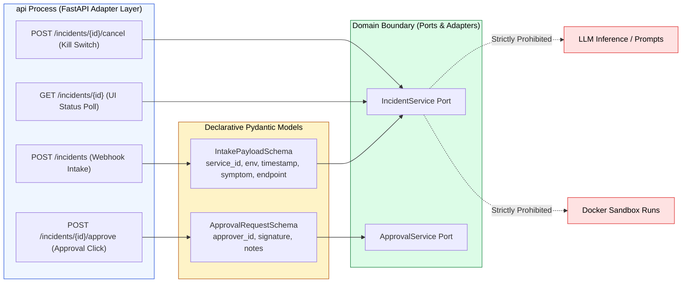

- **Status:** Accepted (2026-11-26)
- **Context (First Principles):** The platform needs an HTTP web server to receive external monitoring webhooks, serve status polling endpoints for the engineer dashboard (5s interval), and accept human approval submissions. The framework must validate schemas strictly without boilerplate, support asynchronous non-blocking I/O so waiting on database queries does not freeze intake, and integrate cleanly with Python 3.11+.
- **Decision:**
  1. **Adopt FastAPI with Pydantic:** FastAPI is selected as the web framework for the `api` container. Pydantic models declaratively validate all incoming JSON payloads, automatically rejecting malformed requests with `422 Unprocessable Entity` before domain logic executes.
  2. **Strict Architectural Seam:** FastAPI resides strictly in the `api/` adapter layer. Route handlers act purely as controllers: validating inputs, initiating database transactions, and dispatching Temporal workflow events. Route handlers are strictly prohibited from executing LLM inference, orchestrating triage, or running sandbox tests.
- **Overrides & Traceability:** Resolves Layer 6 Q6.23.
- **Consequences:** Positive: High async throughput, auto-generated OpenAPI documentation, clean separation between web routing and core domain logic. Negative: Requires developer discipline to keep route handlers thin and prevent domain logic leakage.

---

#### ADR-14: Canonical 9-State Incident Lifecycle Machine Reconciliation

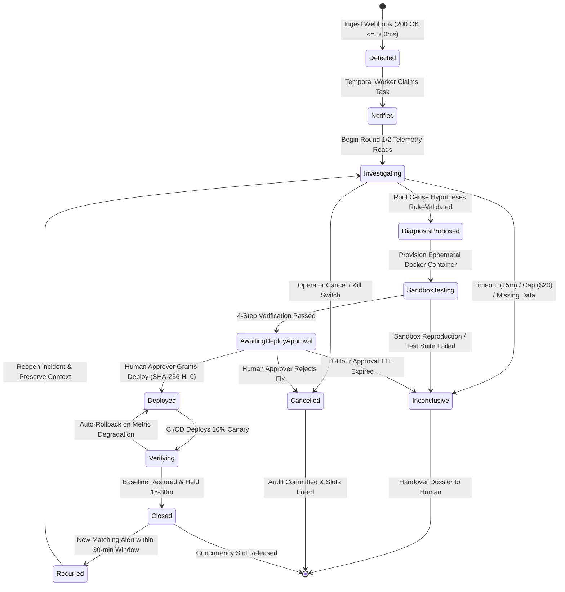

- **Status:** Accepted (2026-11-26)
- **Context (First Principles):** An incident platform requires an authoritative state machine stored in PostgreSQL. Across earlier documentation, minor naming divergences occurred between standard lifecycle stages, transient tags, and terminal statuses (e.g., Layer 3 § 5.3 listed 9 states, while Layer 4 § 1.3 mentioned an "11-state machine" that blended core states with terminal tags like `Recurred` and `Inconclusive`). Without one authoritative state machine, database schemas, UI badges, and worker handlers drift.
- **Decision:**
  1. **Canonical 9 Core States:** The incident lifecycle progresses through exactly 9 core states:
     - `Detected`: Webhook received, validated, and persisted.
     - `Notified`: Concurrency slot reserved and worker claimed from queue.
     - `Investigating`: Read-only evidence collection and hypothesis generation active.
     - `DiagnosisProposed`: Root cause hypothesis formulated and rule-validated.
     - `SandboxTesting`: Ephemeral container executing the 4-step verification protocol.
     - `AwaitingDeployApproval`: Sandbox tests passed; one-page review package presented to human.
     - `Deployed`: Human approved; 10% canary rollout triggered via CI/CD.
     - `Verifying`: Telemetry compared against pre-incident baseline under live traffic.
     - `Closed`: Baseline health verified and sustained for 15–30 min; audit committed.
  2. **Terminal & Recovery Sub-Statuses:**
     - `Inconclusive`: Handover dossier compiled due to timeout (`15m`), budget cap (`$20`), or ambiguous telemetry.
     - `Cancelled`: Terminated via Tier 1 graceful stop or Tier 2 emergency kill switch.
     - `Recurred`: Reopened within the 30-minute deduplication window following closure.
- **Overrides & Traceability:** Reconciles Layer 3 § 5.3, Layer 4 Summary vs. Table, Layer 5 § 8, and Layer 6 Q6.11.
- **Consequences:** Positive: Unambiguous database enum and full alignment across UI, API, Temporal workflows, and audit logs. Negative: None.

---

## 6.6 Component Ownership

*Answers: Q6.3, Q6.4, Q6.6, Q6.9–Q6.22, Q6.35, Q6.38 · Integrates: ADR-08, ADR-10, ADR-14*

Every major logical module has a single owner, an explicit runtime process host, and strict data/credential boundaries:

| Component | Q Ref | Process Host | Primary Responsibility & Invariants |
| :--- | :--- | :--- | :--- |
| **Incident Intake Gateway** | Q6.9 | `api` | Authenticates webhooks, validates 5 mandatory fields, runs 30-min composite deduplication, checks Temporal queue cap (`20`), commits incident + starts workflow, returns `200 OK` (`p95 <= 500 ms`). |
| **Approval Manager** | Q6.18 | `api` | Renders one-page deterministic review dossier, enforces RBAC + peer-only approval (blocks deploy author), computes composite SHA-256 $H_0$, stores `APPROVED` + `1h TTL` in PostgreSQL, emits Temporal Signal. |
| **Incident Record Store** | Q6.10 | Shared Repo (`PostgreSQL`) | Owns relational incident tables, approval records, and insert-only append-only `incident_timeline` audit ledger (`UPDATE`/`DELETE` blocked by DB triggers). Memory buffering active only during total DB outage. |
| **Workflow Orchestrator** | Q6.11 | `Temporal Server` + Workers | Drives canonical 9-state machine (ADR-14); provides durable execution replay across crashes, 3-slot worker concurrency, activity retries, `15m` triage / `2h` incident / `1h` approval timers. |
| **Model Gateway** | Q6.12 | `worker` | Sole egress to external LLMs; applies pre/post secret masking, 2-min timeout, JSON schema validation, `\$20` / `500k` token cap, and Claude → GPT-4o failover via Provider Adapters. |
| **Runbook Lookup** | Q6.13 | `worker` | In-process BM25 keyword and tag-indexed lookup returning static Markdown runbook context behind a port interface. |
| **Evidence Collection Coordinator** | Q6.14 | `worker` | Orchestrates read-only adapters via Execution Harness across Round 1 (`<= 60s`) and Round 2 (`<= 3m`, max 4 concurrent reads); marks unreachable sources `"Not Checked"`. |
| **Diagnostic Engine** | Q6.15 | `worker` | Produces up to 3 structured candidate hypotheses + mandatory `"Other/Unknown"` with qualitative confidence (`High`/`Medium`/`Low`) and `>= 1` timestamped artifact link per cause. |
| **Diagnosis Reviewer** | Q6.16 | `worker` | Platform-owned deterministic verifier executing temporal alignment (`±30s`), symbol intersection checks, and active falsification prior to sandbox verification (ADR-11). |
| **Sandbox Verifier** | Q6.17 | `worker` → `Ephemeral Sandbox` | Launches throwaway Docker container (`30m` TTL, read-only test mount) and deterministically grades the 4-step protocol (reproduce → patch → regression test → blast-radius suite) via exit codes. |
| **AI Deployment Executor** | Q6.19 | `executor` | Isolated process holding exclusive CI/CD deploy tokens; pulls approval from PostgreSQL, re-verifies $H_{\text{live}} == H_0$ and `TTL <= 1h` (fail-closed), triggers 10% canary rollout. |
| **Recovery Verification Component** | Q6.20 | `worker` / `executor` | Evaluates 5xx error rates and `p50/p95/p99` latency against pre-incident baseline over a `15–30 min` window; triggers automated rollback on degradation. |
| **Artifact Storage Component** | Q6.21 | Backing Object Store | Stores large raw logs, unified diffs, and sandbox test stdout; PostgreSQL holds only metadata, hashes, pointers, and sanitized key snapshots. |
| **Platform Observability Component** | Q6.22 | Sidecar / All Processes | OpenTelemetry SDK + Prometheus + Grafana tracking intake latency, stage durations, queue lag, and token spend, paired with an external 60s synthetic blackbox probe. |

---

## 6.7 Trust Boundaries

*Answers: Q6.3, Q6.12, Q6.17–Q6.19, Q6.30, Q6.37, Q6.39 · Integrates: Artifact 5 § 2–§ 7; ADR-08, ADR-12*

### The 4-Axis Security Boundary Rule (Q6.39)

Because components inside the same OS process share memory and environment variables, logical code folders alone cannot isolate risk. A separate process/container boundary is mandatory whenever two components differ on any of **four axes**:
1. **Untrusted Input or Code Execution:** Processing external payloads (webhooks, logs, `.env` diffs), non-deterministic LLM outputs, or AI-generated patch code.
2. **Credential & Secret Scope:** Secrets are never stored inside application code or LLM context; they live in an External Secrets Store and are injected out-of-band per process under least privilege.
3. **Production Write Authority:** Read-only triage vs. non-prod sandbox writes vs. production CI/CD release triggers.
4. **Network Exposure Surface:** Public/webhook ingress vs. internal-only execution.

### Security Zones & Fail-Closed Production Gate (Q6.37, Q6.39)

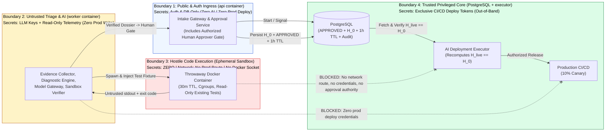

* **Sandbox Isolation & Mediated Verification (Q6.17, Q6.30, Q6.37):** The `Ephemeral Sandbox` never generates proposals, owns pass/fail decisions, or communicates with `AI Deployment Executor`. The platform-owned `Sandbox Verifier` grades exit codes deterministically; existing test suites are mounted read-only.
* **Approval Service & Human Gate (Q6.18, Q6.37):** The `Approval Service` (`Approval Manager`) never approves or rejects autonomously—it presents the verified dossier to an **Authorized Human Approver** (Email/Password + RBAC, barred from self-approving their own triggering deploy), records the human decision, and persists $H_0$ + `1h TTL` in PostgreSQL.
* **Fail-Closed Dispatcher Verification (Q6.19, Q6.37, ADR-12):** The `AI Deployment Executor` never trusts upstream runtime payloads. Before calling CI/CD, it reads PostgreSQL directly, recomputes $H_{\text{live}}$, verifies `status == APPROVED`, `now <= expires_at`, and $H_{\text{live}} == H_0$, and aborts (`INVALIDATED`) if any check fails.

---

## 6.8 Alternatives, Trade-Offs, Conflicts & Assumptions Register

*Answers: Q6.5, Q6.6, Q6.11, Q6.13, Q6.16, Q6.25–Q6.27, Q6.29, Q6.33, Q6.34, Q6.36–Q6.39*

### Major Trade-Offs & Cross-Source Conflict Resolutions

| Topic | Alternative Rejected / Conflicting Proposal | Team Resolution & First-Principles Rationale |
| :--- | :--- | :--- |
| **Service Topology (Q6.5–Q6.8)** | Microservices per domain module OR single monolithic process (`api` doing everything). | **Modular Monolith (1 image, 3 processes: `api`, `worker`, `executor`)** enforced by `import-linter` (ADR-08). Avoids distributed transactions and service-mesh overhead while preserving strict security privilege isolation. |
| **Inter-Process Communication (Q6.1, Q6.35, Q6.38)** | Direct `api ↔ worker ↔ executor` RPC over Docker bridge network. | **Rejected.** All cross-process coordination flows through `PostgreSQL` and `Temporal`. Prevents synchronous HTTP timeouts and makes crash recovery deterministic. |
| **Workflow Orchestration (Q6.4, Q6.11, Q6.26)** | Custom PostgreSQL `SKIP LOCKED` queue + manual checkpoints + 60s heartbeat sweeper (superseded ADR-10), OR Kafka as a state store. | **Temporal adopted (new ADR-10).** Kafka is a message bus, not a durable workflow state engine. Temporal supplies durable replay, retries, timers, and approval signals natively, removing fragile custom checkpoint/sweeper code while PostgreSQL retains domain/audit ownership. |
| **Schema Change Safety (Q6.25)** | Manual SQL `ALTER TABLE` log reviewed ad-hoc by a database administrator. | **Alembic automated migrations.** Version-controlled `upgrade()`/`downgrade()` scripts execute deterministically in CI / pre-start before app containers boot, eliminating human ordering race conditions. |
| **Diagnosis Verification (Q6.16)** | Multi-round LLM-vs-LLM critic debate loops. | **Deterministic rules + empirical sandbox reproduction (ADR-11).** Conserves the `\$20` / `500k` token and `15 min` triage budgets and grounds truth in actual code execution. |
| **Model Providers & Caller (Q6.27, Q6.36)** | `api` calling 3 providers (`Claude, ChatGPT, Tinker`) directly. | **`worker`/`Diagnostic Engine` calling `Model Gateway` → `Claude` (Primary) + `OpenAI GPT-4o` (Failover).** `api` holds zero AI keys; `"Tinker"` rejected as placeholder; self-hosted open-weights deferred post-MVP. |
| **Runbook Retrieval (Q6.13, Q6.29)** | Vector database + embedding pipeline in MVP. | **In-process BM25 keyword ranking.** Zero extra server/embedding cost for a small MVP corpus; vector search triggered only at `> 200` docs or `< 80%` recall. |
| **Visual Diagrams (Q6.34)** | Single flowchart or AWS-specific service icons. | **C4 Model (Context, Container, Component) + Sequence & Trust Boundary overlays.** Matches the vendor-neutral Docker Compose 3-process monolith accurately. |
| **Approval & Sandbox Authority (Q6.37, Q6.39)** | Sandbox generating proposals; Approval Service auto-retrying; components "storing" credentials. | **Sandbox is passive/untrusted; Human Approver is the decision-maker inside Approval Service; Secrets are injected out-of-band.** Enforces Layer 5 § 4, § 6, § 7 cleanly. |

### Layer 6 Assumptions & Validation Register (Provisional Until Validated)

| ID | Linked Questions | Provisional Assumption | Owner | Validation Condition / Test | Target Sprint |
| :--- | :--- | :--- | :--- | :--- | :--- |
| **A-6.1** | Q6.1, Q6.9, Q6.23 | FastAPI + Pydantic intake handshake (`auth` + `5-field validation` + `30m dedup` + `Temporal start_workflow`) completes within `p95 <= 500 ms` under burst load. | Backend Lead | Load-test `POST /incidents` at 50 concurrent webhooks against Docker Compose Postgres + Temporal; assert `p95 <= 500 ms` and `0` dropped alerts. | Sprint 1 |
| **A-6.2** | Q6.4, Q6.11, Q6.26 | Temporal Server backed by a separate PostgreSQL schema adds acceptable memory/CPU overhead on the MVP cloud VM alongside `api`, `worker`, `executor`, and ephemeral sandboxes. | DevOps / Platform Lead | Run 3 concurrent synthetic investigations + 20 queued workflows in Docker Compose; verify host RAM/CPU headroom stays `< 70%` and `SIGKILL` of `worker` resumes cleanly without duplicate side effects. | Sprint 2 |
| **A-6.3** | Q6.6, Q6.7, Q6.38 | `import-linter` contracts keep Modular Monolith boundaries strict without blocking shared Pydantic/domain types across `api`, `worker`, and `executor`. | Tech Lead | Configure `import-linter` in CI with negative test PR importing `executor` from `diagnosis`; assert CI fails automatically. | Sprint 1 |
| **A-6.4** | Q6.12, Q6.27, Q6.28 | Dual-provider failover (`Anthropic Claude` → `OpenAI GPT-4o`) produces valid hypothesis JSON within the `2 min` per-call timeout and `\$20` / `500k` token cap. | AI Lead | Fault-inject `503`/timeout on primary Claude adapter during reference HTTP 500 replay; verify seamless failover to GPT-4o and schema compliance. | Sprint 3 |
| **A-6.5** | Q6.13, Q6.29 | In-process BM25 keyword retrieval achieves `>= 80%` recall on MVP incident runbooks without semantic embeddings. | AI Lead | Benchmark BM25 against 20 realistic incident symptom queries paired with team runbooks; escalate to vector search if recall `< 80%`. | Sprint 2 |
| **A-6.6** | Q6.17, Q6.30, Q6.37 | Ephemeral Docker sandbox with read-only test mount, disabled prod network, and `30m` TTL reproduces the reference Python HTTP 500 config regression deterministically. | Security / DevOps Lead | Execute 4-step verification protocol on reference scenario inside sandbox; confirm outbound prod ping fails, existing test edit fails, and container auto-destroys after exit/TTL. | Sprint 2 |
| **A-6.7** | Q6.18, Q6.19, Q6.37 | Composite SHA-256 fingerprint $H_0$ serializes identically between `Approval Manager` (`api`) and `AI Deployment Executor` (`executor`). | Backend Lead | Modify 1 byte of diff or base commit post-approval in integration test; assert `executor` aborts release with `INVALIDATED`. | Sprint 3 |
| **A-6.8** | Q6.31, Q6.32 | OpenTelemetry SDK + Prometheus + Grafana stack captures all stage latencies, queue lag, and token spend in Docker Compose without degrading worker throughput. | Platform Lead | Run full end-to-end reference scenario locally with `docker compose up`; verify Grafana displays intake p95, active slots, and per-incident token cost. | Sprint 2 |

---

## Cross-Layer Consistency & Acceptance Verification

* **Consistent with [Artifact 4: FR & NFR](file:///c:/Users/diwas/OneDrive/Desktop/Projects/ai-sre/artifacts/functional_and_non_functional_requirements.md):** Preserves `p95 <= 500 ms` intake (`200 OK`), `3` active slots / `20` queue cap, `15m` diagnosis / `2h` incident ceilings, `\$20` / `500k` token cap, `1h` approval TTL, `10%` canary + `15–30m` recovery verification, and append-only `incident_timeline`. *(Orchestration mechanism reconciled via [ADR-10](file:///c:/Users/diwas/OneDrive/Desktop/Projects/ai-sre/adr/ADR-10-temporal-workflow-engine.md) from manual PostgreSQL `SKIP LOCKED` checkpoints to Temporal while preserving all SLAs and concurrency limits.)*
* **Consistent with [Artifact 5: Threat Modeling](file:///c:/Users/diwas/OneDrive/Desktop/Projects/ai-sre/artifacts/threat_modeling.md):** Enforces untrusted perimeter isolation, bidirectional secret masking, out-of-band secret injection, read-only sandbox test mounts, zero arbitrary shell/SQL/SSRF, RBAC + non-self-approval, and fail-closed SHA-256 $H_0$ verification in `AI Deployment Executor`.
* **Layer 7 Readiness (Outbox Note):** Because `api` commits domain state to `PostgreSQL` and calls `Temporal.StartWorkflow` across two systems, **Layer 7 (Data, APIs & Events)** will formalize the transactional **Outbox / Reconciliation pattern** so an alert committed to PostgreSQL can never be stranded if Temporal is momentarily unreachable.
