# AI SRE Platform — Artifact 5: Threat Modeling, Security & Failure-Mode Architecture

**Layer 5 — Security, Trust & Failure-Mode Architecture** · Built from: [Artifact 1: PRD](file:///c:/Users/diwas/OneDrive/Desktop/Projects/ai-sre/artifacts/product_requirement.md), [Artifact 2: Scope & Constraints](file:///c:/Users/diwas/OneDrive/Desktop/Projects/ai-sre/artifacts/scope_and_constraints.md), [Artifact 3: SRE Fundamentals](file:///c:/Users/diwas/OneDrive/Desktop/Projects/ai-sre/artifacts/sre_fundamentals.md), and [Artifact 4: Functional & Non-Functional Requirements](file:///c:/Users/diwas/OneDrive/Desktop/Projects/ai-sre/artifacts/functional_and_non_functional_requirements.md) · *Approved specifications compiled from team discussions, Claude & ChatGPT evaluations, and the [Layer 5 Conversation Log](file:///c:/Users/diwas/OneDrive/Desktop/Projects/ai-sre/conversation%20log/layer_5_conversation_log.md)*

---

## Executive Summary & Layer Alignment

Layer 5 defines the **adversarial security posture, explicit trust boundaries, deterministic execution guardrails, and crash/retry reliability guarantees** for the 6-month MVP. Every control assumes the LLM reasoning core and every external payload (logs, config diffs, sandbox outputs, webhooks) are **untrusted** until verified by deterministic platform code.

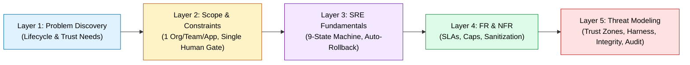

---

## § 1. Threat Surface Overview (Reference Scenario STRIDE Map)

In the reference scenario (config change $\rightarrow$ Python HTTP 500 surge $\rightarrow$ automated triage $\rightarrow$ sandbox fix $\rightarrow$ human approval $\rightarrow$ canary deploy), threats enter at four surfaces: **telemetry ingress**, **LLM reasoning**, **sandbox execution**, and **human approval / deployment**.

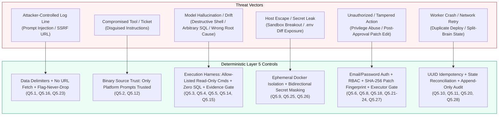

---

## § 2. System Trust Boundaries & Context Isolation

*Answers: Q5.1, Q5.2, Q5.12, Q5.23*

Trust is assigned **strictly by origin**, never by formatting or model confidence. Even deterministic external payloads (monitoring APIs, logs, sandbox stdout) sit outside the trusted boundary.

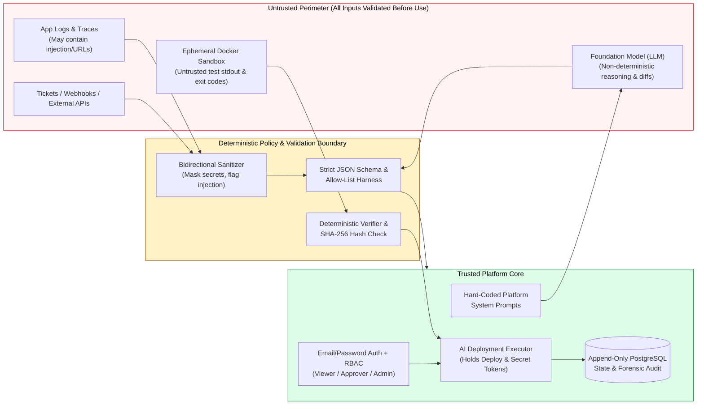

### Prompt Isolation & "Flag-Never-Drop" Handling

Dropping log lines that match injection keywords risks hiding genuine failure clues or letting attackers suppress error logs. Suspicious lines are **kept, wrapped as passive data, and flagged for the human reviewer**; no secondary specialist SLM or vector database is added in the MVP.

```text
assemble_llm_context(system_rules, raw_logs, ticket_payload)
  masked_logs = redact_secrets(raw_logs)
  flagged_logs = mark_suspicious_patterns(masked_logs)   // adds UI warning; NEVER drops lines
  return {
    trusted_instructions: system_rules,                 // fixed platform prompts only
    untrusted_data: wrap_delimiter("UNTRUSTED_EXTERNAL_DATA", flagged_logs, ticket_payload)
  }
```

> [!IMPORTANT]
> **Binary Authority Rule:** Nothing inside `UNTRUSTED_EXTERNAL_DATA` can modify permissions, add tools, override system prompts, or authorize outbound network requests.

---

## § 3. Execution Harness, Shell Allow-List, Zero-SQL & Zero-SSRF

*Answers: Q5.3, Q5.13, Q5.14, Q5.15, Q5.16, Q5.17*

The LLM never holds a shell, database driver, or HTTP client. Every diagnostic request passes through a deterministic **Execution Harness** that enforces four hard prohibitions and three operational permission zones.

```mermaid
sequenceDiagram
    autonumber
    participant LLM as AI Model (Untrusted)
    participant H as Execution Harness (Trusted)
    participant Mon as Monitoring / Git (Read-Only)
    participant SB as Ephemeral Sandbox

    LLM->>H: Emit JSON intent schema (e.g. tool="read_cmd", cmd="tail_logs")
    H->>H: Validate strict JSON schema (invalid -> reject immediately, no retry)
    alt Intent = Predefined Read-Only Command / Monitoring / Git Read
        H->>H: Check command against static read-only allow-list
        H->>Mon: Execute scoped, rate-limited read-only query
        Mon-->>H: Raw telemetry
        H-->>LLM: Return sanitized, delimited data
    else Intent = Arbitrary Shell or SQL Query
        H-->>LLM: REJECT (Zero arbitrary shell; zero DB connection / zero SQL in MVP)
    else Intent = Fetch URL Found in Logs
        H-->>LLM: REJECT (Zero outbound URL fetch; render URL as plain text in UI)
    else Intent = Test Candidate Patch
        H->>SB: Run patch + tests inside isolated throwaway container
        SB-->>H: Pass/Fail + sanitized logs (treated as untrusted)
    end
```

### Three Operational Tool Permission Zones (Q5.17)

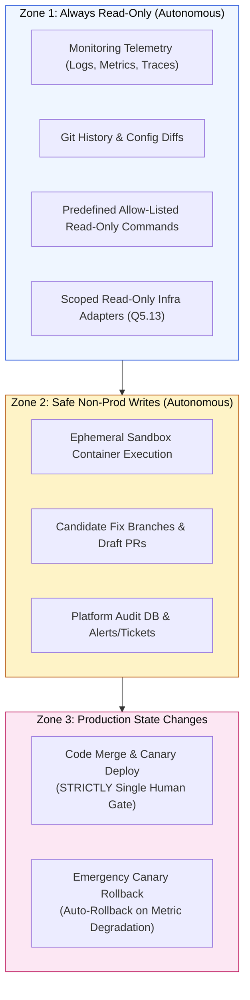

| Attack Surface | MVP Hard Rule | Why |
| :--- | :--- | :--- |
| **Shell Commands (Q5.3, Q5.14)** | Only **predefined, allow-listed read-only commands** via Harness; no arbitrary shell; no second "critical command" human gate. | Prevents file mutation, credential theft, lateral movement, and preserves Layer 2's single human gate. |
| **Database SQL (Q5.15)** | **Zero DB connection & zero AI SQL** in MVP; DB health read via Monitoring telemetry. | Prevents writes, PII leaks, and production DB lock/CPU load from expensive `SELECT` queries. |
| **Log URLs / SSRF (Q5.16)** | **Zero URL fetching** and no AI internet access; URLs shown to humans as plain text. | Eliminates cloud VPC SSRF (hitting internal services or cloud instance metadata credential endpoints). |
| **Infra Failures (Q5.13)** | Mediated, namespace-scoped, rate-limited read-only adapters; zero SSH/root access. | Prevents API throttling or probing outside the incident's target application. |

---

## § 4. Diagnostic Grounding & Verification Ownership

*Answers: Q5.4, Q5.5, Q5.19, Q5.25*

### Preventing Unsafe Changes from Confident Hallucinations (Q5.4, Q5.5)

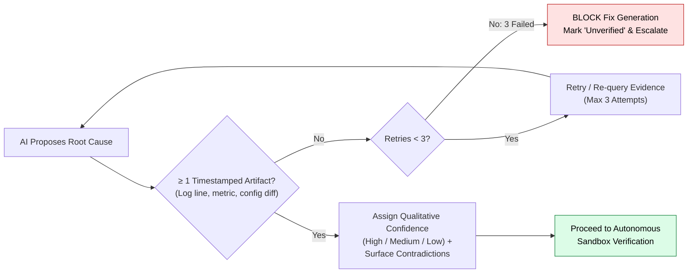

### Ephemeral Sandbox Isolation & Deterministic Verification (Q5.19, Q5.25)

The AI may **suggest** additional regression tests, but **never owns, edits, or grades** the verification pass/fail decision.

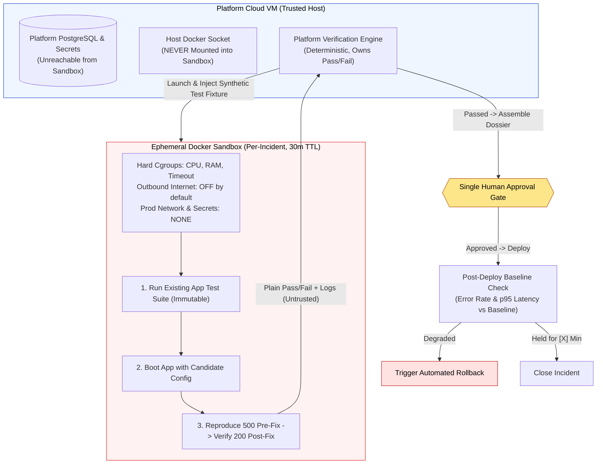

> [!NOTE]
> **Layer 2 Sandbox Note:** Docker-in-Docker (DinD) is strictly rejected (weakens isolation). Running the sandbox on a dedicated small compute host vs. the same VM with strict cgroup/network boundaries remains an open cost/isolation calibration decision (`ADR-06`).

---

## § 5. Authentication, RBAC & Single-App Scope Control

*Answers: Q5.6, Q5.21, Q5.22, Q5.24, Q5.28*

Because Layer 2 constrains the MVP to **1 organization, 1 team, and 1 target application**, multi-layer service-owner matrices are replaced with **email and password authentication**, **three non-overlapping roles**, and app-scoped service tokens.

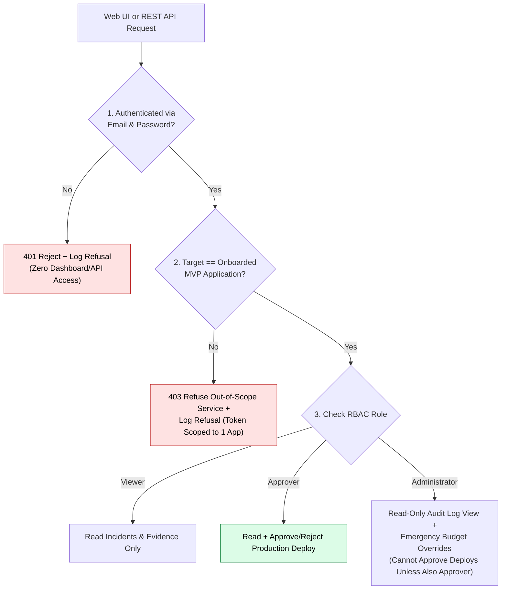

* **Email & Password Authentication:** Individual email + password accounts per user (hashed credentials, session expiry, and account revocation); shared logins are prohibited.
* **Self-Approval Guardrail (Open Decision):** Confirm whether the engineer who authored the incident-triggering deploy is barred from approving their own remediation deploy.

---

## § 6. Approval Integrity, SHA-256 Fingerprinting & Deployment Executor

*Answers: Q5.8, Q5.18, Q5.27*

Only the **`AI Deployment Executor`** holds production deployment credentials. When a human clicks **Approve**, the platform locks the approval to a **SHA-256 fingerprint** of the exact canonical patch bytes so no post-approval modification—accidental or malicious—can ever reach production.

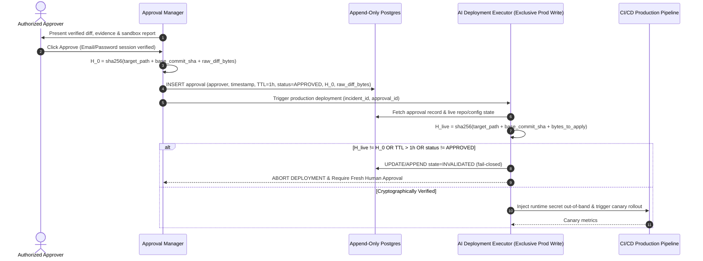

### Executor Verification Logic (Pseudocode)

```text
deploy_approved_patch(incident_id, approval_id)
  record = db.get_approval(approval_id)
  if record.status != "APPROVED" or now() > record.expires_at
    audit_log("DEPLOY_BLOCKED_EXPIRED_OR_INVALID", incident_id, approval_id)
    abort("Approval invalid or expired")

  live_hash = sha256(record.target_path + record.base_sha + record.canonical_diff_bytes)
  if live_hash != record.approved_hash or repo.head_sha() != record.base_sha
    audit_log("DEPLOY_ABORTED_TAMPER_OR_DRIFT", incident_id, approval_id)
    abort("Post-approval modification detected; fresh approval required")

  execute_via_cicd(record.canonical_diff_bytes)
```

---

## § 7. Bidirectional Secret Sanitization & Out-of-Band Injection

*Answers: Q5.9, Q5.26*

Because the reference scenario inspects **configuration diffs and `.env` files**, secrets can leak into the LLM via incident evidence itself—not only via environment injection. Secrets are protected **before** model ingestion, **outside** model execution, and **after** model output.

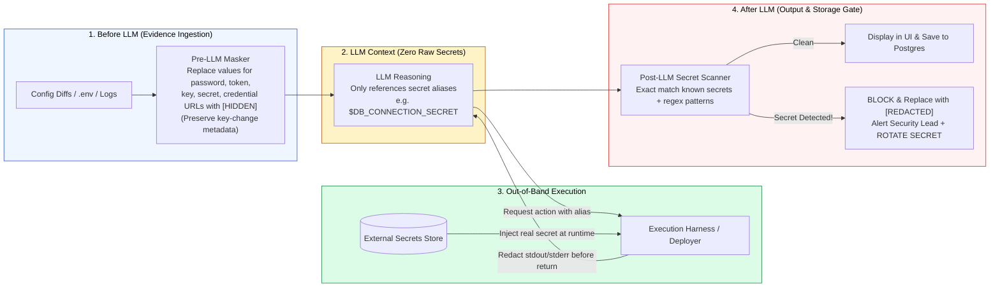

> [!CAUTION]
> **Hashing or masking secrets inside the prompt is not a substitute for secret isolation (Q5.9):** The execution target needs the real secret to authenticate, so the LLM must never possess raw credentials at all—it only names the secret alias, and the trusted harness injects the value at execution time.

---

## § 8. Execution Reliability: Idempotency & Crash Reconciliation

*Answers: Q5.10, Q5.11*

Blind retries after network timeouts or worker crashes cause **duplicate deployments, double restarts, or inconsistent state**. Every side-effecting operation uses a persistent UUID idempotency key and a state machine that **probes real external state before retrying**.

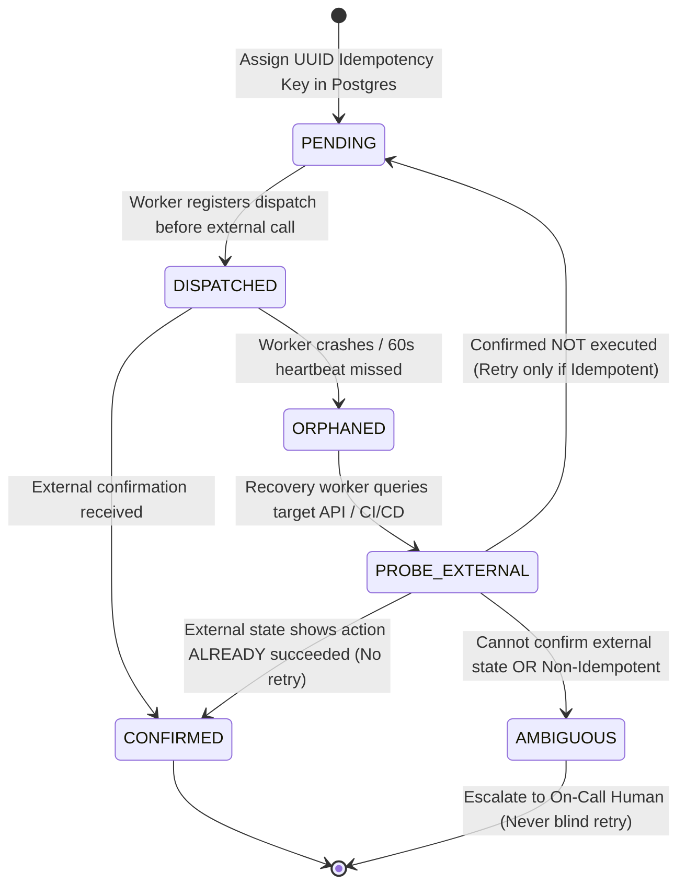

* **Action Classification Mandate (Q5.10):** Every MVP action must be tagged **Idempotent** (safe to retry if confirmed unexecuted, e.g., setting a config value) or **Non-Idempotent** (never auto-retried, e.g., service restart or non-idempotent webhook).

---

## § 9. Immutable Forensic Audit Ledger (Consequential Operations)

*Answers: Q5.20, Q5.28*

Disputes over AI actions (Q5.20) and suspicious production investigations (Q5.28) share **one single append-only PostgreSQL audit ledger** enforced by database-level insert-only privileges. Because raw monitoring logs expire, each incident record snapshots sanitized key evidence lines locally.

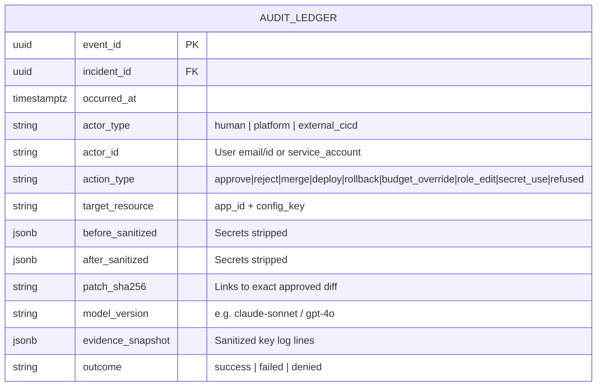

* **Consequential Events Logged:** Approving/rejecting a fix, merging, deploying, auto-rolling back, authorizing budget overrides/unfreezes, modifying roles/approvers, runtime secret injections, and **all refused/unauthorized attempts**.
* **External CI/CD Linking:** Direct production changes made outside the platform are linked via the CI/CD deploy records already ingested by Layer 3 adapters.
* **Administrator Access:** Read-only searchable Web UI filtered by timestamp, actor, and incident ID.

---

## § 10. Traceability Matrix & Layer 5 Assumptions Register

### Traceability Matrix (Q5.1–Q5.28)

| Question | Topic | Decision Summary | Artifact Section |
| :--- | :--- | :--- | :--- |
| **Q5.1, Q5.2, Q5.23** | Prompt Injection & Mixed Contexts | Binary source trust (`UNTRUSTED_EXTERNAL_DATA`), flag-never-drop keyword warnings, no SLM/vector DB in MVP. | § 2 |
| **Q5.3, Q5.14** | Shell Execution | Harness validates strict JSON schemas against predefined allow-listed read-only commands; no arbitrary shell; no 2nd human gate. | § 3 |
| **Q5.4, Q5.5** | Incorrect Diagnosis & Evidence | $\ge 1$ timestamped artifact required; up to **3 retries** before blocking fix generation; qualitative confidence (`High`/`Medium`/`Low`). | § 4 |
| **Q5.6, Q5.21, Q5.22, Q5.24** | AuthN, AuthZ & Scope | Email & password auth; 3 roles (`Viewer`, `Approver`, `Administrator`); single-app scoped tokens; refusals logged. | § 5 |
| **Q5.8, Q5.18, Q5.27** | Patch Integrity & Deploy Authority | Exclusive `AI Deployment Executor` verifies canonical SHA-256 patch hash + 1h TTL + approval before rollout. | § 6 |
| **Q5.9, Q5.26** | Secrets & Sanitization | Alias-only in LLM; out-of-band harness injection; pre-LLM diff masking + post-LLM scan + secret rotation on leak. | § 7 |
| **Q5.10, Q5.11** | Idempotency & Crash Recovery | UUID idempotency keys; `PENDING` $\rightarrow$ `DISPATCHED` $\rightarrow$ `CONFIRMED`; probe external state before retry; escalate `AMBIGUOUS`. | § 8 |
| **Q5.12** | Trust Boundaries | Trusted Core (platform prompts, SSO, Executor, Postgres) vs. Untrusted Perimeter (LLM, logs, APIs, sandbox). | § 2 |
| **Q5.13** | Infra Failure Investigation | Mediated, namespace-scoped, rate-limited read-only infra adapters; zero SSH/root. | § 3 |
| **Q5.15, Q5.16** | SQL & URL/SSRF Prohibition | Zero DB connection / zero AI SQL in MVP; zero URL fetching / zero AI internet access. | § 3 |
| **Q5.17** | Read-Only vs. Write Zones | 3 zones: read-only telemetry, autonomous non-prod writes (sandbox/draft PR), human-gated forward deploys + auto-rollback. | § 3 |
| **Q5.19, Q5.25** | Verification & Sandbox Isolation | Platform-owned deterministic verifier; ephemeral Docker container (30m TTL, cgroup caps, no Docker socket, no DinD). | § 4 |
| **Q5.20, Q5.28** | Forensic Audit & Consequential Ops | Single insert-only PostgreSQL ledger with sanitized evidence snapshots, before/after values, refusals, and admin read-only UI. | § 9 |

### Layer 5 Security Assumptions & Validation Register

| ID | Linked Question | Assumption | Owner | Validation Test | Target Sprint |
| :--- | :--- | :--- | :--- | :--- | :--- |
| **A-5.1** | Q5.1, Q5.2, Q5.23 | Model respects `UNTRUSTED_EXTERNAL_DATA` delimiters and external harness blocks unauthorized tool calls. | AI Lead | Inject 10 adversarial log instructions into test fixtures; verify 0 unauthorized actions and 10 flagged warnings. | Sprint 3 |
| **A-5.2** | Q5.3, Q5.14, Q5.15, Q5.16 | Reference HTTP 500 scenario resolves using Monitoring + Git + predefined read-only commands without SQL or URL fetching. | Tech Lead | Run full reference scenario replay with DB connection & outbound internet disabled. | Sprint 3 |
| **A-5.3** | Q5.8, Q5.18, Q5.27 | Canonical diff bytes can be serialized identically between approval and `AI Deployment Executor` application. | Backend Lead | Modify 1 character in an approved patch; assert `AI Deployment Executor` aborts deploy and marks approval `INVALIDATED`. | Sprint 3 |
| **A-5.4** | Q5.9, Q5.26 | App secret keys can be enumerated and matched via key-name heuristics + exact-secret scanner. | Security Lead | Pass `.env` config diff containing test secret through pre/post sanitizer; verify `[HIDDEN]`/`[REDACTED]` and zero leaks in DB/UI. | Sprint 3 |
| **A-5.5** | Q5.10, Q5.11 | Target CI/CD supports querying deployment status after a worker crash before deciding to retry. | Backend Lead | `SIGKILL` worker mid-dispatch after CI/CD trigger succeeds; confirm recovery worker detects `CONFIRMED` without duplicate deploy. | Sprint 4 |
| **A-5.6** | Q5.21, Q5.24, Q5.28 | Email/password auth supports `Viewer` / `Approver` / `Administrator` roles, session expiry, and revocation. | DevOps Lead | Test 401 unauthenticated, 403 out-of-scope service, and read-only admin UI queries. | Sprint 2 |
| **A-5.7** | Q5.20, Q5.28 | Sanitized key-evidence snapshot in Postgres is sufficient to reconstruct an incident after raw logs expire. | Tech Lead | Ask an uninvolved engineer to reconstruct a practice incident solely from `AUDIT_LEDGER`. | Sprint 4 |

### Open Calibration Decisions (Non-Blocking for Architecture)
1. **Audit Retention Period (Q5.20, Q5.28):** Placeholder `[X months]` to be finalized with Security Lead & Engineering Manager.
2. **Recovery Hold Window (Q5.19):** Exact `[X minutes]` post-canary baseline hold before closing incident.
3. **Self-Approval Policy (Q5.21–Q5.24):** Whether the engineer whose deploy caused the incident may also act as `Approver` on the remediation deploy.
4. **Sandbox Placement (Q5.25):** Separate small VM (stronger isolation) vs. same cloud VM with hard cgroups/network rules.
5. **Predefined Read-Only Allow-List (Q5.3, Q5.14):** Finalize exact command tuple during Sprint 3 reference scenario walk-through.
